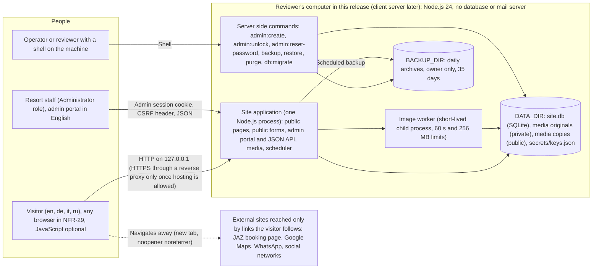
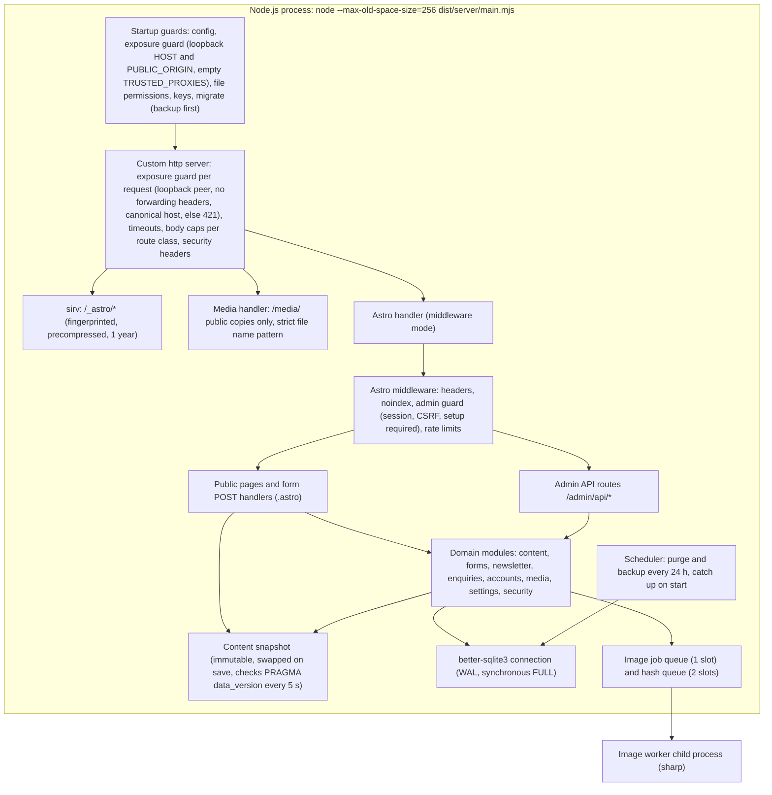

# Architecture: Jazz Casa del Mar resort website

- Client slug: jazz_casa_del_mar
- Project slug: site
- Task: P4-T2 (System Architect)
- Date: 2026-10-15
- Status: proposed for the architecture gate and Steven's T2 touchpoint
- Inputs: `docs/brief.md` (Decisions from Steven are authoritative), `docs/t1-decisions.md` and `approvals/T1-scope.md`, `docs/requirements.md` (FR-1 to FR-48, NFR-1 to NFR-36), `docs/stories.md`, `docs/mvp.md`, `docs/backlog.md`, `docs/assumptions.md`, `docs/legal-register.md`, `docs/threat-model.md`, `docs/risk-register.md`. Design files were not available; the architecture follows the requirements and stories and leaves layout and visual choices to the UI/UX Designer and the Motion Designer.
- Companions: `docs/adr/0001` to `docs/adr/0015` (one decision each, with exact versions and licences), `contract/openapi.yaml` (every HTTP endpoint; source of truth for the web repo), `docs/repo-plan.md` (repos, folders, scripts, `.env.example`, initialisation after T2).

## 1. Summary

One Node.js process on the client's small server serves everything: the 84 public pages, the three public forms, the admin portal and its JSON API, media and built assets. Pages are rendered on every request by **Astro 7** from an in-memory snapshot of the content held in an **embedded SQLite** file, so a saved edit is public at once without a rebuild. The public site ships almost no JavaScript, works with JavaScript off, sets no cookie, and sends a fixed, strict **Content Security Policy** header with no nonce. **Three.js** renders the six scenes after the text and poster have painted, from meshopt compressed glTF files served by the site itself; **swup** provides page transitions without breaking the CSP. The admin portal is a **React** application over a JSON API defined in `contract/openapi.yaml`. Images are processed by **sharp** in a short-lived child process with time and memory limits. A scheduler inside the process runs the retention purge and the daily backup. There is no database server, no mail server, no Docker, no third party service and no outgoing request at run time. Because two step verification is not built, the package refuses to start on any non local address and refuses the common ways of publishing it through a local reverse proxy or tunnel (exposure guard, ADR-0015; a deliberately header stripping forward is a known residual).

## 2. Architectural drivers

| Driver | Requirement | Consequence for the architecture |
| --- | --- | --- |
| No running cost, no third party service, no outgoing request | NFR-31, NFR-15, D6 | Everything self hosted: data store, fonts, decoders, images; no CDN, captcha, analytics, email |
| Small server: 1 CPU, 1 GB, 10 GB, no database or mail server; 512 MB at rest | OQ-14, NFR-31, NFR-10 | One process, embedded SQLite, child process only for image work, bounded concurrency |
| Edits live within 60 s without rebuild | FR-38, US-81 | Server rendering from a live snapshot; no static build of content |
| Works without JavaScript | NFR-13 | Public forms are plain HTML posts handled by the page; language switch is links |
| Strict CSP, no inline scripts | NFR-24, RSK-17 | No framework islands or client router on public pages; fixed header policy; 3D library and decoder chosen for CSP compatibility |
| Six real-time scenes within weight and frame budgets, lazy after first paint | FR-27, FR-28, NFR-7, NFR-8, NFR-12 | Poster first, capability gate, one renderer, meshopt geometry, WebP textures, quality governor |
| Four languages including Cyrillic | FR-24 to FR-26, NFR-28 | Language prefix in the URL, per language font subsets, Unicode aware normalisation |
| Personal data handled properly | D1, NFR-14, NFR-17, FR-45, FR-48 | Minimal fields, privacy safe logs, retention purge, daily backup, restore command |
| Local review only, no second factor | OQ-13, US-31 Won't, NFR-18, G-22 | Exposure guard: loopback `HOST`, the server's own `http` loopback `PUBLIC_ORIGIN` on the same port, empty `TRUSTED_PROXIES`, loopback peers only, and 421 for any request carrying a forwarding header |
| One setup and one verify command, Linux workspace without Docker | Agency rules | No containers; same engine in tests and production; network blocking in tests |

## 3. Stack at a glance

Exact versions are pinned in the web repo's `package.json` and lock file. All were checked on the npm registry on 2026-10-15 and each is the latest stable release published at least two weeks earlier (before 2026-10-01), except where a newer major cannot be installed with the rest (TypeScript 5.9.3 for openapi-typescript). On 2026-10-16 (gate finding AC-H1) the whole set was resolved and installed with `engine-strict=true` and install scripts disabled on Node.js 24.16.0 with npm 11.13.0; the evidence is in ADR-0014.

| Area | Choice | Version | Licence | ADR |
| --- | --- | --- | --- | --- |
| Runtime | Node.js LTS, npm | 24 (minimum 24.16.0), npm 11 or later | MIT; npm Artistic-2.0 (not shipped) | 0001, 0014 |
| Language | TypeScript (strict) | 5.9.3 | Apache-2.0 | 0014 |
| Web framework | Astro, server rendering | 7.3.5 | MIT | 0002 |
| Node adapter | @astrojs/node, middleware mode | 11.1.6 | MIT | 0002 |
| Static serving | sirv | 3.0.2 | MIT | 0002 |
| Data store | SQLite (in better-sqlite3) | better-sqlite3 13.0.3, SQLite 3.53.4 | MIT; SQLite public domain (approval needed) | 0003 |
| Queries and migrations | drizzle-orm, drizzle-kit | 0.45.3, 0.31.11 | Apache-2.0, MIT | 0003 |
| Validation | zod | 4.6.5 | MIT | 0004 |
| Admin UI | react, react-dom | 19.3.0 | MIT | 0005 |
| Admin routing | react-router | 8.4.0 | MIT | 0005 |
| Admin components | react-aria-components | 1.21.1 | Apache-2.0 | 0005 |
| Rich text editor | Tiptap (@tiptap/react, pm, starter-kit, extension-link) | 3.31.4 | MIT | 0005 |
| Typed API client | openapi-fetch, openapi-typescript | 0.17.0, 7.13.0 | MIT | 0005 |
| Password hashing | @node-rs/argon2 (Argon2id) | 2.2.1 | MIT | 0006 |
| 3D engine | three (with GLTFLoader and MeshoptDecoder) | 0.186.1 | MIT | 0007 |
| Page transitions | swup with a11y, head, preload, forms plugins | 4.10.0; 5.2.1, 2.3.1, 3.2.12, 3.6.0 | MIT | 0007 |
| Animation (optional) | motion (vanilla API) | 13.4.6 | MIT | 0007 |
| 3D asset pipeline | @gltf-transform/cli, meshoptimizer, gltf-validator | 4.5.1, 1.3.0, 2.0.0-dev.3.10 | MIT, MIT, Apache-2.0 | 0007 |
| Image processing | sharp with libvips | 0.35.5 with libvips 8.18.7 (@img/sharp-libvips 1.3.4) | Apache-2.0; libvips LGPL-3.0-or-later (approval needed) | 0009 |
| Backup archive | tar-stream | 3.2.1 | MIT | 0010 |
| Fonts | Fontsource packages, chosen by the designer | pinned when chosen (for example @fontsource-variable/inter 5.3.0) | SIL OFL-1.1 | 0011 |
| Unit and integration tests | vitest, @vitest/coverage-v8 | 5.0.3 | MIT | 0012 |
| End-to-end tests | @playwright/test | 1.63.0 | Apache-2.0 | 0012 |
| Accessibility scans | @axe-core/playwright, axe-core | 4.13.0 | MPL-2.0 | 0012 |
| Contract tests | ajv, ajv-formats, @redocly/cli | 8.20.0, 3.0.1, 2.57.0 | MIT | 0012 |
| Performance | lighthouse | 13.5.0 | Apache-2.0 | 0012 |
| Lint and format | eslint, typescript-eslint, eslint-plugin-astro, eslint-plugin-jsx-a11y-x, prettier | 10.11.0, 8.71.0, 3.2.1, 0.2.0, 3.9.9 | MIT | 0014 |
| SBOM and notices | @cyclonedx/cyclonedx-npm, license-checker-rseidelsohn | 6.0.1, 5.0.1 | Apache-2.0, BSD-3-Clause | 0014 |

Not used, with the reason: Next.js (ADR-0002), PostgreSQL and PGlite (ADR-0003), Docker Compose (ADR-0001), React Three Fiber (ADR-0007), GSAP (licence not on the allow-list, ADR-0007), Draco and KTX2 decoders (need `blob:` workers, ADR-0007), Astro `<ClientRouter />` and Astro's CSP feature (incompatible with the strict header policy, ADR-0002, ADR-0008), any email library (OQ-2), a separate api repo (ADR-0013).

## 4. Context diagram

There is no arrow from the application to any external host: the running site makes no outgoing request (NFR-31, AC-76.5). Build time inputs (npm registry, the 3D toolchain on the agency machine) are covered by ADR-0014.

## 5. Runtime view

## 6. Modules and boundaries

Folder names refer to the web repo layout in `docs/repo-plan.md`.

| Module | Folder | Responsibility | May depend on | Must not |
| --- | --- | --- | --- | --- |
| Server entry | `src/server/` | Startup guards, http server, limits, static and media serving, scheduler start | `src/lib/*` | Render pages |
| Pages and form handlers | `src/pages/[lang]/**`, `src/pages/index.ts` | Public routes, form POST handling, error pages | `src/lib/content`, `forms`, `newsletter`, `enquiries`, `i18n`, `security` | Touch the database directly |
| Admin shell and API | `src/pages/admin/**` | Shell page, JSON handlers matching the contract | `src/lib/*` domain modules, `security` | Bypass the admin guard; return shapes not in the contract |
| Middleware | `src/middleware.ts` | Headers, noindex, admin guard, CSRF and origin checks, rate limits | `src/lib/security`, `accounts` | Contain business rules |
| Content | `src/lib/content/` | Registry, validation, rich text schema, snapshot, completeness, rendering helpers | `db`, `i18n` | Accept HTML |
| Forms | `src/lib/forms/` | Shared validators (browser and server), form tokens, honeypot, retry handling | `security` | Use cookies or storage |
| Enquiries, newsletter, settings | `src/lib/enquiries/`, `newsletter/`, `settings/` | Records, normalisation, timing equalisation, caps | `db`, `security` | Log personal data |
| Accounts and sessions | `src/lib/accounts/` | Passwords, lockout, sessions, CSRF secrets | `db`, `security` | Reveal account existence |
| Media | `src/lib/media/` | Upload intake, signature check, queue, worker control, variants, usage, quota | `db` | Decode images in the server process |
| Security | `src/lib/security/` | Headers and CSP, rate limiter, security events, text rules (Cf), CSV writer, trusted proxy | `db` | Depend on page code |
| Jobs | `src/lib/jobs/` | Purge, backup, restore, scheduler, clock | `db`, `media` | Run restore from a web request |
| Config and log | `src/lib/config/`, `src/lib/log/` | Environment parsing, logger with field allow-list | none | Read secrets from the package |
| Data access | `src/lib/db/` | Connection, pragmas, Drizzle schema, migrations | none | Build SQL from strings |
| i18n | `src/i18n/` | Language list, negotiation, fixed resource files | none | Hold editable text |
| Public client scripts | `src/client/` | Transitions, menu, lightbox, FAQ enhancement, motion controls, form enhancement, scene loader | browser APIs, swup, motion | Import `src/lib/**` or `node:*` |
| 3D scenes | `src/client/scenes/` | Engine, capability gate, quality governor, six scene modules | three | Load assets of another scene |
| Admin application | `src/admin-app/` | React screens, generated API client | react, react-aria, tiptap, openapi-fetch | Import server modules; hand write contract types |
| Image worker | `src/workers/image-worker.ts` | Decode, orient, resize, encode | sharp | Use the network or the database |
| Commands | `src/cli/` | admin:create, admin:unlock, admin:reset-password, backup, restore, purge, keys:rotate, seed | `src/lib/*` | Run without the permission and loopback checks that apply to them |

Boundaries are enforced by an ESLint import rule (browser code cannot import server modules), by the admin guard in middleware (deny by default for `/admin/api/`), and by contract tests.

## 7. Frontend (public site)

- **Rendering**: `.astro` layouts and components, HTML first. Every page has the concept notice at the top in normal flow and again in the footer, the skip link first, landmarks, one `h1`, and the title suffix appended by the layout (FR-10, FR-17, NFR-2, NFR-3).
- **JavaScript**: one small bundled entry for all public pages (swup and its plugins, menu, lightbox, FAQ enhancement, motion controls, scene loader), plus the lazily imported 3D chunk. No framework runtime. Budget: about 50 KB compressed before 3D against the 200 KB limit (NFR-7).
- **Without JavaScript** (NFR-13): navigation and the language switcher are links; FAQ answers are in the HTML (a `
` element or a button enhanced from it); forms post normally; the lightbox, 3D, loader and transitions are absent.
- **CSS**: one stylesheet per page type built by Astro, no inline styles; design tokens from the UI/UX Designer (NFR-30); per language font face declarations (ADR-0011); `prefers-reduced-motion` handled in CSS first (NFR-11).
- **Forms** (FR-19 to FR-23): the same validation module runs in the browser (for immediate messages) and on the server. Errors are listed next to fields and in a summary; the retry message element has `role="alert"` and `tabindex="-1"` and receives focus (AC-13.10). With JavaScript on, `@swup/forms-plugin` may submit through a transition; the endpoints are the same.
- **Images**: `<picture>` with AVIF and WebP sources from the media pipeline or the build time image pipeline, explicit sizes, lazy below the fold (FR-41). Posters are the LCP elements on scene pages.
- **Motion**: CSS first; Motion 13.4.6 only where CSS cannot do the job; pause control on every page with autonomous motion, kept in `sessionStorage` under `jcdm-motion-paused`; after a paused reload the poster shows with a visible Resume control (FR-30, section 13).
- **Transitions** (FR-29, NFR-9; containers amended for gate finding AC-H2): swup replaces three containers on every visit: `#swup-top` (skip link, top concept notice, header with navigation and server rendered `aria-current`, menu, language switcher), `#swup-main` (`main`, scene slot) and `#swup-footer` (concept sentence, legal links, newsletter form with the `formToken` signed for that response). `@swup/head-plugin` merges the new `head` (title, description, robots, stylesheets, waiting for new stylesheets with `awaitAssets`) and updates `lang` and `dir` on `html` only, so `data-motion` survives. The transition panel, the loader and the announcement live region sit outside the containers; their "Loading" text and `lang` are copied from the fetched page after each swap, and the a11y plugin announces in the page language and focuses the `main h1`. swup's page cache only hands a preloaded page to the next visit (entries older than 30 s dropped, cache cleared after every page view), so no form token is shown twice. The server returns the same full document to swup as to a normal request. Details and tests in ADR-0007. The loader shows only after 300 ms, never longer than 8 s, and ends when text, poster and fonts are ready, without waiting for 3D (section 13).

## 8. Backend

- **Server**: the custom Node.js http server of ADR-0015 hosts Astro in middleware mode. Before anything else it runs the request part of the exposure guard (loopback peer, no forwarding header, canonical host; otherwise 421 without reading the body). Then, before Astro sees a request, it enforces timeouts and body caps (64 KB public forms, 1 MB admin, 10 MB uploads), and serves `/_astro/*` and `/media/*` directly.
- **Public form handlers**: the page file handles POST: parse the urlencoded body, verify the form token (all checks always run), check the honeypot and the rate limit, validate, then store and render the confirmation, or render the form again with errors (FR-20, FR-22, FR-23). Status codes are in the contract.
- **Admin API**: Astro API routes under `src/pages/admin/api/`, one file per path in the contract. Each handler validates input with Zod schemas that mirror the contract, calls a domain module, and returns contract shapes. Problem details for every error.
- **Jobs**: purge and backup run in the scheduler (ADR-0010); image processing in the child process (ADR-0009).
- **Commands**: compiled to `dist/cli/*.mjs` and run with `npm run <name>`; each checks the data folder permissions and refuses to run as a different user from the folder owner.
- **Concurrency on 1 CPU**: SQLite calls are synchronous and short; long work is moved out of the event loop (Argon2id on the thread pool with at most 2 at once, images in the child process, CSV export read in keyset chunks of 500 rows with `.all()` and `setImmediate` between chunks, not `.iterate()`, data model D-10).

## 9. Internationalisation and routes

Language is the first path segment, slugs are shared English slugs (ADR-0011). Every public route exists for `en`, `de`, `it` and `ru`.

| Page (FR-1) | Path | Scene |
| --- | --- | --- |
| Home | `/{lang}` | Hero (FR-27) |
| Rooms and suites | `/{lang}/rooms` | Yes |
| Six room pages | `/{lang}/rooms/{family-suite, executive-suite, superior-twin-sea-view, superior-queen-sea-view, triple-deluxe-twin-pool-view, triple-deluxe-queen-pool-view}` | No |
| Dining | `/{lang}/dining` (venues by anchor `#venue-<slug>`) | Yes |
| Pools and beach | `/{lang}/pools-and-beach` | Yes |
| Activities and facilities | `/{lang}/activities` | Yes |
| Location | `/{lang}/location` | Yes |
| Offers | `/{lang}/offers` | No |
| Gallery | `/{lang}/gallery` | No |
| FAQ | `/{lang}/faq` | No |
| Contact Us (GET and POST) | `/{lang}/contact` | No |
| Privacy notice | `/{lang}/privacy` | No |
| Cookie notice | `/{lang}/cookies` | No |
| Terms | `/{lang}/terms` | No |
| Accessibility statement | `/{lang}/accessibility` | No |
| Newsletter unsubscribe (GET and POST) | `/{lang}/newsletter/unsubscribe` | No |
| Newsletter sign up (POST from the footer) | `/{lang}/newsletter` | n/a |
| Site root | `/` redirects to `/{lang}` by `Accept-Language` | n/a |

21 page types times 4 languages = 84 URLs. Unknown paths render the localised 404 page (the language is taken from the first segment if valid, otherwise English).

- Fixed texts (concept sentence, title suffix) in `src/i18n/fixed/{lang}.json`; everything else editable in the content store (NFR-28).
- Missing value: English with `lang="en"` on the element (FR-26).
- Fonts: per language face declarations so Cyrillic files load only on `ru` pages (NFR-7).
- Admin portal in English (FR-32).

## 10. Data

**Store**: one SQLite file `DATA_DIR/site.db`, WAL, `synchronous=FULL`, `secure_delete=ON`, with a WAL checkpoint after each purge, accessed only through Drizzle (ADR-0003). The detailed model is `docs/data-model.md`; this section is the summary. Media files under `DATA_DIR/media/`. Keys in `DATA_DIR/secrets/keys.json`. Nothing under `DATA_DIR` is served except the public media copies through the strict file name handler.

**Tables** (the Database Engineer details columns, indexes and constraints in Phase 5):

| Table | Holds | Personal data | Retention (FR-45) |
| --- | --- | --- | --- |
| `site_state`, `install_secret` | Content revision and schema version; the suppression HMAC key (never in `settings` or any response) | None | Kept |
| `account` | Staff accounts, Argon2id hash, status, must change password, last sign in, lockout counters (no separate login attempt table) | Name, email | Personal data removed 30 days after deletion; disabled after 12 months without sign in |
| `session` | SHA-256 of session id, account, times, CSRF secret | Account id | Deleted at sign out, idle 30 min, 8 h, or on password change, reset, disable, delete |
| `content_entry`, `list_item`, `settings` | Content in four languages, with `version`; lists also have a list order version (D-7) | Placeholder contact details only | Kept |
| `legal_text_version` (proposed, pending T2, D-2) | Immutable archive of the privacy information and consent wording, referenced by enquiries and subscribers | None | Kept |
| `media_asset`, `media_variant`, `media_usage` | Library metadata, alt text, captions, variants, usage | Possibly people in photos (FR-18 forbids in placeholders) | Original 30 days after deletion; public copies removed at once |
| `enquiry` | FR-20 fields plus normalised search columns, status, read time (set by an explicit `PATCH`, never by a GET, D-1), data protection flag; reference `ENQ-` plus 6 characters from `A-HJ-NP-Z2-9`, retried on a unique violation (D-5) | Name, email, telephone, message | 12 months after receipt |
| `subscriber` | Email, normalised email, language, status, consent version and time; the cap is checked before the address is looked up (D-4) | Email | Active until unsubscribed or removed; the whole row deleted 30 days after unsubscribing |
| `suppression` | HMAC-SHA256 of normalised email, time; blocks a new sign up of that address with the same confirmation (proposed, pending T2, D-3) | Keyed hash | 36 months |
| `rate_limit`, `used_form_token` | Counters and accepted contact form nonces | Keyed hash of the client address in the counter key (D-9) | 24 hours, removed by the 10 minute sweep (D-13) |
| `security_event` | Time, account id or `anonymous`/`system`, event, result, counts | Account id only | 12 months |
| `job_run`, `backup_archive` | Last runs of purge and backup; metadata of archives that exist | None | Last 400 runs; archive rows with their files |
| `health` | One row for the health check write | None | n/a |
| `dsr_record` (created empty, used when FR-44 is built) | Data subject request records, no message text | Reference only | 24 months after closure |

**Normalisation**: email addresses trimmed and lower cased in TypeScript (Unicode aware) before storing the normalised column; search columns also NFKD folded without combining marks (G-12, NFR-28).

**Integrity**: every save in one transaction with an optimistic `version` check (NFR-33); foreign keys on; a confirmed enquiry or subscription is committed with `synchronous=FULL` before the confirmation is sent.

**Caps**: 50,000 enquiries and 50,000 subscribers by default, warning at 80 percent, refusal at 100 percent (NFR-35).

**Migrations**: SQL files generated by drizzle-kit, committed, applied by `npm run db:migrate` and at server start after an automatic backup (ADR-0003, ADR-0010).

**Backups and restore**: daily full archive (database copy without sessions, counters and used tokens, plus media), optional AES-256-GCM encryption, owner only, 35 days, restore into an empty install only with strict entry validation (ADR-0010).

## 11. Authentication and authorisation

- **Staff only**: email and password, Argon2id (19 MiB, 2 iterations, parallelism 1), common password list, 12 to 128 characters, lockout 5 per 15 minutes per account, generic failure message, equal timing (NFR-19, FR-32).
- **First Administrator**: `npm run admin:create` on the machine only; until then every admin route answers "setup required" (FR-47, G-1).
- **Sessions**: 256-bit random id, SHA-256 stored, cookie `HttpOnly; SameSite=Strict`, `Secure` and `__Host-` prefix whenever the origin is https, idle 30 minutes with a 2 minute warning and extend, absolute 8 hours, rotation at sign in, all sessions of an account ended on password change, reset, disable or delete (NFR-5, NFR-20, G-19).
- **Forced password change** at first sign in and after a reset; the session can only change the password or sign out until done (FR-34, NFR-5).
- **Request forgery**: session bound `X-CSRF-Token` plus `Origin` check plus `SameSite=Strict` for admin; JSON plus `X-Requested-With` plus `Origin` for sign in; signed form tokens with no cookie for public forms (NFR-22, LR-21, ADR-0006).
- **Authorisation**: deny by default for `/admin/api/`; every handler behind one guard; one Administrator role this release, with the role check already in the guard so an Editor role can return (NFR-25, OQ-1).
- **Account recovery without email**: another Administrator sets a temporary password, or `npm run admin:reset-password` on the machine; `npm run admin:unlock` clears a lockout (FR-34, G-21).
- **Two step verification**: not built (US-31 Won't). Compensating control: the exposure guard (NFR-18, G-22, ADR-0015): loopback `HOST`, the server's own `http` loopback `PUBLIC_ORIGIN` on the same port, empty `TRUSTED_PROXIES`, loopback peers only, and 421 for any request carrying a forwarding header, so another machine and the common local reverse proxies and tunnels cannot reach the portal (a header stripping forward that rewrites `Host` is a known residual, ADR-0015).

## 12. Rendering and caching

| Response | Rendering | Cache-Control | Notes |
| --- | --- | --- | --- |
| Public pages | Server rendered per request from the content snapshot | `no-cache` with `ETag` (build id, content revision, path, language) | Saved edits visible on the next request (FR-38); `304` when unchanged |
| Form results and errors | Server rendered | `no-store` | Contain typed values |
| Admin shell and API | Shell is static per build; API is dynamic | `no-store` | NFR-20 |
| `/_astro/*` (JS, CSS, fonts, posters, `.glb`) | Built, fingerprinted, precompressed (brotli and gzip) | `public, max-age=31536000, immutable` | NFR-35 |
| `/media/*` | Created by the image worker, name changes on replacement | `public, max-age=31536000, immutable` | Old variants deleted on replacement |
| `/` | Redirect | `no-store`, `Vary: Accept-Language` | FR-25 |
| `/healthz` | Dynamic | `no-store` | NFR-32 |

**Live publishing path**: save in the portal, transaction commits, `content_revision` increments, the snapshot is rebuilt and swapped in the same process, the next page request renders new content. A second safety net reloads the snapshot when `PRAGMA data_version` changes (writes by commands). Typical delay: under one second; requirement: 60 seconds (FR-38).

**Optional HTML cache**: only if the NFR-10 measurement needs it (ADR-0004). Safe because the CSP has no nonce; form tokens are written at serve time.

**HTML compression**: gzip level 6 on the fly for HTML and JSON; precompressed files for static assets.

## 13. 3D loading

1. HTML arrives with the poster `` (the LCP element) in the scene slot and `data-scene`, `data-poster` attributes.
2. Text and poster paint. The public bundle starts.
3. Capability gate, as soon as the poster has painted (LCP candidate reported, or `img.decode()` resolved plus one frame): no reduced motion, motion not paused (session key `jcdm-motion-paused` absent), no `Save-Data`, effective type not 2g or slow-2g, and a WebGL 2 context created on the engine's own canvas (that same context is later handed to three's `WebGLRenderer`, so no second context is ever created). If any check fails, stop here: fallback mode, no 3D download (NFR-12).
4. At poster paint, not after `load` and idle: `import()` the 3D chunk (Three.js core, GLTFLoader, MeshoptDecoder, engine; 350 KB compressed at most) and fetch the scene's `.glb` in parallel. NFR-7 requires only that 3D is requested after the text and poster have rendered; starting here is what lets the first frame arrive within 4 s on profile L1 (`docs/design/budgets.md` section 6; motion spec decision D3).
5. Decode the `.glb` (3 MB hero, 2 MB others at most): meshopt geometry (WebAssembly on the main thread, needs `wasm-unsafe-eval`) and WebP textures (browser decoder, through `blob:` URLs). Scene build and shader compilation are sliced into tasks of at most 50 ms with yields, to protect TBT and INP.
6. Render the first frame into the single persistent canvas (still transparent), then fade the canvas in over the poster; the poster stays underneath for context loss recovery (no layout shift, the slot has fixed dimensions).
7. Quality governor and visibility handling run; context loss for more than 3 s, a scene error, or slow frames at the lowest quality switch to fallback (NFR-8, NFR-12).
8. On swup navigation: dispose the old scene, move the canvas into the next page's slot, and once the transition has finished (`is-animating` removed, then one idle callback or 200 ms, whichever first) repeat from step 3 for that page's scene, so scene work never lands inside the transition or adds to the next page's LCP (NFR-9). One WebGL context for the whole tab.

**Loader** (FR-29, NFR-9; motion spec decision D2): shown on a full document load only, and only if the page is not ready after 300 ms. Its timing is pure CSS (visible from 300 ms, hidden at 8,300 ms at the latest, hidden entirely without JavaScript by a linked `noscript` stylesheet, never an inline style). "Ready" means the `h1` text is painted, the hero poster has decoded and the above the fold fonts are loaded (`document.fonts.ready`, or 1.5 s). The loader **does not wait for 3D**: it ends when the 2D hero is ready, and the scene fades in over the visible page afterwards (step 6). The poster is the hero asset of FR-29 in every mode.

**Pause and resume** (FR-30, NFR-12; motion spec decision D4): Pause freezes the scene on its current frame, stops CSS motion and makes swup transitions instant swaps, and writes `jcdm-motion-paused` = `1` to `sessionStorage` (the key is removed on Resume; it is the only public storage item, FR-15). A reload or navigation in the same tab while the key is present shows the poster with no 3D download (fallback mode), and the **Resume motion control stays visible** on the poster even though 3D is not running, so the visitor always has a way back; pressing it removes the key, runs the capability gate and loads the scene exactly as on a fresh page. In every other case where 3D cannot run (reduced motion, no WebGL 2, data saving, adaptive fallback) the scene controls stay hidden.

## 14. Configuration, logging and environments

**Configuration** (ADR-0015): environment variables, optionally from `.env` (mode 0600), validated with Zod at start. Full list in `docs/repo-plan.md` section 6. Key variables: `HOST` (default `127.0.0.1`, only loopback accepted), `PORT` (4321), `PUBLIC_ORIGIN` (only `http://localhost`, `http://127.0.0.1` or `http://[::1]` with the same port as `PORT`), `DATA_DIR`, `BACKUP_DIR`, `BACKUP_PASSPHRASE` (optional secret), retention periods, session limits, upload limits, caps, rate limits, `TRUSTED_PROXIES` (must be empty in this release). No variable holds credentials for an external service.

**Startup refusals** (each prints a line starting `STARTUP-REFUSED` and exits non zero before any port opens): non loopback `HOST` (NFR-18, G-22, AC-63.2); a `PUBLIC_ORIGIN` that is not the server's own `http` loopback origin on the same port, including any `https://` origin; a non empty `TRUSTED_PROXIES` (G-22, amended for gate finding SEC-H1); configuration file, data folder, backup folder or keys file readable by other accounts (G-17, AC-77.4); invalid configuration; failed migration.

**Request refusals** (exposure guard, ADR-0015): a non loopback peer, any forwarding header (`Forwarded`, `X-Forwarded-*`, `X-Real-IP`, `Via` and the others listed in ADR-0015) or a `Host` other than the `PUBLIC_ORIGIN` host gets `421 Misdirected Request` before the body is read, on every path. There is no override until two step verification is built and enforced.

**Keys**: generated per install at first start (form token, CSRF derivation and rate limit key hash in `keys.json`; the suppression HMAC key in the database table `install_secret`), 256 bits each, never in the package (AC-77.5).

**Logging**: JSON lines to standard output with an allow-list of fields and no personal data (NFR-14); error correlation ids shown on the 500 page (FR-13); security events in the database (NFR-34); access logs belong to the reverse proxy when hosted.

**Environments**: development (`npm run dev`), test (fresh data folder, network blocked), local review (the release; loopback only), hosted (future; refused by the exposure guard, including through a local proxy or tunnel, until FR-33 is built and the T1 section D conditions are met). The agency never deploys.

## 15. Local run and test approach

- **Setup on Steven's Mac** (one command): `bash scripts/setup.sh` installs dependencies with install scripts disabled, installs Playwright browsers, creates `.env`, `data/` and `backups/` with owner only permissions, migrates and seeds. Then `npm run admin:create` and `npm start`, and open `http://localhost:4321`. Docker is not needed.
- **Verify** (one command): `bash scripts/verify.sh` runs the dash check, secret scan, `lint` (ESLint, Prettier, `npm audit` of shipped dependencies), `typecheck`, `test` (unit and integration on real SQLite files), `test:contract` (handlers against `contract/openapi.yaml`), `test:e2e` (builds, starts the production server on loopback with a fresh data folder, Playwright on Chromium with axe, CSP and external request listeners, JavaScript on and off, 3D and fallback modes) and `build`.
- **Cloud workspace**: same commands with `bash scripts/setup.sh --workspace`; Node.js 24.16.0 or later with npm 11 (the workspace has 22.22.0 today and must be upgraded first, ADR-0012), no Docker needed.
- **Network blocked** (NFR-31): Node.js processes in tests load a guard that refuses non loopback connections; browsers use host resolver rules that resolve only localhost; `npm run test:offline` adds `unshare -rn` on Linux where available (ADR-0012).
- **Browser matrix and performance**: `npm run test:e2e:all` (Chromium, WebKit, Firefox) on the Mac; `npm run test:perf` (Lighthouse with profile L1 and the NFR-10 load script) for the Performance Engineer. Frame rate on R1 or profile L2 is measured manually (NFR-8).

## 16. Threat mitigations

### 16.1 High threats from the threat model

| Threat | How the architecture mitigates it | Where |
| --- | --- | --- |
| TM-01 Concept mistaken for the official site | Fixed concept sentence in resource files, rendered by the layout on every page and admin screen, not in the content store and not editable; title suffix added by the layout; noindex header and meta on every response with no setting; loopback only start | ADR-0004, ADR-0008, ADR-0011, ADR-0015 |
| TM-08 Contact form spam floods storage | Signed form token with 2 second minimum and 8 hour maximum, honeypot, used nonce table (no replays), rate limit 5 per hour per address, 64 KB body cap, 50,000 enquiry cap with warning | ADR-0006, ADR-0015, ADR-0003 |
| TM-09 Stored XSS against staff through enquiry fields | Server validation of type, length and format; React escapes every value in the admin; `dangerouslySetInnerHTML` banned by lint; strict admin CSP without inline scripts | ADR-0005, ADR-0008, ADR-0014 |
| TM-14 Newsletter list poisoning | Same token, honeypot and timing as the contact form; rate limit 5 per hour; consent tick and version recorded; 50,000 subscriber cap | ADR-0006 |
| TM-16 Formula payload stored as an email local part | Accepted as data, neutralised on export: every CSV cell quoted and prefixed with a single quote when it starts with `=`, `+`, `-`, `@`, tab or carriage return, by one shared CSV writer | Contract `exportSubscribers`, `src/lib/security/csv.ts` |
| TM-20 Credential stuffing and password spraying | Argon2id, 12 character minimum, common password list, account lockout 5 per 15 minutes, sign in rate limit 20 per 15 minutes per address, equal timing, two hashes at once at most | ADR-0006 |
| TM-21 Account takeover with no second factor | Not fully mitigated by design (US-31 Won't). Compensating: the exposure guard (loopback `HOST`, the server's own `http` loopback `PUBLIC_ORIGIN` on the same port, empty `TRUSTED_PROXIES`, loopback peers only, and 421 for any request carrying a forwarding header; this also stops a local reverse proxy or tunnel), previous sign in and failure count shown after sign in, sessions short and rotated, security events recorded. Residual High if hosted, Low in local review (a raw TCP forward set up on purpose by the machine's owner is the remaining case, ADR-0015) | ADR-0015, ADR-0006 |
| TM-26 First run hijack | No setup screen; first Administrator only by `npm run admin:create` on the machine; every admin route refused until then; no default credentials; loopback only | ADR-0006, ADR-0015 |
| TM-30 Stored XSS through four language rich text | Rich text stored only as allow-listed ProseMirror JSON, validated on save for every language by the same schema (no HTML parsing, no mutation XSS); link schemes allow-listed after WHATWG URL parsing; rendering builds escaped elements; `set:html` banned; strict CSP | ADR-0005, ADR-0004, ADR-0008 |
| TM-31 XSS through plain text in attribute, head or script contexts | Astro escapes in every context; no inline scripts at all, data passed to scripts in `data-*` attributes; Cf characters rejected; tests fail on any inline script or CSP violation | ADR-0002, ADR-0008 |
| TM-33 Defacement or mass deletion without history | Daily automatic full backup, restore command, optimistic versions, confirmation before deletes, last Administrator protected, security events | ADR-0010, ADR-0004 |
| TM-37 Concept notice emptied or rewritten | The fixed sentence cannot be reached by any admin request (not in the registry or contract); the optional sentence is plain text, 200 characters, Cf rejected; no setting removes the notice | ADR-0004, contract `SettingsValues.conceptSentence` |
| TM-45 Enquiries read without permission | Deny by default guard on `/admin/api/`, session required for every data request, random UUID v7 ids, 404 for unknown records, admin pages redirect when signed out, `no-store` | ADR-0005, ADR-0006 |
| TM-47 CSV formula injection | Shared CSV writer with quoting and prefix rule for every CSV the site produces; UTF-8 with byte order mark; tested with payloads for all six leading characters | Contract, `src/lib/security/csv.ts` |
| TM-48 Bulk copy of the subscriber list unnoticed | Export recorded as a security event with account, time and row count; export only by POST with CSRF; one role this release (least privilege returns before real data) | ADR-0006 |
| TM-53 Compromised dependency | Exact pins and lock file, install scripts disabled with an empty allow list, audit in lint, SBOM and licence check, no CDN, small public dependency set (no framework runtime on public pages) | ADR-0014, ADR-0002 |
| TM-58 Backup archives exposed | Archives outside served folders and outside `DATA_DIR`, mode 0600 in a 0700 folder, permission check at start, optional AES-256-GCM, no keys inside, sessions and counters excluded, 35 day deletion, file name says it contains personal data | ADR-0010, ADR-0015 |

### 16.2 Other gaps closed by the architecture

| Gap | Mitigation |
| --- | --- |
| G-1 | Server command only for the first Administrator |
| G-2 | `security_event` table, append only from code, 12 months |
| G-3 | Scheduler runs the backup every 24 hours, catches up on start |
| G-4 | Shared CSV writer |
| G-5 | Contract `HttpsUrl` pattern plus WHATWG URL parsing (no credentials, https only, 2,048 characters) |
| G-6 | Fixed sentence in resource files |
| G-7 | Rich text schema on save for every language; Cf rejected in plain text |
| G-8 | One header middleware for every response; no version headers; no source maps (build check) |
| G-9 | Signed form token for all three public forms |
| G-10 | Rate limits in the MVP |
| G-11 | Same statements and a 150 ms response floor for sign up and unsubscribe |
| G-12 | Normalised email columns |
| G-13 | Body caps, timeouts, image queue of 1, hash queue of 2, caps, long cache lifetimes |
| G-14 | Header check before decode, child process with 60 s and 256 MB limits |
| G-15 | Archive permissions, exclusions, optional encryption, strict restore validation |
| G-16 | Not applicable this release (no email); FR-21 would use the client's SMTP with TLS required |
| G-17 | Permission checks at start, per install keys |
| G-18 | SBOM, empty install script allow list, bundled meshopt decoder, glTF validation in tests |
| G-19 | Sessions deleted in the same transaction as password change, reset, disable, delete |
| G-20 | `TRUSTED_PROXIES` must be empty in this release and forwarding headers are refused with 421; the trusted proxy rule applies once FR-33 is built |
| G-21 | `npm run admin:unlock` |
| G-22 | Exposure guard: start part (loopback `HOST`, own loopback `http` `PUBLIC_ORIGIN` on the same port, empty `TRUSTED_PROXIES`) and request part (loopback peer, no forwarding header, canonical host, else 421), ADR-0015 |
| G-23 | Previous sign in and failure count in the session response |

## 17. Decisions for Steven at T2

1. **Astro instead of Next.js** (ADR-0002). A deviation from the agency default, chosen for the 200 KB JavaScript budget, forms without JavaScript, a strict CSP without nonces and a smaller server attack surface. Alternative: Next.js 16 with nonce based CSP and server actions.
2. **Embedded SQLite instead of PostgreSQL, and no Docker** (ADR-0001, ADR-0003). Required by "no database server"; the same engine on the Mac, in the workspace and on the server.
3. **Two licence approvals** for the licence register (ADR-0014): SQLite (public domain dedication) and libvips inside sharp (LGPL-3.0-or-later). If libvips is refused, images are processed with slower WebAssembly codecs; if SQLite is refused, there is no workable data store without a database server.
4. **Backups and the 10 GB disk** (ADR-0010). Every daily archive is full, so 35 archives need about 36 times the data size. Fine for placeholder content; with 2 GB of photos it would need about 72 GB. Before any hosting: a larger disk, a lower media cap, or a shorter archive retention.
5. **Single web repo; no api repo** (ADR-0013). Nothing for Steven to create.
6. **Node.js 24 now (minimum 24.16.0 with npm 11)** (ADR-0001, ADR-0014; changed from Node.js 22 to fix gate finding AC-H1). The pinned lint and licence tools do not install on Node.js 22.22.0, and npm 10 cannot resolve vitest 5. This also removes the earlier item that Node.js 22 ends support on 30 April 2027 (Node.js 24: 30 April 2028). Steven's Mac and the cloud workspace need Node.js 24.
7. **Rich text sanitiser interpretation** (ADR-0005). The allow-list sanitiser required by NFR-24 is a strict schema check of the editor's JSON instead of an HTML sanitiser library. The Security Engineer should confirm.
8. **First Administrator by server command only** (ADR-0006). The setup screen alternative allowed by FR-47 is not built.
9. **`wasm-unsafe-eval` and `blob:` sources in the public CSP** (ADR-0007, ADR-0008), needed by the meshopt decoder and three.js texture loading; allowed by NFR-24 for a 3D decoder.
10. **English URL slugs in all four languages** (ADR-0011), for example `/de/rooms/family-suite`.
11. **Safari during local review** signs in with a non `Secure` cookie on `http://localhost` only (ADR-0006, RSK-10); impossible on any other address, or through a local proxy or tunnel, because of the exposure guard (ADR-0015). Consequence for Steven: the release cannot be tried behind a local HTTPS proxy or tunnel (for example to view it on a phone); that is intended until two step verification is built.
12. **Consent and privacy wording archive** (data model D-2, ADR-0004, ADR-0006): proposed, pending T2. A small immutable `legal_text_version` table records each version of the wording, and the label shown on the page travels in the signed form token. Recommended, because without it "consent wording version" proves nothing.
13. **Suppressed addresses at sign up** (data model D-3, ADR-0006): proposed, pending T2. Default: an address unsubscribed within 36 months is silently not re-added and sees the same confirmation; alternative: a fresh ticked consent removes the suppression entry.

## 18. Questions answered from threat model section 9

| Decision (threat model section 9) | Threats | Answer |
| --- | --- | --- |
| Templating and front end framework: automatic context aware encoding; no raw HTML insertion outside the sanitiser output; how content reaches the 3D scenes and transitions without inline scripts | TM-09, TM-30, TM-31, TM-56 | Astro templates and React escape by default in every context. Raw HTML insertion (`set:html`, `dangerouslySetInnerHTML`) is banned by lint everywhere; rich text is rendered from allow-listed JSON by a component, not inserted as HTML. Content reaches the 3D scenes and transitions only as `data-*` attributes read by bundled modules; there are no inline scripts or JSON islands, and tests fail on any inline script or CSP violation (ADR-0002, ADR-0005, ADR-0008). |
| Rich text sanitiser: a maintained allow list sanitiser that runs on the server; same library for all four languages | TM-30 | Rich text is never HTML on the server. The Tiptap editor produces ProseMirror JSON; the server validates it against one Zod allow-list schema (paragraph, bold, italic, link with https, http, mailto, tel, bullet list) for every language value on every save, rejecting anything else with 422 and removing Cf characters except soft hyphen. Rendering builds escaped elements from the JSON (ADR-0005). Flagged for the Security Engineer's confirmation (decision 7 above). |
| 3D, animation and transition libraries, decoders: CSP compatibility (no `unsafe-eval`; `wasm-unsafe-eval` only for a decoder); worker sources from `'self'` | TM-53, TM-54, TM-55, TM-56 | Three.js 0.186.1 (no eval), meshopt decoder bundled from the pinned three package and run on the main thread (needs only `wasm-unsafe-eval`; no workers, so `worker-src 'none'`), WebP textures decoded by the browser (needs `blob:` in `img-src` and `connect-src`, verified in the GLTFLoader source). Draco and KTX2 excluded because their decoders use `blob:` workers. swup and Motion need no eval and no inline script. GSAP excluded by licence. Every `.glb` passes the glTF validator with no external URI. Quality governor, visibility pause and context loss handling bound GPU use (ADR-0007). |
| Session and form token mechanism: server side sessions or signed cookies; signed form tokens for the cookie free public site; Safari on `http://localhost` (RSK-10) | TM-10, TM-22, TM-23, TM-62 | Server side sessions with 256-bit random ids stored hashed, rotated at sign in. Public forms use HMAC-SHA256 signed tokens in a hidden field with form, language, issue time and nonce, no cookie. Keys are random per install at first start. Safari on `http://localhost`: cookie without `Secure` only for a loopback `http` origin, which is the only kind of origin the exposure guard allows in this release (no proxy, no tunnel, no https origin); `__Host-` and `Secure` whenever https (ADR-0006, ADR-0015). |
| Data store (embedded file database or files): parameterised access, file permissions, record level checks, archive format for backup | TM-04, TM-13, TM-45, TM-59 | SQLite through Drizzle with bound parameters only (string built SQL banned by lint). `DATA_DIR`, `BACKUP_DIR`, `.env` and keys owner only, checked at every start. Record level checks: session required for every admin data request, random ids, 404 for unknown records. Backup is a gzip tar written and read with `tar-stream`, with a manifest of SHA-256 sums, optional AES-256-GCM, and a restore that refuses links, absolute paths, `..`, unknown names and checksum mismatches (ADR-0003, ADR-0010). Logs never include personal data (TM-13, ADR-0015). |
| Image processing library: library maturity and patch cadence; running it in a worker with limits | TM-39, TM-40, TM-41, TM-43 | sharp 0.35.5 with libvips 8.18.7 (mature, frequent releases). Content signature check before anything else, header dimension check before decode, then a fresh child process per job with `limitInputPixels`, cache off, concurrency 1, a 60 s kill and a 256 MB resident memory kill, one job at a time. Random file names; user names never reach the file system; only re-encoded copies are public (ADR-0009). |
| Web server, process model and reverse proxy: body and time limits, concurrency on one CPU, trusted proxy configuration, header stripping | TM-03, TM-06, TM-49, TM-65, TM-66, TM-67 | Custom Node.js http server: request timeout 30 s, header timeout 20 s, body caps per route class, canonical host check, no version headers, no source maps. One process; Argon2id limited to 2 concurrent hashes, images to 1 job, exports streamed in chunks. Static and 3D assets precompressed and cached for a year. In this release no proxy is allowed: `TRUSTED_PROXIES` must be empty, only loopback peers are served, and any request carrying a forwarding header gets 421 (exposure guard, G-22). Once FR-33 is built, `X-Forwarded-For` will be honoured only from addresses in `TRUSTED_PROXIES`, and the hosting guide will configure the proxy to strip incoming forwarding headers (ADR-0001, ADR-0015). |
| SMTP client: TLS enforcement and certificate checks | TM-61 | Not applicable in this release: no email is sent (OQ-2, US-14 Won't) and no mail library is included. If FR-21 returns, it uses the client's SMTP host with implicit TLS or required STARTTLS and certificate verification, credentials only from configuration, never logged or backed up (G-16). |

## 19. Risks, trade-offs and requirements not fully met

### 19.1 Risks and trade-offs

| Item | Trade-off or risk | Mitigation or owner |
| --- | --- | --- |
| RSK-3 3D budgets on mid range phones; Lighthouse renders WebGL in software | The 3D mode Performance score of 80 (NFR-6) may be hard to reach in Lighthouse even when real phones are smooth | Poster as LCP, 3D requested at poster paint (not earlier), Phase 4 performance spike by the Performance Engineer and Motion Designer before Phase 6; if needed, re-baseline per A-12 |
| Astro instead of the agency default | Less familiar to agency roles than Next.js | ADR-0002, documentation links in the web repo `CLAUDE.md`; contract tests catch drift |
| Astro 7 is recent | Upgrades may change behaviour | Exact pins, upgrades only through reviewed changes |
| Single process | No redundancy; a crash stops the site | Accepted for local review; hosting guide adds a service manager with restart |
| Synchronous SQLite | A slow query blocks every request | Small indexed queries, streamed exports, NFR-10 load test |
| One renderer across swup navigations | Disposal bugs leak GPU and heap memory | 20 navigation heap test (NFR-8) in the end-to-end suite |
| `wasm-unsafe-eval` on public pages | Slightly wider CSP than the strictest possible | Allowed by NFR-24; no `unsafe-eval`; alternative without WebAssembly documented in ADR-0007 |
| Full daily archives on a 10 GB disk | Disk exhaustion with large media | Free space check before each backup, warning on the portal; decision 4 in section 17 |
| Admin bundle size | 250 to 350 KB compressed | Admin only; not part of the public budgets |
| Machine assisted translations | Errors in legal pages (RSK-8) | Content register marks them unreviewed (FR-16) |

### 19.2 Requirements the architecture cannot meet, or meets only with a condition

| Requirement | Status | Why |
| --- | --- | --- |
| NFR-18 and FR-33 (HTTPS plus two step verification for a reachable site) | Met by refusal | Two step verification is not built (US-31 Won't), so the package refuses every non local address and every proxied request (exposure guard, ADR-0015). The site cannot be hosted in this release; that is the agreed outcome of T1 section D, not a defect. |
| TM-21 residual | High if hosted | No second factor; only the exposure guard keeps it Low. A raw TCP forward created on purpose by the machine's owner cannot be detected by the server (ADR-0015). |
| NFR-31 licence allow-list | Met only with Steven's approval | SQLite is public domain and libvips is LGPL-3.0-or-later, neither on the allow-list (decision 3). |
| FR-48 with NFR-17 and the 10 GB disk of OQ-14 | Met for placeholder content only | 35 full archives of 2 GB of media do not fit on 10 GB (decision 4). |
| NFR-8 frame rate on R1, NFR-6 on R1 | Cannot be measured in the cloud workspace | No physical phone; the Performance Engineer uses R1 when available or lab profile L2 labelled "emulated" (A-27). |
| NFR-10 (1 CPU, 1 GB) | Approximated | Measured on Steven's Mac or the workspace with the process limited to one CPU and 1 GB (for example `taskset` and the heap flag on Linux); the real server is unknown until the hosting questionnaire is filled in (RSK-6). |
| AC-76.3 network blocked on macOS | Met with in-process guards | macOS has no unprivileged network namespace; Linux runs the stronger `unshare -rn` variant. |
| NFR-28 admin portal strings | Interpretation | Admin portal strings are English text in the admin code (FR-32 says the portal is English); if NFR-28 is read to include the portal, they move to an English resource file. |
| FR-47 setup screen | Not built (allowed) | Only the server command exists; the requirement allows either. |

## 20. ADR index

| ADR | Title |
| --- | --- |
| 0001 | One Node.js process on the client's small server, no containers, no database server |
| 0002 | Astro with server rendering for the public site, instead of the agency default Next.js |
| 0003 | Embedded SQLite (better-sqlite3) with Drizzle migrations as the only data store |
| 0004 | Schema driven content model, in-memory snapshot, and live publishing without rebuild |
| 0005 | Admin portal as a React application over a JSON API defined by the OpenAPI contract, with rich text stored as allow-listed JSON |
| 0006 | Admin authentication, server side sessions, request forgery protection, signed public form tokens and rate limits |
| 0007 | Three.js for the six scenes, meshopt compressed glTF, swup for page transitions, CSS first motion |
| 0008 | Security headers, a fixed Content Security Policy without nonces, and noindex on every response |
| 0009 | Media upload with sharp in a short-lived child process, one job at a time |
| 0010 | Daily backup archive, safe restore, retention purge and an in-process scheduler |
| 0011 | Language in the URL path, shared English slugs, per request language negotiation, language scoped font loading |
| 0012 | Vitest and Playwright on the real engine, one setup command, one verify command, tests that pass with the network blocked |
| 0013 | One web repo holds the whole application; no separate api repo |
| 0014 | Supply chain controls, licence allow-list checks, software bill of materials, and the lint and type tooling |
| 0015 | Environment configuration, per install keys, startup refusals, request limits and privacy safe logging |
