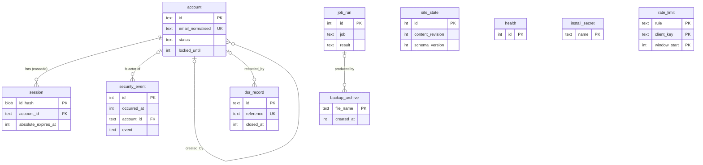
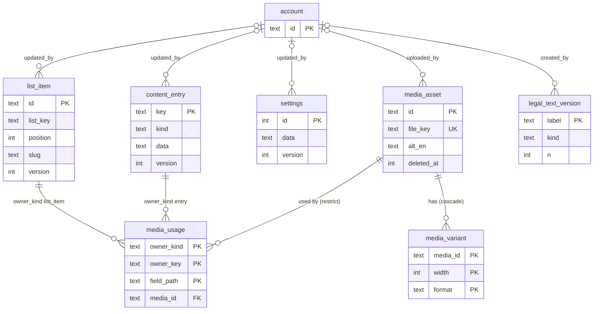
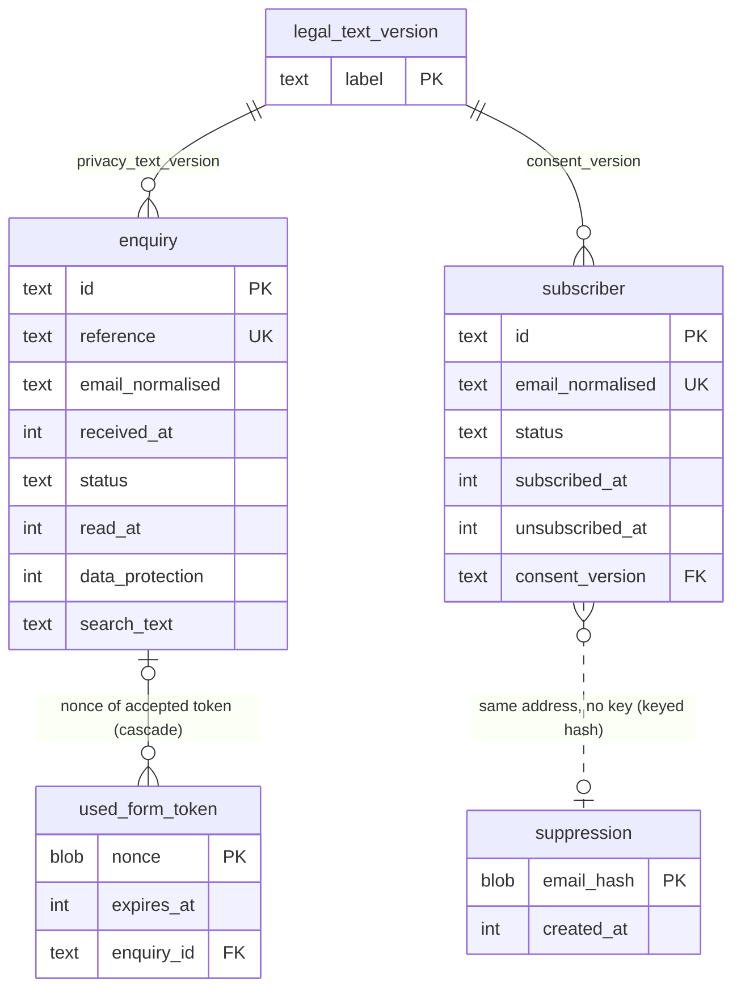

# Data model: Jazz Casa del Mar resort website

- Client slug: jazz_casa_del_mar
- Project slug: site
- Task: P4-T4 (Database Engineer), design time work only
- Date: 2026-10-15
- Status: proposed for the architecture gate and Steven's T2 touchpoint. No migrations exist yet because the web repo has no schema before T2.
- Engine: SQLite 3.53.4 bundled in better-sqlite3 13.0.3, accessed through drizzle-orm 0.45.3, migrations generated by drizzle-kit 0.31.11 (ADR-0003). One file, `DATA_DIR/site.db`. No database server.
- Inputs: ADR-0003, 0004, 0006, 0009, 0010, 0011, 0015; `docs/architecture.md`; `contract/openapi.yaml` (not edited); `docs/requirements.md` (FR-1, FR-19 to FR-23, FR-32 to FR-48, NFR-14 to NFR-19, NFR-33 to NFR-35, Retention schedule); `docs/stories.md`; `docs/legal-register.md`; `docs/threat-model.md`; `docs/mvp.md`.
- What was checked: the reference SQL in appendices A and B was loaded into SQLite 3.45.1 (Python `sqlite3`, the newest engine available in the workspace) with `trusted_schema=OFF`, `foreign_keys=ON`, `secure_delete=ON` and WAL, every trigger and constraint was exercised, and the query plans in section 11 were taken on synthetic data (5,000 and 50,000 enquiries, 10,000 and 50,000 subscribers). Nothing has been run on better-sqlite3 13.0.3 yet; the plans and timings are design evidence, not the NFR-10 measurement (that is taken after the build).

## 1. Summary

Twenty-one tables plus Drizzle's own migrations table. Content is stored as validated JSON documents keyed by registry path (one row per page, global group or room, one row per list item, one settings row), so a save is one row, one version check and one transaction. Everything that must be queried, counted, joined or purged by time (accounts, sessions, media, enquiries, subscribers, suppression, counters, security events, jobs) is relational with typed columns, CHECK constraints and indexes chosen from the access patterns in the stories.

| Group | Tables |
| --- | --- |
| Install state | `site_state`, `health`, `install_secret`, `__drizzle_migrations` (Drizzle's own) |
| Accounts | `account`, `session` |
| Content | `content_entry`, `list_item`, `settings`, `legal_text_version` |
| Media | `media_asset`, `media_variant`, `media_usage` |
| Public submissions | `enquiry`, `subscriber`, `suppression`, `used_form_token` |
| Operations and records | `rate_limit`, `security_event`, `job_run`, `backup_archive`, `dsr_record` |

Differences from the table list in ADR-0003 and `docs/architecture.md` section 10 (each is explained where the table is defined and listed in section 13):

- `login_attempt` is not created. Lockout state lives in four columns on `account` (less personal data, nothing to purge, no table to keep consistent).
- `site_state`, `install_secret`, `legal_text_version` and `backup_archive` are added.
- `list_item` gains a nullable `slug` (stable anchors for the ten dining venues, FR-3).
- Search columns, version steps, last Administrator protection, ending sessions on password change, "exactly six rooms", "no delete of a used photo" and "security events are append only" are enforced inside the database by constraints and triggers, not only in code.

## 2. Conventions

| Topic | Rule |
| --- | --- |
| Names | `snake_case` tables and columns; Drizzle maps them to camelCase in TypeScript. |
| Record identifiers | `account`, `list_item`, `media_asset`, `enquiry`, `subscriber`, `dsr_record` use `id TEXT PRIMARY KEY`: a UUID version 7 as 36 lower case characters (contract `Id`), generated in TypeScript. UUID v7 sorts by creation time, so `ORDER BY id DESC` is also newest first. `content_entry` uses its registry key. Internal tables with no public identifier use composite keys or `INTEGER`. |
| Time | Every instant is `INTEGER`: milliseconds since 1970-01-01 UTC. The application passes the time from the injected `Clock` (ADR-0010); no column has a database side time default and no SQL calls `unixepoch()` or `CURRENT_TIMESTAMP`, so tests that advance the clock (AC-43.6, AC-46.4) control every stored time. The API converts to RFC 3339. Dates such as `acknowledgeBy` are computed, never stored. |
| Booleans | `INTEGER` 0 or 1 with `CHECK (col IN (0,1))`. |
| Enumerations | `TEXT` with `CHECK (col IN (...))` whose values equal the contract enums. |
| Optional text | Stored as `NULL` when absent (for example `enquiry.telephone`). Localised content text uses the empty string for "missing" because the contract defines it that way. |
| JSON | `TEXT` with `CHECK (json_valid(col) AND length(col) <= cap)`. JSON is used only for content documents, settings and small count records, never for anything that is filtered or joined. |
| Strictness | SQLite `STRICT` tables are not used: drizzle-kit cannot emit them. Types are enforced by `CHECK` constraints on the columns where a wrong type would matter (lengths, enumerations, `length(blob) = 32`) and by Drizzle's typed schema. |
| Drizzle versus custom SQL | Tables, columns, `CHECK` constraints, foreign keys, plain and partial indexes are declared in `src/lib/db/schema.ts` and generated by drizzle-kit. Triggers are not representable there; they live in custom migration files (`drizzle-kit generate --custom`) and are applied in order with the generated ones. Appendix B holds them. |
| Pragmas | Per connection: `journal_mode=WAL`, `synchronous=FULL`, `foreign_keys=ON`, `busy_timeout=5000`, `trusted_schema=OFF` (ADR-0003), plus **`secure_delete=ON`** (new, section 9.2: purged personal data is overwritten in the database file). Verified that JSON `CHECK` constraints and the triggers work with `trusted_schema=OFF`. |
| Write transactions | Every write runs as `BEGIN IMMEDIATE` (better-sqlite3: `db.transaction(fn).immediate()`), so a write never fails halfway on a lock upgrade, and the server and a server side command (purge, unlock, backup) queue behind each other on `busy_timeout`. |
| Cascades | `ON DELETE CASCADE` only for rows that cannot exist without their parent (`session`, `media_variant`, `used_form_token`). Everything else is `RESTRICT`/`NO ACTION` or `SET NULL` so a deletion never silently removes records. |
| Child key indexes | Every foreign key column that is deleted from often has an index (`session.account_id`, `media_usage.media_id`, `used_form_token.enquiry_id`). The `updated_by` and `created_by` columns are deliberately unindexed: they point at `account`, whose rows are removed rarely, and the referencing tables hold fewer than a thousand rows. |

## 3. Entity relationship diagrams

Three views keep the diagrams readable. Column lists are in section 4; the full reference SQL is in appendix A.

### 3.1 Accounts, sessions and records about activity

`site_state`, `health`, `install_secret` and `rate_limit` have no foreign keys by design.

### 3.2 Content and media

`media_usage.owner_key` holds either a `content_entry.key` or a `list_item.id`, chosen by `owner_kind`; SQLite cannot declare a foreign key to two parents, so the link to the owner is kept by the save transaction and by the trigger in appendix B that clears a deleted list item's rows.

### 3.3 Public submissions

The dotted line between `subscriber` and `suppression` is a logical link only: the suppression entry is looked up by `HMAC-SHA256(suppression key, normalised address)` and must not be joinable to a subscriber row by any stored column (that is the point of the keyed hash).

## 4. Entities, fields, constraints and indexes

Nullability: **N** = `NOT NULL`, **null** = may be `NULL`. "Soft" = a column kept for a reason explained in the note.

### 4.1 Install state

**`site_state`** (exactly one row, `id = 1`)

| Column | Type | Null | Rule and note |
| --- | --- | --- | --- |
| `id` | INTEGER PK | N | `CHECK (id = 1)` |
| `content_revision` | INTEGER | N | `>= 1`. The "global content revision" of ADR-0004: incremented by 1 in the same transaction as every write to `content_entry`, `list_item`, `settings`, `media_asset` (metadata, file, delete) and `legal_text_version`. Feeds the page `ETag` and the snapshot swap. |
| `schema_version` | INTEGER | N | Highest applied migration number. Set by the migration runner after it applies pending migrations (same transaction), copied into backup manifests, and compared on restore (section 10.5). |
| `seed_version` | TEXT | null | Version label of the seed that populated an empty install (`seed/` folder). |
| `seed_content_revision` | INTEGER | null | `content_revision` right after seeding. Restore into an "empty install" (FR-48) means: no account, enquiry, subscriber, suppression or media rows, and `content_revision = seed_content_revision`. |
| `installed_at` | INTEGER | N | Time of the first migration. |

**`health`** (exactly one row, `id = 1`): `id INTEGER PK CHECK (id = 1)`, `checked_at INTEGER N`. `GET /healthz` reads it and updates `checked_at` inside one transaction (NFR-32). Because every call fsyncs, the handler caches a successful result for 5 seconds.

**`install_secret`**: `name TEXT PK CHECK (name IN ('suppression_hmac_key'))`, `value BLOB N CHECK (length(value) = 32)`, `created_at INTEGER N`. Holds the suppression HMAC key so that suppression entries stay usable after a restore (ADR-0010, ADR-0015). It is a separate table from `settings` so that it can never reach the content snapshot, the `Settings` API shape or an admin response. Only the newsletter module reads it. The form token and CSRF keys stay in `secrets/keys.json` and are not in the database or in backups.

**`__drizzle_migrations`** (created by Drizzle's migrator: `id`, `hash`, `created_at`): the applied migration list. Never edited by hand. See section 10.

### 4.2 Accounts and sessions

**`account`** (FR-32, FR-34, NFR-19, NFR-20, G-19, G-21, G-23)

| Column | Type | Null | Rule and note |
| --- | --- | --- | --- |
| `id` | TEXT PK | N | UUID v7 |
| `email` | TEXT | null | As typed, trimmed, 3 to 254 characters. `NULL` once the account is deleted and its personal data purged. |
| `email_normalised` | TEXT | null | Section 8.1. Sign in and duplicate detection compare this. `NULL` with `email`. |
| `name` | TEXT | null | 1 to 100 characters. `NULL` after personal data purge. |
| `password_hash` | TEXT | null | Argon2id PHC string from `@node-rs/argon2`. `NULL` for deleted accounts (set at deletion; the credential is useless and is not kept). |
| `status` | TEXT | N | `active`, `disabled`, `deleted` (contract `Account.status` shows only the first two; `deleted` rows are tombstones, never listed). |
| `disabled_reason` | TEXT | null | `manual` or `inactive` (disabled by the 12 month rule); only when `status = 'disabled'`. |
| `must_change_password` | INTEGER | N | Default 1. The authoritative value for contract `Session.mustChangePassword` (the session row does not copy it, so it cannot go stale). |
| `created_at`, `updated_at` | INTEGER | N | |
| `created_by` | TEXT FK `account` | null | `ON DELETE SET NULL`; `NULL` when made by `npm run admin:create`. |
| `password_changed_at` | INTEGER | null | |
| `last_sign_in_at` | INTEGER | null | Contract `Account.lastSignInAt`. Also the inactivity clock for the 12 month rule (`created_at` when never signed in). |
| `failed_since_last_success` | INTEGER | N | Default 0. Failed attempts since the last successful sign in; copied into the new session at sign in for FR-32/G-23, then reset to 0. |
| `failed_window_started_at` | INTEGER | null | Start of the current lockout window (15 minutes, `LOCKOUT_MINUTES`). |
| `failed_window_count` | INTEGER | N | Default 0. Failures in the window. At `LOCKOUT_ATTEMPTS` (5), `locked_until = now + 15 minutes`. |
| `locked_until` | INTEGER | null | Contract `Account.locked` is `locked_until > now`. `npm run admin:unlock` clears it and the two window columns. Unknown email addresses never create anything here (NFR-19: nothing to learn from state). |
| `deleted_at` | INTEGER | null | Set with `status = 'deleted'`. |

Constraints: `CHECK ((status = 'deleted') = (deleted_at IS NOT NULL))`; a non deleted account must have `email`, `email_normalised`, `name` and `password_hash`; a deleted account has `password_hash IS NULL`; `disabled_reason` only when disabled.

Indexes:

- `UNIQUE (email_normalised) WHERE status <> 'deleted'`: sign in lookup (US-30), duplicate check (contract `duplicate`), and lets an address be reused for a new account while the old tombstone waits for its 30 day purge.
- `(deleted_at) WHERE status = 'deleted'`: deleted-account personal data purge.
- `(last_sign_in_at) WHERE status = 'active'`: inactive account rule.

Triggers (appendix B): the last active Administrator cannot be disabled or deleted (`last_administrator`, contract 409); any change of `status` away from `active`, or of `password_hash`, deletes every `session` row of the account in the same statement (NFR-20, G-19, AC-32.6). Because it is a trigger, the server commands `admin:reset-password` and any future code path get the same guarantee.

**`session`** (NFR-20, ADR-0006)

| Column | Type | Null | Rule and note |
| --- | --- | --- | --- |
| `id_hash` | BLOB PK | N | SHA-256 (32 bytes) of the 256-bit identifier in the cookie. A copy of the database reveals no live session. `WITHOUT ROWID`. |
| `account_id` | TEXT FK `account` | N | `ON DELETE CASCADE` |
| `created_at` | INTEGER | N | |
| `last_seen_at` | INTEGER | N | Idle expiry is `last_seen_at + SESSION_IDLE_MINUTES`; it is updated at most once per 30 seconds per session to avoid a write for every read request. |
| `absolute_expires_at` | INTEGER | N | `created_at + 8 hours`, `> created_at` |
| `csrf_secret` | BLOB | N | 32 random bytes; the contract's `csrfToken` is an HMAC of it. |
| `previous_sign_in_at` | INTEGER | null | The account's `last_sign_in_at` before this sign in. Stored here because contract `Session` returns it on every `GET /admin/api/session` (G-23), not only at sign in. |
| `failed_attempts_before` | INTEGER | N | Default 0. Value of `failed_since_last_success` captured at sign in (same reason). |

Indexes: `(account_id)` ends all sessions of an account; `(absolute_expires_at)` and `(last_seen_at)` serve the expired session sweep. The per request check is a primary key lookup joined to `account` by primary key.

### 4.3 Content (FR-35 to FR-39, ADR-0004, ADR-0011)

**`content_entry`**: one row per editable page, global group or room.

| Column | Type | Null | Rule and note |
| --- | --- | --- | --- |
| `key` | TEXT PK | N | Contract `EntryKey` shape: `page.<slug>`, `global.<slug>` or `room.<slug>`; `CHECK (length(key) BETWEEN 6 AND 66 AND key NOT GLOB '*[^a-z0-9.-]*')`. |
| `kind` | TEXT | N | `page`, `global`, `room`; must agree with the key prefix (`CHECK`). |
| `data` | TEXT | N | JSON document, section 5.1. `json_valid`, at most 512 KB. |
| `version` | INTEGER | N | `>= 1`, starts at 1. Optimistic lock (section 6). |
| `created_at`, `updated_at` | INTEGER | N | |
| `updated_by` | TEXT FK `account` | null | `ON DELETE SET NULL`; the API returns `null` for a deleted account. |

Index: the primary key only (about 30 rows). Triggers: no `DELETE` of any entry; `key` and `kind` immutable; only the six fixed room keys may be inserted with `kind = 'room'` (section 5.4); an update of `data` or `version` must raise `version` by exactly 1.

**`list_item`**: one row per item of the seven lists (contract `ListKey`).

| Column | Type | Null | Rule and note |
| --- | --- | --- | --- |
| `id` | TEXT PK | N | UUID v7 |
| `list_key` | TEXT | N | `CHECK` in `dining-venues`, `pools-and-beach`, `activities`, `offers`, `gallery`, `faq`, `attractions`. Room features are not a list table: they are a `textList` field inside each room entry (ADR-0004). |
| `position` | INTEGER | N | `>= 0`, saved order |
| `slug` | TEXT | null | Anchor name (`#venue-<slug>`, FR-3). Set at creation from the English title (ASCII, `a-z0-9-`), never changed by later edits so links keep working. Used by `dining-venues`; other lists leave it `NULL`. Not in the contract, so staff cannot see or change it. |
| `data` | TEXT | N | JSON document of the item's fields, same shape as `content_entry.data`; at most 256 KB. |
| `version` | INTEGER | N | Optimistic lock |
| `created_at`, `updated_at` | INTEGER | N | |
| `updated_by` | TEXT FK `account` | null | `SET NULL` |

Indexes: `UNIQUE (list_key, position)` (reading a list in saved order, FR-36; also stops two items sharing a place); `UNIQUE (list_key, slug) WHERE slug IS NOT NULL`. Reordering writes positions in two passes inside one transaction (first `position = position + 1000000`, then the final values), because SQLite checks a unique index after every statement. A trigger deletes the item's `media_usage` rows when it is deleted.

**`settings`** (exactly one row, `id = 1`, FR-39)

| Column | Type | Null | Rule and note |
| --- | --- | --- | --- |
| `id` | INTEGER PK | N | `CHECK (id = 1)` |
| `data` | TEXT | N | JSON object equal to contract `SettingsValues` (Book now URL, maps URL, five social links, telephone, WhatsApp, email, postal address, per language optional concept sentence, provider details), plus `"v": 1`. At most 64 KB. Validated by the same Zod schema as the API. There is no key for the fixed concept sentence, the title suffix or noindex (FR-39, NFR-27). |
| `version` | INTEGER | N | Optimistic lock |
| `updated_at` | INTEGER | N | |
| `updated_by` | TEXT FK `account` | null | `SET NULL` |

One JSON document, not one column per setting: the only reads are "all settings into the snapshot" and "replace all settings", and the nested shapes (`social`, `provider`, per language sentence) are validated as a whole.

**`legal_text_version`**: the wording shown for consent and privacy information (NFR-14, FR-20, FR-22, LR-3, LR-4). The requirements record a "version" of these texts but the editable content model has no place that makes a version mean something; this table closes the gap (open question D-2).

| Column | Type | Null | Rule and note |
| --- | --- | --- | --- |
| `label` | TEXT PK | N | The version identifier stored on enquiries and subscribers and returned as `privacyTextVersion` / `consentVersion` (at most 50 characters): `privacy-<n>` or `consent-<n>`, lower case. |
| `kind` | TEXT | N | `newsletter_consent` or `enquiry_privacy_info` |
| `n` | INTEGER | N | `>= 1`; `UNIQUE (kind, n)` |
| `text_en`, `text_de`, `text_it`, `text_ru` | TEXT | N | The full wording in each language as shown at the time. English required (1 to 2,000 characters); other languages may be empty (the visitor then saw the English fallback). |
| `created_at` | INTEGER | N | |
| `created_by` | TEXT FK `account` | null | `SET NULL` |

Rules: rows are immutable (triggers forbid `UPDATE` and `DELETE`). The registry marks the consent text field and the enquiry privacy information line as "versioned": a content save that changes any language of such a field appends a row with `n = previous + 1` in the same transaction, and the forms record the newest `label`. The seed creates `consent-1` and `privacy-1`. Rows contain no personal data (the controller name in them is a marked placeholder until Q3) and are kept for as long as any enquiry or subscriber could refer to them; they are never purged (their size is a few kilobytes per edit).

### 4.4 Media (FR-40, FR-41, ADR-0009)

**`media_asset`**

| Column | Type | Null | Rule and note |
| --- | --- | --- | --- |
| `id` | TEXT PK | N | UUID v7 (contract `MediaAsset.id`) |
| `file_key` | TEXT | N | `UNIQUE`; 26 characters `[0-9a-z]` (ADR-0009). Names the files on disk; user supplied names never reach the file system. |
| `name` | TEXT | N | Display name, 1 to 200 characters |
| `mime_type` | TEXT | N | Of the original: `image/jpeg`, `image/png`, `image/webp`, `image/avif` |
| `size_bytes` | INTEGER | N | Original, 1 to 10,485,760 |
| `width`, `height` | INTEGER | N | Original pixels, each `>= 1`, `width * height <= 40,000,000` (NFR-23) |
| `rev` | INTEGER | N | Default 1; the `<rev>` in public variant file names (ADR-0009); incremented when the file is replaced |
| `version` | INTEGER | N | Default 1; optimistic lock for `PATCH` and file replacement |
| `alt_en`, `alt_de`, `alt_it`, `alt_ru` | TEXT | N | Default `''`; at most 300 characters; empty means missing |
| `caption_en`, `caption_de`, `caption_it`, `caption_ru` | TEXT | N | Default `''`; at most 300 characters |
| `uploaded_at`, `updated_at` | INTEGER | N | |
| `uploaded_by` | TEXT FK `account` | null | `SET NULL` |
| `deleted_at` | INTEGER | null | Soft delete: public variant files and `media_variant` rows are removed at once, the row and the original file stay for 30 days (Retention schedule), then both are removed. |

Alternative text and captions are eight columns, not JSON: the "usable on a public page" test (`alt_en <> ''`, FR-40) and the missing translation list are plain column tests, and each value gets its own length check.

Indexes: `(uploaded_at DESC, id DESC) WHERE deleted_at IS NULL` (library, newest first, 48 per page); `(deleted_at) WHERE deleted_at IS NOT NULL` (30 day purge).

Triggers: `media_usage` rows cannot be inserted for a photo with empty English alternative text or a deleted photo (`media_not_usable`, FR-40, `media_missing_alt`); a photo that has `media_usage` rows cannot be soft deleted (`in_use`, contract 409 with the `usage` list); its English alternative text cannot be emptied while used. The code checks first and returns the contract errors; the triggers are the safety net.

**`media_variant`**: `media_id TEXT FK media_asset ON DELETE CASCADE`, `width INTEGER CHECK IN (480,768,1280,1920)`, `format TEXT CHECK IN ('avif','webp')`, `bytes INTEGER >= 1`; `PRIMARY KEY (media_id, width, format)`, `WITHOUT ROWID`. At most 8 rows per photo (contract `variants` maxItems 8); fewer for small originals. The public file name is derived (`<file_key>-<rev>-<width>.<format>`), not stored, so it cannot drift.

**`media_usage`**: where each photo is used.

| Column | Type | Null | Rule and note |
| --- | --- | --- | --- |
| `owner_kind` | TEXT | N | `entry` or `list_item` |
| `owner_key` | TEXT | N | `content_entry.key` or `list_item.id` |
| `field_path` | TEXT | N | Registry field path of the media field |
| `media_id` | TEXT FK `media_asset` | N | `ON DELETE RESTRICT` |

`PRIMARY KEY (owner_kind, owner_key, field_path)`, `WITHOUT ROWID`; index `(media_id)` for "where is this photo used" and the delete check. ADR-0009 says usage is rebuilt from the snapshot on every save; this model refreshes it per owner instead (delete the owner's rows, insert the rows of the saved document, same transaction), which is cheaper and gives the same result. A test rebuilds the table from all documents and compares.

### 4.5 Public submissions

**`enquiry`** (FR-19, FR-20, FR-42, LR-5)

| Column | Type | Null | Rule and note |
| --- | --- | --- | --- |
| `id` | TEXT PK | N | UUID v7 (contract `Enquiry.id`; random, so unguessable, TM-45) |
| `reference` | TEXT | N | `UNIQUE`, `CHECK (reference GLOB 'ENQ-[A-Z2-9][A-Z2-9][A-Z2-9][A-Z2-9][A-Z2-9][A-Z2-9]')` (contract pattern). The generator uses `A-HJ-NP-Z2-9` (32 characters, no `I` or `O`), which satisfies FR-20, the contract and AC-13.4. With 32^6 values, one collision is expected once about 50,000 enquiries exist, so the insert retries with a new reference on a unique violation. |
| `name` | TEXT | N | 2 to 100 characters |
| `email` | TEXT | N | As typed, trimmed, 3 to 254 characters |
| `email_normalised` | TEXT | N | Section 8.1 |
| `telephone` | TEXT | null | 7 to 20 characters when present; empty input is stored as `NULL` |
| `subject` | TEXT | N | `general` or `data_protection` |
| `message` | TEXT | N | 10 to 2,000 characters |
| `language` | TEXT | N | Page language `en`, `de`, `it`, `ru` |
| `received_at` | INTEGER | N | |
| `privacy_text_version` | TEXT FK `legal_text_version(label)` | N | Wording shown (NFR-14). The code reads the newest `label` in the insert transaction; see open question D-2 for carrying it in the form token. |
| `status` | TEXT | N | `unhandled` (default) or `handled` |
| `read_at` | INTEGER | null | `NULL` = unread (FR-42). A time, not a boolean, so "when" is never lost; the contract's boolean `read` is `read_at IS NOT NULL`. |
| `data_protection` | INTEGER | N | Default 0. `CHECK (subject <> 'data_protection' OR data_protection = 1)`: the subject implies the flag; an Administrator may also set it on a general enquiry (FR-42). `acknowledgeBy` is `date(received_at) + 30 days` when set, computed by the API. |
| `search_text` | TEXT | N | `lower(reference) || char(10) || fold(name) || char(10) || email_normalised` (section 8.2), computed in TypeScript. Searched with `instr(search_text, ?) > 0`. |

Indexes (all justified in section 11):

- `(received_at DESC, id DESC)`: default list, newest first, and the 12 month purge range.
- `(status, received_at DESC, id DESC)`: Handled/Unhandled filter with newest first.
- `(received_at DESC, id DESC) WHERE data_protection = 1`: the data protection filter and the acknowledgement review, a few rows.
- `(received_at) WHERE read_at IS NULL`: unread count on the main screen.
- `(email_normalised)`: exact address lookup for FR-44 (AC-42.4, 5 seconds) later; costs almost nothing now.
- `UNIQUE (reference)` (implicit): search by reference and the retry on collision.

No index on `subject`: the filter scans the date index and rejects rows, which measured at 0.3 ms for 50,000 rows.

**`subscriber`** (FR-22, FR-23, FR-43)

| Column | Type | Null | Rule and note |
| --- | --- | --- | --- |
| `id` | TEXT PK | N | UUID v7 |
| `email` | TEXT | N | As typed on the first sign up, trimmed. Exported as given. |
| `email_normalised` | TEXT | N | `UNIQUE`. One record per address whatever its status. |
| `language` | TEXT | N | Page language at sign up |
| `status` | TEXT | N | `active` or `unsubscribed` |
| `subscribed_at` | INTEGER | N | The time consent was given (FR-22: "the time"); this is the consent time record |
| `unsubscribed_at` | INTEGER | null | `CHECK ((status = 'active') = (unsubscribed_at IS NULL))` |
| `consent_version` | TEXT FK `legal_text_version(label)` | N | Consent wording version agreed to |

Indexes: `UNIQUE (email_normalised)` (duplicate detection, unsubscribe, exact search, FR-44); `(subscribed_at DESC, id DESC)` (default list); `(status, subscribed_at DESC, id DESC)` (status filter, `activeTotal`, the CSV export of active subscribers); `(unsubscribed_at) WHERE status = 'unsubscribed'` (30 day purge). Search by part of an address is `instr(email_normalised, ?) > 0` with the same ordering.

**`suppression`**: `email_hash BLOB PK CHECK (length(email_hash) = 32)`, `created_at INTEGER N`; `WITHOUT ROWID`; index `(created_at)` for the 36 month purge. `email_hash = HMAC-SHA256(install_secret 'suppression_hmac_key', email_normalised)`. Nothing else is stored, so the address cannot be read back. How it is written and read is in section 8.3.

**`used_form_token`** (contact form replay protection, ADR-0006): `nonce BLOB PK CHECK (length(nonce) = 16)`, `expires_at INTEGER N` (token issue time plus 8 hours), `enquiry_id TEXT FK enquiry ON DELETE CASCADE` null. `WITHOUT ROWID`. The nonce insert and the enquiry insert are one transaction: a primary key conflict means the same accepted token is being replayed (a refresh of the confirmation page), the transaction rolls back and the handler shows the confirmation of the original enquiry (its reference is found through `enquiry_id`) instead of creating a duplicate. Indexes: `(expires_at)` for the sweep; `(enquiry_id) WHERE enquiry_id IS NOT NULL` so deleting an enquiry does not scan the table. Only the contact form uses it; the two newsletter forms are idempotent by design.

### 4.6 Rate limits, records of activity, jobs and backups

**`rate_limit`** (NFR-21, G-10)

| Column | Type | Null | Rule and note |
| --- | --- | --- | --- |
| `rule` | TEXT | N | `admin_sign_in`, `contact`, `newsletter_signup`, `newsletter_unsubscribe`, `admin_write`, `media_upload` (ADR-0006). Not a `CHECK`: a new rule needs no migration. |
| `client_key` | TEXT | N | Rules keyed by address: the first 32 hex characters of `HMAC-SHA256(rate key, client address)`. `admin_write`: the first 32 hex characters of the session `id_hash`. `media_upload`: the account id. The address is therefore not stored in readable form (data minimisation, LR-7); this is a change from the wording "client address in counter key" in `docs/architecture.md` section 10 (open question D-9). |
| `window_start` | INTEGER | N | Start of the fixed window: `floor(now / window) * window` |
| `count` | INTEGER | N | `>= 1` |

`PRIMARY KEY (rule, client_key, window_start)`, `WITHOUT ROWID`; index `(window_start)` for the sweep. The hit is one statement: `INSERT ... ON CONFLICT (rule, client_key, window_start) DO UPDATE SET count = count + 1 RETURNING count`, committed before the request is processed so refused and failed requests still count. Rows are never older than 24 hours when swept (section 9.1).

**`security_event`** (NFR-34, FR-46 later, G-2)

| Column | Type | Null | Rule and note |
| --- | --- | --- | --- |
| `id` | INTEGER PK AUTOINCREMENT | N | Internal only; AUTOINCREMENT so numbers are never reused and order is provable |
| `occurred_at` | INTEGER | N | |
| `actor_type` | TEXT | N | `account`, `anonymous`, `system` |
| `account_id` | TEXT FK `account` | null | Required when `actor_type = 'account'`, otherwise `NULL` (`CHECK`). No `ON DELETE` action: an account row that is still referenced cannot be removed (section 9). |
| `event` | TEXT | N | Lower case code of at most 60 characters: `sign_in`, `lockout`, `password_change`, `password_reset`, `account_create`, `account_update`, `account_delete`, `account_auto_disabled`, `account_unlock`, `subscriber_export`, `subscriber_delete`, `enquiry_delete`, `purge_run`, `backup_run`, `restore_run`, `keys_rotated`, `migration_applied`. FR-46 adds more codes without a schema change. |
| `result` | TEXT | N | `success`, `failure`, `refused` |
| `target_type`, `target_id` | TEXT | null | What it was done to: `account`/`enquiry`/`subscriber` and its UUID. Identifiers only, never an address or text. |
| `detail` | TEXT | null | JSON of counts only, at most 2,000 characters: `{"rows":3}` for an export, `{"enquiry":4,"suppression":0,...}` for a purge. Validated by a Zod schema that allows only non negative integers. |

A failed sign in for an unknown address is `actor_type = 'anonymous'`, `account_id = NULL`, with no address recorded (NFR-34, AC-79.2). The client address is not recorded either (NFR-34 allows no personal data beyond the account identifier), which limits what an investigation can learn; that is a stated consequence of NFR-34, not an oversight.

Indexes: `(occurred_at)` (12 month purge, newest first screens); `(account_id, occurred_at) WHERE account_id IS NOT NULL` (FR-46 filter by user, "previous sign in"); `(event, occurred_at)` (filter by event type). Trigger: `UPDATE` is refused (`security_event_is_append_only`). `DELETE` is not blocked in SQL because the retention period is a configuration value (a test configuration of one day must work, AC-79.4); only the purge module contains a `DELETE` against this table, enforced by a lint rule and a test that greps the compiled code.

**`job_run`** (FR-45, FR-48, `Overview.jobs`)

| Column | Type | Null | Rule and note |
| --- | --- | --- | --- |
| `id` | INTEGER PK AUTOINCREMENT | N | |
| `job` | TEXT | N | `purge` or `backup` |
| `started_at`, `finished_at` | INTEGER | N / null | `finished_at` is `NULL` while running |
| `result` | TEXT | N | `running`, `success`, `failed`, `skipped` (the contract's `lastResult` also has `never`, derived when there is no row) |
| `message` | TEXT | null | At most 300 characters; no personal data (it is shown on the main screen) |
| `counts` | TEXT | null | JSON of counts only, for example removed rows per category or archive bytes |

Index `(job, started_at DESC)`: the scheduler's "last successful run" and the main screen status. A row left `running` by a crash is marked `failed` at the next start. Only the newest 400 rows are kept. Backups use `skipped` for the free space guard of ADR-0010.

**`backup_archive`**: `file_name TEXT PK` (`CHECK (file_name GLOB 'jcdm-backup-*-CONTAINS-PERSONAL-DATA.tar.gz*')`, the ADR-0010 name pattern, no path), `created_at INTEGER N`, `bytes INTEGER N`, `sha256 TEXT N` (64 hex characters of the archive file), `encrypted INTEGER N`, `app_version TEXT N`, `schema_version INTEGER N`, `job_run_id INTEGER FK job_run ON DELETE SET NULL`. One row per archive that exists, written by the backup job after the archive is complete and deleted together with the file when it is older than `BACKUP_RETENTION_DAYS` (AC-46.3). It records what only the job knows (hash, schema version, size) for the free space check and for an operator checking a copy; it holds no personal data. The folder is authoritative: at the start of every backup run the job reconciles rows with the files present. An archive cannot contain its own row, so a restored database lists archives older than the restored one and is reconciled at its first backup. Index `(created_at)`.

**`dsr_record`** (FR-44, created empty; LR-5, LR-10, LR-12)

| Column | Type | Null | Rule and note |
| --- | --- | --- | --- |
| `id` | TEXT PK | N | UUID v7 |
| `reference` | TEXT | N | `UNIQUE`; the controller's reference, `DSR-` plus 6 characters from the enquiry alphabet |
| `type` | TEXT | N | `access`, `erasure`, `rectification`, `restriction`, `objection`, `portability`, `complaint`, `other` |
| `received_at` | INTEGER | N | |
| `acknowledged_at`, `closed_at` | INTEGER | null | |
| `outcome` | TEXT | null | Fixed list only: `fulfilled`, `partly_fulfilled`, `refused`, `withdrawn`, `no_data_held`. No free text, so no message text can be stored (FR-44, Retention schedule). `CHECK ((closed_at IS NULL) = (outcome IS NULL))`. |
| `recorded_by` | TEXT FK `account` | null | `SET NULL` |
| `created_at`, `updated_at` | INTEGER | N | |

The row holds no name, address or message of the requester (FR-44 asks for "reference only"). Indexes: `(closed_at) WHERE closed_at IS NOT NULL` (24 month purge); `(received_at) WHERE closed_at IS NULL` (open requests and their one month and 30 day deadlines). A request that is never closed is never purged; the main screen of FR-44 should list open requests older than 90 days.
