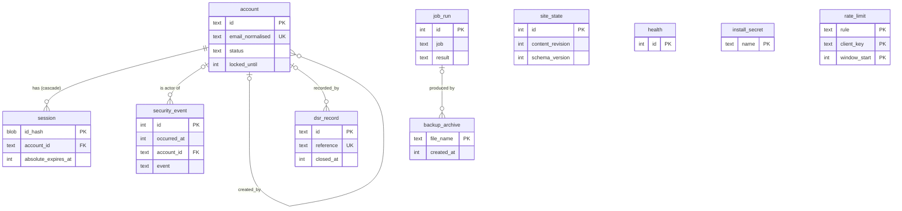
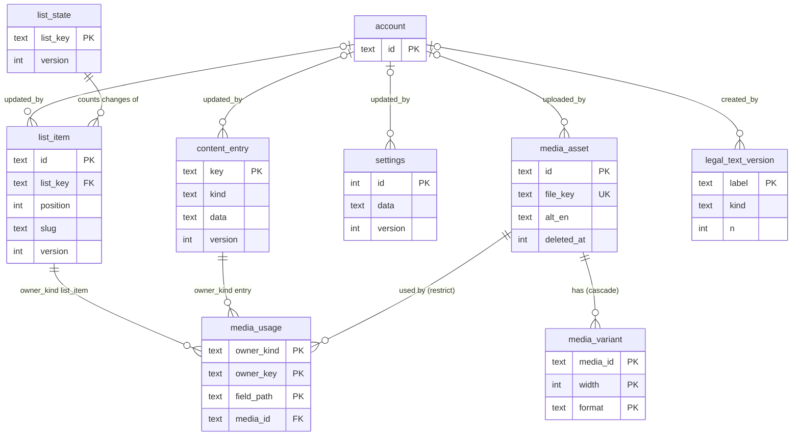
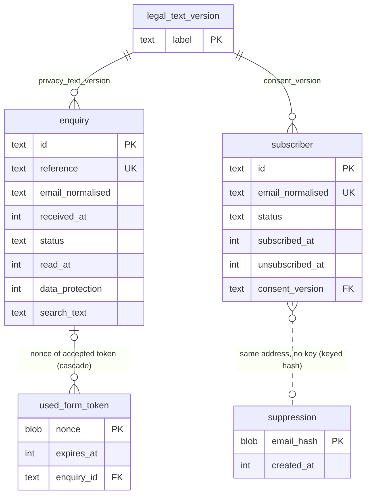

# Data model: Jazz Casa del Mar resort website

- Client slug: jazz_casa_del_mar
- Project slug: site
- Task: P4-T4 (Database Engineer), design time work only
- Date: 2026-10-15
- Status: proposed for the architecture gate and Steven's T2 touchpoint. Revision 2 (P4-T8) applies the contract and requirements changes made after the first report: list order version (D-7), explicit enquiry read state (D-1), and the status of D-2 and D-3 as proposals pending Steven's T2 decision. No migrations exist yet because the web repo has no schema before T2.
- Engine: SQLite 3.53.4 bundled in better-sqlite3 13.0.3, accessed through drizzle-orm 0.45.3, migrations generated by drizzle-kit 0.31.11 (ADR-0003). One file, `DATA_DIR/site.db`. No database server.
- Inputs: ADR-0003, 0004, 0006, 0009, 0010, 0011, 0015; `docs/architecture.md`; `contract/openapi.yaml` (not edited); `docs/requirements.md` (FR-1, FR-19 to FR-23, FR-32 to FR-48, NFR-14 to NFR-19, NFR-33 to NFR-35, Retention schedule); `docs/stories.md`; `docs/legal-register.md`; `docs/threat-model.md`; `docs/mvp.md`.
- What was checked: the reference SQL in appendices A and B was loaded into SQLite 3.45.1 (Python `sqlite3`, the newest engine available in the workspace) with `trusted_schema=OFF`, `foreign_keys=ON`, `secure_delete=ON` and WAL, every trigger and constraint was exercised, and the query plans in section 11 were taken on synthetic data (5,000 and 50,000 enquiries, 10,000 and 50,000 subscribers). Nothing has been run on better-sqlite3 13.0.3 yet; the plans and timings are design evidence, not the NFR-10 measurement (that is taken after the build).

## 1. Summary

Twenty-two tables plus Drizzle's own migrations table. Content is stored as validated JSON documents keyed by registry path (one row per page, global group or room, one row per list item, one settings row), so a save is one row, one version check and one transaction. Everything that must be queried, counted, joined or purged by time (accounts, sessions, media, enquiries, subscribers, suppression, counters, security events, jobs) is relational with typed columns, CHECK constraints and indexes chosen from the access patterns in the stories.

| Group | Tables |
| --- | --- |
| Install state | `site_state`, `health`, `install_secret`, `__drizzle_migrations` (Drizzle's own) |
| Accounts | `account`, `session` |
| Content | `content_entry`, `list_item`, `list_state`, `settings`, `legal_text_version` (pending T2, see D-2) |
| Media | `media_asset`, `media_variant`, `media_usage` |
| Public submissions | `enquiry`, `subscriber`, `suppression`, `used_form_token` |
| Operations and records | `rate_limit`, `security_event`, `job_run`, `backup_archive`, `dsr_record` |

Differences from the table list in ADR-0003 and `docs/architecture.md` section 10 (each is explained where the table is defined and listed in section 13):

- `login_attempt` is not created. Lockout state lives in four columns on `account` (less personal data, nothing to purge, no table to keep consistent).
- `site_state`, `install_secret`, `list_state`, `legal_text_version` (proposed, pending Steven's T2 decision, D-2) and `backup_archive` are added.
- `list_item` gains a nullable `slug` (stable anchors for the ten dining venues, FR-3).
- List order versions, search columns, version steps, last Administrator protection, ending sessions on password change, "exactly six rooms", "no delete of a used photo" and "security events are append only" are enforced inside the database by constraints and triggers, not only in code.

## 2. Conventions

| Topic | Rule |
| --- | --- |
| Names | `snake_case` tables and columns; Drizzle maps them to camelCase in TypeScript. |
| Record identifiers | `account`, `list_item`, `media_asset`, `enquiry`, `subscriber`, `dsr_record` use `id TEXT PRIMARY KEY`: a UUID version 7 as 36 lower case characters (contract `Id`), generated in TypeScript. UUID v7 sorts by creation time, so `ORDER BY id DESC` is also newest first. `content_entry` uses its registry key. Internal tables with no public identifier use composite keys or `INTEGER`. |
| Time | Every instant is `INTEGER`: milliseconds since 1970-01-01 UTC. The application passes the time from the injected `Clock` (ADR-0010); no column has a database side time default and no SQL calls `unixepoch()` or `CURRENT_TIMESTAMP`, so tests that advance the clock (AC-43.6, AC-46.4) control every stored time. The API converts to RFC 3339. Dates such as `acknowledgeBy` are computed, never stored. |
| Booleans | `INTEGER` 0 or 1 with `CHECK (col IN (0,1))`. |
| Enumerations | `TEXT` with `CHECK (col IN (...))` whose values equal the contract enums. |
| Optional text | Stored as `NULL` when absent (for example `enquiry.telephone`). Localised content text uses the empty string for "missing" because the contract defines it that way. |
| JSON | `TEXT` with `CHECK (json_valid(col) AND length(col) <= cap)`. JSON is used only for content documents, settings and small count records, never for anything that is filtered or joined. |
| Strictness | SQLite `STRICT` tables are not used: drizzle-kit cannot emit them. Types are enforced by `CHECK` constraints on the columns where a wrong type would matter (lengths, enumerations, `length(blob) = 32`) and by Drizzle's typed schema. |
| Drizzle versus custom SQL | Tables, columns, `CHECK` constraints, foreign keys, plain and partial indexes are declared in `src/lib/db/schema.ts` and generated by drizzle-kit. Triggers are not representable there; they live in custom migration files (`drizzle-kit generate --custom`) and are applied in order with the generated ones. Appendix B holds them. |
| Pragmas | Per connection: `journal_mode=WAL`, `synchronous=FULL`, `foreign_keys=ON`, `busy_timeout=5000`, `trusted_schema=OFF` (ADR-0003), plus **`secure_delete=ON`** (new, section 9.2: purged personal data is overwritten in the database file). Verified that JSON `CHECK` constraints and the triggers work with `trusted_schema=OFF`. |
| Write transactions | Every write runs as `BEGIN IMMEDIATE` (better-sqlite3: `db.transaction(fn).immediate()`), so a write never fails halfway on a lock upgrade, and the server and a server side command (purge, unlock, backup) queue behind each other on `busy_timeout`. |
| Cascades | `ON DELETE CASCADE` only for rows that cannot exist without their parent (`session`, `media_variant`, `used_form_token`). Everything else is `RESTRICT`/`NO ACTION` or `SET NULL` so a deletion never silently removes records. |
| Child key indexes | Every foreign key column that is deleted from often has an index (`session.account_id`, `media_usage.media_id`, `used_form_token.enquiry_id`). The `updated_by` and `created_by` columns are deliberately unindexed: they point at `account`, whose rows are removed rarely, and the referencing tables hold fewer than a thousand rows. |

## 3. Entity relationship diagrams

Three views keep the diagrams readable. Column lists are in section 4; the full reference SQL is in appendix A.

### 3.1 Accounts, sessions and records about activity



`site_state`, `health`, `install_secret` and `rate_limit` have no foreign keys by design.

### 3.2 Content and media



`media_usage.owner_key` holds either a `content_entry.key` or a `list_item.id`, chosen by `owner_kind`; SQLite cannot declare a foreign key to two parents, so the link to the owner is kept by the save transaction and by the trigger in appendix B that clears a deleted list item's rows.

### 3.3 Public submissions



The dotted line between `subscriber` and `suppression` is a logical link only: the suppression entry is looked up by `HMAC-SHA256(suppression key, normalised address)` and must not be joinable to a subscriber row by any stored column (that is the point of the keyed hash).

## 4. Entities, fields, constraints and indexes

Nullability: **N** = `NOT NULL`, **null** = may be `NULL`. "Soft" = a column kept for a reason explained in the note.

### 4.1 Install state

**`site_state`** (exactly one row, `id = 1`)

| Column | Type | Null | Rule and note |
| --- | --- | --- | --- |
| `id` | INTEGER PK | N | `CHECK (id = 1)` |
| `content_revision` | INTEGER | N | `>= 1`. The "global content revision" of ADR-0004: incremented by 1 in the same transaction as every write to `content_entry`, `list_item`, `settings`, `media_asset` (metadata, file, delete) and `legal_text_version`. Feeds the page `ETag` and the snapshot swap. |
| `schema_version` | INTEGER | N | Number of applied migrations (the highest file number plus one). Set by the migration runner after it applies pending migrations (same transaction), copied into backup manifests, and compared on restore (section 10.5). |
| `seed_version` | TEXT | null | Version label of the seed that populated an empty install (`seed/` folder). |
| `seed_content_revision` | INTEGER | null | `content_revision` right after seeding. Restore into an "empty install" (FR-48) means: no account, enquiry, subscriber, suppression or media rows, and `content_revision = seed_content_revision`. |
| `installed_at` | INTEGER | N | Time of the first migration. |

**`health`** (exactly one row, `id = 1`): `id INTEGER PK CHECK (id = 1)`, `checked_at INTEGER N`. `GET /healthz` reads it and updates `checked_at` inside one transaction (NFR-32). Because every call fsyncs, the handler caches a successful result for 5 seconds.

**`install_secret`**: `name TEXT PK CHECK (name IN ('suppression_hmac_key'))`, `value BLOB N CHECK (length(value) = 32)`, `created_at INTEGER N`. Holds the suppression HMAC key so that suppression entries stay usable after a restore (ADR-0010, ADR-0015). It is a separate table from `settings` so that it can never reach the content snapshot, the `Settings` API shape or an admin response. Only the newsletter module reads it. The form token and CSRF keys stay in `secrets/keys.json` and are not in the database or in backups.

**`__drizzle_migrations`** (created by Drizzle's migrator: `id`, `hash`, `created_at`): the applied migration list. Never edited by hand. See section 10.

### 4.2 Accounts and sessions

**`account`** (FR-32, FR-34, NFR-19, NFR-20, G-19, G-21, G-23)

| Column | Type | Null | Rule and note |
| --- | --- | --- | --- |
| `id` | TEXT PK | N | UUID v7 |
| `email` | TEXT | null | As typed, trimmed, 3 to 254 characters. `NULL` once the account is deleted and its personal data purged. |
| `email_normalised` | TEXT | null | Section 8.1. Sign in and duplicate detection compare this. `NULL` with `email`. |
| `name` | TEXT | null | 1 to 100 characters. `NULL` after personal data purge. |
| `password_hash` | TEXT | null | Argon2id PHC string from `@node-rs/argon2`. `NULL` for deleted accounts (set at deletion; the credential is useless and is not kept). |
| `status` | TEXT | N | `active`, `disabled`, `deleted` (contract `Account.status` shows only the first two; `deleted` rows are tombstones, never listed). |
| `disabled_reason` | TEXT | null | `manual` or `inactive` (disabled by the 12 month rule); only when `status = 'disabled'`. |
| `must_change_password` | INTEGER | N | Default 1. The authoritative value for contract `Session.mustChangePassword` (the session row does not copy it, so it cannot go stale). |
| `created_at`, `updated_at` | INTEGER | N | |
| `created_by` | TEXT FK `account` | null | `ON DELETE SET NULL`; `NULL` when made by `npm run admin:create`. |
| `password_changed_at` | INTEGER | null | |
| `last_sign_in_at` | INTEGER | null | Contract `Account.lastSignInAt`. Also the inactivity clock for the 12 month rule (`created_at` when never signed in). |
| `failed_since_last_success` | INTEGER | N | Default 0. Failed attempts since the last successful sign in; copied into the new session at sign in for FR-32/G-23, then reset to 0. |
| `failed_window_started_at` | INTEGER | null | Start of the current lockout window (15 minutes, `LOCKOUT_MINUTES`). |
| `failed_window_count` | INTEGER | N | Default 0. Failures in the window. At `LOCKOUT_ATTEMPTS` (5), `locked_until = now + 15 minutes`. |
| `locked_until` | INTEGER | null | Contract `Account.locked` is `locked_until > now`. `npm run admin:unlock` clears it and the two window columns. Unknown email addresses never create anything here (NFR-19: nothing to learn from state). |
| `deleted_at` | INTEGER | null | Set with `status = 'deleted'`. |

Constraints: `CHECK ((status = 'deleted') = (deleted_at IS NOT NULL))`; a non deleted account must have `email`, `email_normalised`, `name` and `password_hash`; a deleted account has `password_hash IS NULL`; `disabled_reason` only when disabled.

Indexes:

- `UNIQUE (email_normalised) WHERE status <> 'deleted'`: sign in lookup (US-30), duplicate check (contract `duplicate`), and lets an address be reused for a new account while the old tombstone waits for its 30 day purge.
- `(deleted_at) WHERE status = 'deleted'`: deleted-account personal data purge.
- `(last_sign_in_at) WHERE status = 'active'`: inactive account rule.

Triggers (appendix B): the last active Administrator cannot be disabled or deleted (`last_administrator`, contract 409); any change of `status` away from `active`, or of `password_hash`, deletes every `session` row of the account in the same statement (NFR-20, G-19, AC-32.6). Because it is a trigger, the server commands `admin:reset-password` and any future code path get the same guarantee.

**`session`** (NFR-20, ADR-0006)

| Column | Type | Null | Rule and note |
| --- | --- | --- | --- |
| `id_hash` | BLOB PK | N | SHA-256 (32 bytes) of the 256-bit identifier in the cookie. A copy of the database reveals no live session. `WITHOUT ROWID`. |
| `account_id` | TEXT FK `account` | N | `ON DELETE CASCADE` |
| `created_at` | INTEGER | N | |
| `last_seen_at` | INTEGER | N | Idle expiry is `last_seen_at + SESSION_IDLE_MINUTES`; it is updated at most once per 30 seconds per session to avoid a write for every read request. |
| `absolute_expires_at` | INTEGER | N | `created_at + 8 hours`, `> created_at` |
| `csrf_secret` | BLOB | N | 32 random bytes; the contract's `csrfToken` is an HMAC of it. |
| `previous_sign_in_at` | INTEGER | null | The account's `last_sign_in_at` before this sign in. Stored here because contract `Session` returns it on every `GET /admin/api/session` (G-23), not only at sign in. |
| `failed_attempts_before` | INTEGER | N | Default 0. Value of `failed_since_last_success` captured at sign in (same reason). |

Indexes: `(account_id)` ends all sessions of an account; `(absolute_expires_at)` and `(last_seen_at)` serve the expired session sweep. The per request check is a primary key lookup joined to `account` by primary key.

### 4.3 Content (FR-35 to FR-39, ADR-0004, ADR-0011)

**`content_entry`**: one row per editable page, global group or room.

| Column | Type | Null | Rule and note |
| --- | --- | --- | --- |
| `key` | TEXT PK | N | Contract `EntryKey` shape: `page.<slug>`, `global.<slug>` or `room.<slug>`; `CHECK (length(key) BETWEEN 6 AND 66 AND key NOT GLOB '*[^a-z0-9.-]*')`. |
| `kind` | TEXT | N | `page`, `global`, `room`; must agree with the key prefix (`CHECK`). |
| `data` | TEXT | N | JSON document, section 5.1. `json_valid`, at most 512 KB. |
| `version` | INTEGER | N | `>= 1`, starts at 1. Optimistic lock (section 6). |
| `created_at`, `updated_at` | INTEGER | N | |
| `updated_by` | TEXT FK `account` | null | `ON DELETE SET NULL`; the API returns `null` for a deleted account. |

Index: the primary key only (about 30 rows). Triggers: no `DELETE` of any entry; `key` and `kind` immutable; only the six fixed room keys may be inserted with `kind = 'room'` (section 5.4); an update of `data` or `version` must raise `version` by exactly 1.

**`list_state`**: one row per list, seven in all (contract `ListKey`). It holds the **list order version** that the contract returns as `ListSummary.version` and requires in `ListOrderUpdate.version` (D-7, NFR-33, ADR-0004). A separate small table was chosen over a column on `list_item` (an item can be deleted, leaving nowhere to keep the counter, and the empty list still needs a version) and over `settings` (a list is not a setting).

| Column | Type | Null | Rule and note |
| --- | --- | --- | --- |
| `list_key` | TEXT PK | N | `CHECK` in the seven keys; `WITHOUT ROWID` |
| `version` | INTEGER | N | `>= 1`, default 1. Goes up by exactly 1 each time an item is added, an item is deleted, or the list is reordered. |
| `updated_at` | INTEGER | N | Time of the last such change |

Rules: the seven rows are inserted by migration `0002` (they are constants, not content). Triggers (appendix B): adding a `list_item` row and deleting one each raise the list's `version` by 1 in the same statement, so no code path can forget; `version` may only change by exactly 1 (`version_conflict`); rows cannot be deleted. A reorder is the one change the database cannot see on its own (it only rewrites `position`), so the reorder statement raises the version explicitly with a compare and set (section 6). Editing the content of an item changes the item's own `version`, not the list's. The counter is read for `ListSummary.version` and does not need an index (primary key lookup on seven rows).

**`list_item`**: one row per item of the seven lists (contract `ListKey`).

| Column | Type | Null | Rule and note |
| --- | --- | --- | --- |
| `id` | TEXT PK | N | UUID v7 |
| `list_key` | TEXT FK `list_state` | N | One of `dining-venues`, `pools-and-beach`, `activities`, `offers`, `gallery`, `faq`, `attractions` (the allowed values are the seven `list_state` rows, so an unknown list is a foreign key error). Room features are not a list table: they are a `textList` field inside each room entry (ADR-0004). |
| `position` | INTEGER | N | `>= 0`, saved order |
| `slug` | TEXT | null | Anchor name (`#venue-<slug>`, FR-3). Set at creation from the English title (ASCII, `a-z0-9-`), never changed by later edits so links keep working. Used by `dining-venues`; other lists leave it `NULL`. Not in the contract, so staff cannot see or change it. |
| `data` | TEXT | N | JSON document of the item's fields, same shape as `content_entry.data`; at most 256 KB. |
| `version` | INTEGER | N | Optimistic lock |
| `created_at`, `updated_at` | INTEGER | N | |
| `updated_by` | TEXT FK `account` | null | `SET NULL` |

Indexes: `UNIQUE (list_key, position)` (reading a list in saved order, FR-36; also stops two items sharing a place); `UNIQUE (list_key, slug) WHERE slug IS NOT NULL`. Reordering writes positions in two passes inside one transaction (first `position = position + 1000000`, then the final values), because SQLite checks a unique index after every statement. A trigger deletes the item's `media_usage` rows when it is deleted.

**`settings`** (exactly one row, `id = 1`, FR-39)

| Column | Type | Null | Rule and note |
| --- | --- | --- | --- |
| `id` | INTEGER PK | N | `CHECK (id = 1)` |
| `data` | TEXT | N | JSON object equal to contract `SettingsValues` (Book now URL, maps URL, five social links, telephone, WhatsApp, email, postal address, per language optional concept sentence, provider details), plus `"v": 1`. At most 64 KB. Validated by the same Zod schema as the API. There is no key for the fixed concept sentence, the title suffix or noindex (FR-39, NFR-27). |
| `version` | INTEGER | N | Optimistic lock |
| `updated_at` | INTEGER | N | |
| `updated_by` | TEXT FK `account` | null | `SET NULL` |

One JSON document, not one column per setting: the only reads are "all settings into the snapshot" and "replace all settings", and the nested shapes (`social`, `provider`, per language sentence) are validated as a whole.

**`legal_text_version`**: the wording shown for consent and privacy information (NFR-14, FR-20, FR-22, LR-3, LR-4). The requirements record a "version" of these texts but the editable content model has no place that makes a version mean something; this table closes the gap. **Pending Steven's decision at T2 (D-2): ADR-0004 and ADR-0006 record the archive and the form token label `v` as proposed, and the requirements define "Wording version" in the glossary (FR-20, FR-22, NFR-14, AC-13.12).** If Steven rejects the archive, this table, the two `consent_version` / `privacy_text_version` foreign keys and the registry "versioned" flag are removed, and the two columns become plain text labels; nothing else in the model changes. The table is built either way only after the T2 decision.

| Column | Type | Null | Rule and note |
| --- | --- | --- | --- |
| `label` | TEXT PK | N | The version identifier stored on enquiries and subscribers and returned as `privacyTextVersion` / `consentVersion` (at most 50 characters): `privacy-<n>` or `consent-<n>`, lower case. |
| `kind` | TEXT | N | `newsletter_consent` or `enquiry_privacy_info` |
| `n` | INTEGER | N | `>= 1`; `UNIQUE (kind, n)` |
| `text_en`, `text_de`, `text_it`, `text_ru` | TEXT | N | The full wording in each language as shown at the time. English required (1 to 2,000 characters); other languages may be empty (the visitor then saw the English fallback). |
| `created_at` | INTEGER | N | |
| `created_by` | TEXT FK `account` | null | `SET NULL` |

Rules: rows are immutable (triggers forbid `UPDATE` and `DELETE`). The registry marks the consent text field and the enquiry privacy information line as "versioned": a content save that changes any language of such a field appends a row with `n = previous + 1` in the same transaction, and the forms record the newest `label`. The seed creates `consent-1` and `privacy-1`. Rows contain no personal data (the controller name in them is a marked placeholder until Q3) and are kept for as long as any enquiry or subscriber could refer to them; they are never purged (their size is a few kilobytes per edit).

### 4.4 Media (FR-40, FR-41, ADR-0009)

**`media_asset`**

| Column | Type | Null | Rule and note |
| --- | --- | --- | --- |
| `id` | TEXT PK | N | UUID v7 (contract `MediaAsset.id`) |
| `file_key` | TEXT | N | `UNIQUE`; 26 characters `[0-9a-z]` (ADR-0009). Names the files on disk; user supplied names never reach the file system. |
| `name` | TEXT | N | Display name, 1 to 200 characters |
| `mime_type` | TEXT | N | Of the original: `image/jpeg`, `image/png`, `image/webp`, `image/avif` |
| `size_bytes` | INTEGER | N | Original, 1 to 10,485,760 |
| `width`, `height` | INTEGER | N | Original pixels, each `>= 1`, `width * height <= 40,000,000` (NFR-23) |
| `rev` | INTEGER | N | Default 1; the `<rev>` in public variant file names (ADR-0009); incremented when the file is replaced |
| `version` | INTEGER | N | Default 1; optimistic lock for `PATCH` and file replacement |
| `alt_en`, `alt_de`, `alt_it`, `alt_ru` | TEXT | N | Default `''`; at most 300 characters; empty means missing |
| `caption_en`, `caption_de`, `caption_it`, `caption_ru` | TEXT | N | Default `''`; at most 300 characters |
| `uploaded_at`, `updated_at` | INTEGER | N | |
| `uploaded_by` | TEXT FK `account` | null | `SET NULL` |
| `deleted_at` | INTEGER | null | Soft delete: public variant files and `media_variant` rows are removed at once, the row and the original file stay for 30 days (Retention schedule), then both are removed. |

Alternative text and captions are eight columns, not JSON: the "usable on a public page" test (`alt_en <> ''`, FR-40) and the missing translation list are plain column tests, and each value gets its own length check.

Indexes: `(uploaded_at DESC, id DESC) WHERE deleted_at IS NULL` (library, newest first, 48 per page); `(deleted_at) WHERE deleted_at IS NOT NULL` (30 day purge).

Triggers: `media_usage` rows cannot be inserted for a photo with empty English alternative text or for a deleted photo (error `media_not_usable`, FR-40); a photo that has `media_usage` rows cannot be soft deleted (error `in_use`, contract 409 with the `usage` list); its English alternative text cannot be emptied while it is used (error `media_missing_alt`). The code checks first and returns the contract errors; the triggers are the safety net.

**`media_variant`**: `media_id TEXT FK media_asset ON DELETE CASCADE`, `width INTEGER CHECK IN (480,768,1280,1920)`, `format TEXT CHECK IN ('avif','webp')`, `bytes INTEGER >= 1`; `PRIMARY KEY (media_id, width, format)`, `WITHOUT ROWID`. At most 8 rows per photo (contract `variants` maxItems 8); fewer for small originals. The public file name is derived (`<file_key>-<rev>-<width>.<format>`), not stored, so it cannot drift.

**`media_usage`**: where each photo is used.

| Column | Type | Null | Rule and note |
| --- | --- | --- | --- |
| `owner_kind` | TEXT | N | `entry` or `list_item` |
| `owner_key` | TEXT | N | `content_entry.key` or `list_item.id` |
| `field_path` | TEXT | N | Registry field path of the media field |
| `media_id` | TEXT FK `media_asset` | N | `ON DELETE RESTRICT` |

`PRIMARY KEY (owner_kind, owner_key, field_path)`, `WITHOUT ROWID`; index `(media_id)` for "where is this photo used" and the delete check. ADR-0009 says usage is rebuilt from the snapshot on every save; this model refreshes it per owner instead (delete the owner's rows, insert the rows of the saved document, same transaction), which is cheaper and gives the same result. A test rebuilds the table from all documents and compares.

### 4.5 Public submissions

**`enquiry`** (FR-19, FR-20, FR-42, LR-5)

| Column | Type | Null | Rule and note |
| --- | --- | --- | --- |
| `id` | TEXT PK | N | UUID v7 (contract `Enquiry.id`; random, so unguessable, TM-45) |
| `reference` | TEXT | N | `UNIQUE`, `CHECK (reference GLOB 'ENQ-[A-Z2-9][A-Z2-9][A-Z2-9][A-Z2-9][A-Z2-9][A-Z2-9]')` (contract pattern). The generator uses `A-HJ-NP-Z2-9` (32 characters, no `I` or `O`), which satisfies FR-20, the contract and AC-13.4. With 32^6 values, one collision is expected once about 50,000 enquiries exist, so the insert retries with a new reference on a unique violation. |
| `name` | TEXT | N | 2 to 100 characters |
| `email` | TEXT | N | As typed, trimmed, 3 to 254 characters |
| `email_normalised` | TEXT | N | Section 8.1 |
| `telephone` | TEXT | null | 7 to 20 characters when present; empty input is stored as `NULL` |
| `subject` | TEXT | N | `general` or `data_protection` |
| `message` | TEXT | N | 10 to 2,000 characters |
| `language` | TEXT | N | Page language `en`, `de`, `it`, `ru` |
| `received_at` | INTEGER | N | |
| `privacy_text_version` | TEXT FK `legal_text_version(label)` | N | Wording shown (NFR-14). The code reads the newest `label` in the insert transaction; carrying it in the form token is part of D-2, which is proposed and pending Steven's T2 decision. |
| `status` | TEXT | N | `unhandled` (default) or `handled` |
| `read_at` | INTEGER | null | `NULL` = unread (FR-42). A time, not a boolean, so "when" is never lost; the contract's boolean `read` is `read_at IS NOT NULL`. It is changed only by `PATCH /admin/api/enquiries/{id}`: `read: true` runs `UPDATE enquiry SET read_at = coalesce(read_at, ?)` (the portal sends it when it opens an enquiry; a repeat keeps the first read time), `read: false` sets `NULL`. `GET` never writes (NFR-22, D-1); the model needs no write on the read path. Tested, section 7. |
| `data_protection` | INTEGER | N | Default 0. `CHECK (subject <> 'data_protection' OR data_protection = 1)`: the subject implies the flag; an Administrator may also set it on a general enquiry (FR-42). `acknowledgeBy` is `date(received_at) + 30 days` when set, computed by the API. |
| `search_text` | TEXT | N | `lower(reference) || char(10) || fold(name) || char(10) || email_normalised` (section 8.2), computed in TypeScript. Searched with `instr(search_text, ?) > 0`. |

Indexes (all justified in section 11):

- `(received_at DESC, id DESC)`: default list, newest first, and the 12 month purge range.
- `(status, received_at DESC, id DESC)`: Handled/Unhandled filter with newest first.
- `(received_at DESC, id DESC) WHERE data_protection = 1`: the data protection filter and the acknowledgement review, a few rows.
- `(received_at) WHERE read_at IS NULL`: unread count on the main screen.
- `(email_normalised)`: exact address lookup for FR-44 (AC-42.4, 5 seconds) later; costs almost nothing now.
- `UNIQUE (reference)` (implicit): search by reference and the retry on collision.

No index on `subject`: the filter scans the date index and rejects rows, which measured at 0.3 ms for 50,000 rows.

**`subscriber`** (FR-22, FR-23, FR-43)

| Column | Type | Null | Rule and note |
| --- | --- | --- | --- |
| `id` | TEXT PK | N | UUID v7 |
| `email` | TEXT | N | As typed on the first sign up, trimmed. Exported as given. |
| `email_normalised` | TEXT | N | `UNIQUE`. One record per address whatever its status. |
| `language` | TEXT | N | Page language at sign up |
| `status` | TEXT | N | `active` or `unsubscribed` |
| `subscribed_at` | INTEGER | N | The time consent was given (FR-22: "the time"); this is the consent time record |
| `unsubscribed_at` | INTEGER | null | `CHECK ((status = 'active') = (unsubscribed_at IS NULL))` |
| `consent_version` | TEXT FK `legal_text_version(label)` | N | Consent wording version agreed to (D-2, pending T2) |

Indexes: `UNIQUE (email_normalised)` (duplicate detection, unsubscribe, exact search, FR-44); `(subscribed_at DESC, id DESC)` (default list); `(status, subscribed_at DESC, id DESC)` (status filter, `activeTotal`, the CSV export of active subscribers); `(unsubscribed_at) WHERE status = 'unsubscribed'` (30 day purge). Search by part of an address is `instr(email_normalised, ?) > 0` with the same ordering.

**`suppression`**: `email_hash BLOB PK CHECK (length(email_hash) = 32)`, `created_at INTEGER N`; `WITHOUT ROWID`; index `(created_at)` for the 36 month purge. `email_hash = HMAC-SHA256(install_secret 'suppression_hmac_key', email_normalised)`. Nothing else is stored, so the address cannot be read back. How it is written and read is in section 8.3.

**`used_form_token`** (contact form replay protection, ADR-0006): `nonce BLOB PK CHECK (length(nonce) = 16)`, `expires_at INTEGER N` (token issue time plus 8 hours), `enquiry_id TEXT FK enquiry ON DELETE CASCADE` null. `WITHOUT ROWID`. The nonce insert and the enquiry insert are one transaction: a primary key conflict means the same accepted token is being replayed (a refresh of the confirmation page), the transaction rolls back and the handler shows the confirmation of the original enquiry (its reference is found through `enquiry_id`) instead of creating a duplicate. Indexes: `(expires_at)` for the sweep; `(enquiry_id) WHERE enquiry_id IS NOT NULL` so deleting an enquiry does not scan the table. Only the contact form uses it; the two newsletter forms are idempotent by design.

### 4.6 Rate limits, records of activity, jobs and backups

**`rate_limit`** (NFR-21, G-10)

| Column | Type | Null | Rule and note |
| --- | --- | --- | --- |
| `rule` | TEXT | N | `admin_sign_in`, `contact`, `newsletter_signup`, `newsletter_unsubscribe`, `admin_write`, `media_upload` (ADR-0006). Not a `CHECK`: a new rule needs no migration. |
| `client_key` | TEXT | N | Rules keyed by address: the first 32 hex characters of `HMAC-SHA256(rate key, client address)`. `admin_write`: the first 32 hex characters of the session `id_hash`. `media_upload`: the account id. The address is therefore not stored in readable form (data minimisation, LR-7); this is a change from the wording "client address in counter key" in `docs/architecture.md` section 10 (open question D-9). |
| `window_start` | INTEGER | N | Start of the fixed window: `floor(now / window) * window` |
| `count` | INTEGER | N | `>= 1` |

`PRIMARY KEY (rule, client_key, window_start)`, `WITHOUT ROWID`; index `(window_start)` for the sweep. The hit is one statement: `INSERT ... ON CONFLICT (rule, client_key, window_start) DO UPDATE SET count = count + 1 RETURNING count`, committed before the request is processed so refused and failed requests still count. Rows are never older than 24 hours when swept (section 9.1).

**`security_event`** (NFR-34, FR-46 later, G-2)

| Column | Type | Null | Rule and note |
| --- | --- | --- | --- |
| `id` | INTEGER PK AUTOINCREMENT | N | Internal only; AUTOINCREMENT so numbers are never reused and order is provable |
| `occurred_at` | INTEGER | N | |
| `actor_type` | TEXT | N | `account`, `anonymous`, `system` |
| `account_id` | TEXT FK `account` | null | Required when `actor_type = 'account'`, otherwise `NULL` (`CHECK`). No `ON DELETE` action: an account row that is still referenced cannot be removed (section 9). |
| `event` | TEXT | N | Lower case code of at most 60 characters: `sign_in`, `lockout`, `password_change`, `password_reset`, `account_create`, `account_update`, `account_delete`, `account_auto_disabled`, `account_unlock`, `subscriber_export`, `subscriber_delete`, `enquiry_delete`, `purge_run`, `backup_run`, `restore_run`, `keys_rotated`, `migration_applied`. FR-46 adds more codes without a schema change. |
| `result` | TEXT | N | `success`, `failure`, `refused` |
| `target_type`, `target_id` | TEXT | null | What it was done to: `account`/`enquiry`/`subscriber` and its UUID. Identifiers only, never an address or text. |
| `detail` | TEXT | null | JSON of counts only, at most 2,000 characters: `{"rows":3}` for an export, `{"enquiry":4,"suppression":0,...}` for a purge. Validated by a Zod schema that allows only non negative integers. |

A failed sign in for an unknown address is `actor_type = 'anonymous'`, `account_id = NULL`, with no address recorded (NFR-34, AC-79.2). The client address is not recorded either (NFR-34 allows no personal data beyond the account identifier), which limits what an investigation can learn; that is a stated consequence of NFR-34, not an oversight.

Indexes: `(occurred_at)` (12 month purge, newest first screens); `(account_id, occurred_at) WHERE account_id IS NOT NULL` (FR-46 filter by user, "previous sign in"); `(event, occurred_at)` (filter by event type). Trigger: `UPDATE` is refused (`security_event_is_append_only`). `DELETE` is not blocked in SQL because the retention period is a configuration value (a test configuration of one day must work, AC-79.4); only the purge module contains a `DELETE` against this table, enforced by a lint rule and a test that greps the compiled code.

**`job_run`** (FR-45, FR-48, `Overview.jobs`)

| Column | Type | Null | Rule and note |
| --- | --- | --- | --- |
| `id` | INTEGER PK AUTOINCREMENT | N | |
| `job` | TEXT | N | `purge` or `backup` |
| `started_at`, `finished_at` | INTEGER | N / null | `finished_at` is `NULL` while running |
| `result` | TEXT | N | `running`, `success`, `failed`, `skipped` (the contract's `lastResult` also has `never`, derived when there is no row) |
| `message` | TEXT | null | At most 300 characters; no personal data (it is shown on the main screen) |
| `counts` | TEXT | null | JSON of counts only, for example removed rows per category or archive bytes |

Index `(job, started_at DESC)`: the scheduler's "last successful run" and the main screen status. A row left `running` by a crash is marked `failed` at the next start. Only the newest 400 rows are kept. Backups use `skipped` for the free space guard of ADR-0010.

**`backup_archive`**: `file_name TEXT PK` (`CHECK (file_name GLOB 'jcdm-backup-*-CONTAINS-PERSONAL-DATA.tar.gz*')`, the ADR-0010 name pattern, no path), `created_at INTEGER N`, `bytes INTEGER N`, `sha256 TEXT N` (64 hex characters of the archive file), `encrypted INTEGER N`, `app_version TEXT N`, `schema_version INTEGER N`, `job_run_id INTEGER FK job_run ON DELETE SET NULL`. One row per archive that exists, written by the backup job after the archive is complete and deleted together with the file when it is older than `BACKUP_RETENTION_DAYS` (AC-46.3). It records what only the job knows (hash, schema version, size) for the free space check and for an operator checking a copy; it holds no personal data. The folder is authoritative: at the start of every backup run the job reconciles rows with the files present. An archive cannot contain its own row, so a restored database lists archives older than the restored one and is reconciled at its first backup. Index `(created_at)`.

**`dsr_record`** (FR-44, created empty; LR-5, LR-10, LR-12)

| Column | Type | Null | Rule and note |
| --- | --- | --- | --- |
| `id` | TEXT PK | N | UUID v7 |
| `reference` | TEXT | N | `UNIQUE`; the controller's reference, `DSR-` plus 6 characters from the enquiry alphabet |
| `type` | TEXT | N | `access`, `erasure`, `rectification`, `restriction`, `objection`, `portability`, `complaint`, `other` |
| `received_at` | INTEGER | N | |
| `acknowledged_at`, `closed_at` | INTEGER | null | |
| `outcome` | TEXT | null | Fixed list only: `fulfilled`, `partly_fulfilled`, `refused`, `withdrawn`, `no_data_held`. No free text, so no message text can be stored (FR-44, Retention schedule). `CHECK ((closed_at IS NULL) = (outcome IS NULL))`. |
| `recorded_by` | TEXT FK `account` | null | `SET NULL` |
| `created_at`, `updated_at` | INTEGER | N | |

The row holds no name, address or message of the requester (FR-44 asks for "reference only"). Indexes: `(closed_at) WHERE closed_at IS NOT NULL` (24 month purge); `(received_at) WHERE closed_at IS NULL` (open requests and their one month and 30 day deadlines). A request that is never closed is never purged; the main screen of FR-44 should list open requests older than 90 days.

## 5. How content is stored

### 5.1 Document shape

`content_entry.data`, `list_item.data` and `settings.data` hold one JSON document. The keys are the registry **field paths** that the contract already uses (`ContentField.path`, for example `hero.heading`: dotted, camelCase segments, at most 200 characters).

```json
{
  "v": 1,
  "fields": {
    "hero.heading": { "en": "Welcome", "de": "Willkommen", "it": "", "ru": "" },
    "hero.intro":   { "en": { "type": "doc", "content": [] }, "de": null, "it": null, "ru": null },
    "hero.image":   { "mediaId": "0197c0de-0000-7000-8000-000000000001" },
    "features":     [ { "en": "Balcony", "de": "", "it": "", "ru": "" } ]
  }
}
```

| Registry field type (ADR-0004) | Stored value | "Missing" means |
| --- | --- | --- |
| `text` | `{ en, de, it, ru }` strings, each at most the field's `maxLength` (contract maximum 20,000) | empty string in that language |
| `richText` | `{ en, de, it, ru }`, each an allow-listed ProseMirror document or `null` | `null`, or a document with no non blank text |
| `media` | `{ "mediaId": "<uuid>" }` or `null` | `null` |
| `textList` | array of up to 100 `text` values | an element empty in that language |

- `v` is the shape version of the document, so a later change of the representation can be migrated lazily by a script.
- A path that is absent is empty. A new registry field therefore needs no data migration to exist; it simply shows as missing everywhere until filled.
- A save sends only the paths it changes (contract `FieldValueUpdate`); the server merges them into `fields`, validates the whole merged document against the registry, and writes it. Unknown paths are refused on save (`unknown_field`) and ignored with a logged warning on load.
- Why JSON and not a `content_value(entry, path, lang, value)` table: there are about 30 entries and about 100 list items (a few thousand values in all); a save must be all or nothing and versioned at entry level anyway; nothing ever filters or sorts by content text (there is no site search, FR-1); completeness and missing translation lists are computed in memory from the registry (section 5.5). The cost is that the database cannot check field rules, which is why the registry validates on save, on load and once at start, and why `CHECK (json_valid(...))` and size caps remain as a last line.
- Media in content is by id only (`mediaId`), never by file name or URL; the public file name is derived from `media_asset.file_key`, `rev`, the width and the format (section 4.4).

### 5.2 Four languages and the English fallback (FR-24, FR-26, FR-37, NFR-28)

- The language set is the fixed enumeration `en`, `de`, `it`, `ru` (a `CHECK` on `enquiry.language` and `subscriber.language`, and a constant in the registry). Every localised value always carries all four keys, so a document is complete in shape even when texts are empty.
- Fallback is applied when the snapshot is read, never in SQL: `pick(value, lang)` returns the value in the page language if it is non empty, otherwise the English value together with a flag, and the rendering helper writes `lang="en"` on the element when the flag is set (ADR-0011). A page therefore cannot render an empty heading because of a missing translation, provided required fields (`required: true`, English must be non empty to save) are enforced on save.
- Photos: alternative text and captions follow the same rule per photo (`alt_de` empty falls back to `alt_en`). `alt_en` cannot be empty while a photo is used (trigger), so a photo always has some alternative text.
- Optional settings text (the per language concept sentence) falls back to English by the same rule.
- Fixed texts (the concept sentence, the title suffix, the 500 page fallback) are not in the database at all; they are in `src/i18n/fixed/{lang}.json` (FR-17).
- Seed content is supplied in all four languages; machine assisted translations are marked unreviewed in the content register (OQ-8), not in the database.

### 5.3 How the fixed page designs map to content records (FR-1, FR-35, FR-36)

Each of the 21 page types is an Astro page component with a fixed layout. Its component reads only the fields that its registry entry declares, from the entry, the lists and the settings named below. The registry (`src/lib/content/registry.ts`) is the authority for field paths and limits; the keys here are the proposed ones (15 page entries, 6 room entries, a handful of global entries).

| Page type (FR-1) | Public path | Content entry | Lists read | Settings and other |
| --- | --- | --- | --- | --- |
| Home | `/{lang}` | `page.home` (hero text, overview, key facts as a `textList`) | `offers` (titles only) | Book now and contact links from `settings` |
| Rooms and suites | `/{lang}/rooms` | `page.rooms` | none | six cards read from the six `room.*` entries (name, one image, short description) |
| Six room pages | `/{lang}/rooms/<slug>` | `room.family-suite`, `room.executive-suite`, `room.superior-twin-sea-view`, `room.superior-queen-sea-view`, `room.triple-deluxe-twin-pool-view`, `room.triple-deluxe-queen-pool-view` | none | name, rich description, `features` `textList`, image fields |
| Dining | `/{lang}/dining` | `page.dining` | `dining-venues` (10 items; anchor from `slug`) | |
| Pools and beach | `/{lang}/pools-and-beach` | `page.pools-and-beach` | `pools-and-beach` (4) | |
| Activities and facilities | `/{lang}/activities` | `page.activities` | `activities` (5) | |
| Location | `/{lang}/location` | `page.location` (static map image field, text) | `attractions` (5 or more) | Maps link from `settings` |
| Offers | `/{lang}/offers` | `page.offers` | `offers` (3 or more) | Book now link |
| Gallery | `/{lang}/gallery` | `page.gallery` | `gallery` (12 or more, each a `media` field and caption text) | |
| FAQ | `/{lang}/faq` | `page.faq` | `faq` (8 or more) | |
| Contact Us | `/{lang}/contact` | `page.contact`; form labels and messages in `global.forms` | none | telephone, WhatsApp, email, address, social from `settings`; privacy information line is a versioned field (section 4.3) |
| Privacy, Cookie, Terms, Accessibility | `/{lang}/privacy`, `/cookies`, `/terms`, `/accessibility` | `page.privacy`, `page.cookies`, `page.terms`, `page.accessibility` (rich text) | none | Terms reads the provider details from `settings` |
| Newsletter unsubscribe | `/{lang}/newsletter/unsubscribe` | `page.newsletter-unsubscribe` | none | |
| Every page | all | `global.navigation`, `global.footer` (newsletter form labels and the versioned consent text), `global.forms` (validation, confirmation and retry messages), `global.errors` (404 and 500 text), `global.common` (Book now labels, external site label) | none | `settings` |

Consequences of "fixed designs": an admin can change text, order and membership of the seven lists, and photos, but cannot add a field, a list, a page or a room; any of those is a code change to the registry and the template plus a migration or seed update (RSK-4). Because field types have no "list of photos", a room's three to six images are separate `media` fields in the room entry (the registry fixes the count, FR-2 requires at least three); the gallery is a list whose items each hold one `media` field.

### 5.4 Rooms are exactly six (FR-1, FR-36, OQ-20)

Enforced in layers, so no single bug can add or remove a room:

1. The seed inserts exactly the six `room.<slug>` rows (slugs equal the contract `RoomSlug` enum).
2. Trigger `content_entry_room_insert` refuses any other `room.*` key. Trigger `content_entry_no_delete` refuses deleting any content entry. Trigger `content_entry_key_immutable` refuses changing `key` or `kind`. (Appendix B.)
3. The contract has no endpoint that creates or deletes an entry; only `PUT /admin/api/content/{entryKey}` on an existing key.
4. At start, the server compares the set of `content_entry.key` with the registry's key set and prints `STARTUP-REFUSED` if they differ (a hand edited or wrongly restored database).
5. A test counts `room.*` rows after every content API test.

### 5.5 Completeness and the missing translation list (FR-37)

Computed in memory from the registry and the documents, never stored (a stored count could go stale):

- Per entry or item and language: `complete` = number of `text`/`richText` fields (and `textList` fields, counted once, complete when every element has text) that are non blank in that language; `total` = number of such fields. `languagesComplete` = languages with `complete = total`. This is exactly the contract `Completeness` shape.
- Photos count as owners `media/<id>`: `alt` always, `caption` only when the English caption is non empty (recommended so that a photo with no caption anywhere is not reported as three missing captions; open question D-15).
- The list of all missing fields (contract `MissingTranslation`, up to 10,000 items) and `Overview.missingTranslations` come from the same pass over the snapshot.

### 5.6 Live publishing support (FR-38, ADR-0004)

Every write to content, lists, settings, media metadata or legal text increments `site_state.content_revision` in the same transaction. The snapshot is rebuilt from `content_entry`, `list_item` (ordered by `list_key, position`), `list_state` (versions), `settings`, non deleted `media_asset` with their `media_variant` rows, and the revision; about 30 + 100 + 1 + a few hundred rows, which is a few milliseconds of query time. The 5 second `PRAGMA data_version` check catches changes made by other connections (a restore or a server command).

## 6. Optimistic locking (NFR-33, TM-35)

Versioned rows: `content_entry`, `list_item`, `list_state` (the list order version), `settings`, `media_asset`. Each starts at 1 and goes up by exactly 1 per change.

| Operation | Statement shape (bound parameters) | If `changes() = 0` |
| --- | --- | --- |
| Save an entry | `UPDATE content_entry SET data=?, version=version+1, updated_at=?, updated_by=? WHERE key=? AND version=?` | The row exists with another version: re-read it and answer 409 `version_conflict` with the current entry (contract `current`). |
| Save a list item | same, `WHERE id=? AND list_key=? AND version=?` | 404 if the row does not exist, otherwise 409. |
| Delete a list item | `DELETE FROM list_item WHERE id=? AND list_key=? AND version=?`. The delete trigger raises `list_state.version` by 1. | 404 if the row does not exist, otherwise 409. Positions are not renumbered; gaps are harmless because reading orders by `position`. |
| Create a list item | `position = coalesce(max(position), -1) + 1` for the list, `version = 1`, inside the transaction. The insert trigger raises `list_state.version` by 1. | A unique violation on `(list_key, position)` cannot happen under `BEGIN IMMEDIATE`; if it does, retry once. |
| Save settings | `UPDATE settings SET data=?, version=version+1, ... WHERE id=1 AND version=?` | 409 |
| Edit photo metadata or replace its file | `UPDATE media_asset SET ..., version=version+1[, rev=rev+1] WHERE id=? AND version=?` | 409 |
| Reorder a list | In one `BEGIN IMMEDIATE` transaction: (1) check that `itemIds` equals the current set of ids of the list, otherwise 409; (2) `UPDATE list_state SET version=version+1, updated_at=? WHERE list_key=? AND version=?` with the `version` the client sent; (3) rewrite positions in two passes (first `position = position + 1000000`, then the final values). Item versions do not change (a position is not content). | Step 1 or step 2 fails: roll back and answer 409 `version_conflict` with the current list (items in saved order and the current `ListSummary.version`), so the editor can review the other change. Tested: a reorder with the old version after an add, delete or other reorder is refused (section 7). |

Everything in a save happens in one `BEGIN IMMEDIATE` transaction: the version check, the document write, the `media_usage` refresh for that owner, a `legal_text_version` append when a versioned wording changed, and the `content_revision` increment. A failure or an interrupted process rolls the whole save back (WAL), so the previous content is intact (NFR-33). The in-memory snapshot is swapped only after the commit returns, and with `synchronous=FULL` a confirmed save survives a power cut.

The version step triggers (appendix B) are a safety net: any update of `data` that does not raise `version` by exactly 1 aborts with `version_conflict`, so a code path that forgets the version cannot overwrite silently. They fire only when `data` (or the named columns) appear in the `SET` list, so foreign key actions such as `ON DELETE SET NULL` on `updated_by` are not blocked (tested).

Not versioned, by design: `enquiry` changes (`read_at`, `status` and `data_protection` are idempotent flags set by an explicit `PATCH`; a `GET` never writes, NFR-22, D-1), `subscriber`, `account` (rename, enable and disable; the last Administrator trigger protects the one dangerous combination). Last writer wins for these.

## 7. Invariants enforced inside the database

| Invariant | Mechanism | Source |
| --- | --- | --- |
| Exactly six rooms; no entry added or deleted | triggers on `content_entry` | FR-1, FR-36, OQ-20 |
| A save cannot overwrite a newer one | `version` step triggers; `WHERE version = ?` in the update | NFR-33 |
| Content documents are valid JSON of bounded size | `CHECK (json_valid(data) AND length(data) <= ...)` | NFR-24, NFR-35 |
| A list order change is detected: the list order version goes up exactly once per add, delete and reorder, never by other amounts, and the list rows cannot be removed | `list_state` triggers plus the compare and set in the reorder statement | NFR-33, FR-36, D-7 |
| At least one active Administrator remains | trigger `account_last_admin_update` and `account_last_admin_delete` | FR-34, AC-32.3 |
| Sessions end when the password changes or the account stops being active | trigger `account_ends_sessions` | NFR-20, G-19, AC-32.6 |
| A used photo cannot be deleted; a photo cannot be used without English alternative text; English alternative text of a used photo cannot be emptied | triggers on `media_asset` and `media_usage`, `RESTRICT` foreign key | FR-40, AC-38.3, AC-38.4 |
| Security events cannot be edited | trigger `security_event_no_update` | NFR-34, AC-79.3 |
| Consent and privacy wording versions never change once written | triggers on `legal_text_version` | NFR-14, LR-3 |
| Every enquiry and subscriber points at an existing wording version | foreign keys to `legal_text_version(label)` | NFR-14 |
| One subscriber record per address, whatever case or surrounding spaces | `UNIQUE (email_normalised)` | FR-22, G-12 |
| One live account per address | partial unique index | FR-34 |
| `unsubscribed_at` is set exactly when the status is `unsubscribed` | `CHECK` | FR-23 |
| A data protection subject always carries the flag | `CHECK` on `enquiry` | LR-5, FR-42 |
| Field lengths and formats equal the contract and the forms (name 2 to 100, message 10 to 2,000, telephone 7 to 20, alternative text 300, photo 10 MB and 40 megapixels, reference format) | `CHECK` constraints | FR-19, FR-40, NFR-23 |
| Singleton rows stay singletons | `CHECK (id = 1)` | `site_state`, `settings`, `health` |

Stay in code, because they depend on configuration or on registry knowledge the database does not have: the enquiry and subscriber caps (NFR-35), the media quota (NFR-23), rate limits, normalisation, registry validation of documents, minimum counts of lists (warnings, FR-36), and the retention periods.

## 8. Normalisation, search and the subscriber flows

### 8.1 Email normalisation (G-12, TM-19, NFR-28)

One function, `normaliseEmail(s) = s.trim().normalize('NFC').toLowerCase().normalize('NFC')`, used for every comparison: sign in, account duplicates, enquiry search, subscriber sign up, unsubscribe, suppression hash, admin search, and the FR-44 tool later. Rules:

- Surrounding whitespace (any Unicode space) is removed; internal characters are not touched.
- `toLowerCase()` is Unicode aware and locale independent (Cyrillic works, ADR-0003); NFC makes composed and decomposed forms equal.
- No provider specific rules: dots and `+tags` are significant, so `a.b@x` and `ab@x` are different addresses. This is stated in the code comment and the test.
- The original trimmed text is stored too (`email`) and is what the CSV export shows; only `email_normalised` is ever compared.
- The 254 character limit applies to the trimmed original.

A unit test covers AC-15.9, AC-16.5, AC-40.7, AC-41.7 and AC-42.5 and adds Cyrillic, Turkish dotted I, German eszett and combining mark cases.

### 8.2 Search fold for names and references (NFR-28)

`fold(s)`: NFKD decompose, remove combining marks that follow a Latin letter, map `ß` to `ss`, `toLowerCase()`, NFC. `enquiry.search_text` is `lower(reference) + "\n" + fold(name) + "\n" + email_normalised`; the admin query `q` is folded the same way (trimmed, at most 254 characters) and matched with `instr(search_text, ?) > 0`. `instr` takes the text literally, so there is no `LIKE` wildcard escaping and no pattern to attack. Marks are removed only after Latin letters so that the Russian letters `й` and `ё` stay distinct from `и` and `е`; whether staff would rather match them is open question D-14. Display sorting never happens in SQL: lists are ordered by time or position, and any alphabetical order is `Intl.Collator(lang)` in TypeScript.

### 8.3 Sign up, unsubscribe and the suppression entry (FR-22, FR-23, G-11, LR-19, LR-20)

States of one address: no record; `active`; `unsubscribed` with a readable address (up to 30 days); suppression entry only (30 days up to 36 months); nothing.

**Sign up** (one transaction, `BEGIN IMMEDIATE`, the same statements for new, existing and suppressed addresses):

1. `n = normaliseEmail(email)`, `h = HMAC-SHA256(suppression key, n)`.
2. Cap check first: if `count(*) FROM subscriber >= SUBSCRIBER_CAP`, refuse every address the same way (open question D-4).
3. One statement:
   `INSERT INTO subscriber (id, email, email_normalised, language, status, subscribed_at, unsubscribed_at, consent_version) SELECT ?, ?, ?, ?, 'active', ?, NULL, (SELECT label FROM legal_text_version WHERE kind = 'newsletter_consent' ORDER BY n DESC LIMIT 1) WHERE NOT EXISTS (SELECT 1 FROM suppression WHERE email_hash = ?) ON CONFLICT (email_normalised) DO NOTHING`.
   An existing address, a suppressed address and a new address all run this statement; only the new, unsuppressed one inserts a row (checked).
4. Commit, then the same confirmation message and a response padded to the 150 ms floor (ADR-0006).

**Pending Steven's decision at T2 (D-3, OQ-22).** This is the working answer now written into FR-22, FR-23, the Retention schedule and ADR-0006 (marked provisional there): **a suppression entry blocks a new sign up of that address on this site** for 36 months, with the same confirmation shown. It protects someone who unsubscribed from being added again by a third party (sign up is single opt in, so anyone can type any address), at the price that a person who really wants to come back within 36 months is silently ignored. The alternative (a fresh, ticked consent deletes the suppression entry and subscribes) is a one statement change (delete the suppression row in the same sign up statement, and the unsubscribed readable row is then reactivated instead of blocked); the tables support either answer, so the T2 outcome changes code, not schema.

**Unsubscribe** (one transaction):

1. `INSERT OR IGNORE INTO suppression (email_hash, created_at) SELECT ?, ? WHERE EXISTS (SELECT 1 FROM subscriber WHERE email_normalised = ?)`
2. `UPDATE subscriber SET status = 'unsubscribed', unsubscribed_at = ? WHERE email_normalised = ? AND status = 'active'`
3. Commit; the same result page and the same floor whether or not the address was known. The two statements always run; for an unknown address both change zero rows, so unknown addresses never create suppression entries (ADR-0006 says the suppression insert always runs; it does, it just inserts nothing; decision D-3 covers whether unknown addresses should be suppressed).

**Administrator removal** (FR-43): `DELETE FROM subscriber WHERE id = ?` plus a `subscriber_delete` security event. It does not create a suppression entry (removal is not an objection); an existing entry from an earlier unsubscribe stays.

### 8.4 Account lifecycle

1. **Create** (portal or `admin:create`): `status = 'active'`, `must_change_password = 1`, `password_hash` set. Admin access reports `setup_required` while no account with `status <> 'deleted'` exists.
2. **Sign in**: look up `email_normalised` among non deleted accounts; if `locked_until > now` or unknown, verify against the fixed dummy hash and answer the one generic 401; on success insert the `session` row with `previous_sign_in_at` and `failed_attempts_before` copied from the account, set `last_sign_in_at`, zero `failed_since_last_success` and the window; on failure update the window columns and `failed_since_last_success`, and at the fifth failure set `locked_until` (events `sign_in` failure, `lockout`).
3. **Change or reset password**: write the new `password_hash`; the trigger deletes every session of the account, including the current one (AC-32.6); `must_change_password` is 0 after an own change and 1 after a temporary password.
4. **Disable, enable**: `status` change; disabling deletes sessions by trigger; refused by trigger for the last active account (contract `last_administrator`).
5. **Delete**: `status = 'deleted'`, `deleted_at = now`, `password_hash = NULL`; sessions deleted by trigger. The row keeps `email` and `name` for 30 days (Retention schedule), then the purge sets `email`, `email_normalised` and `name` to `NULL`; the row stays as an id only tombstone so `security_event.account_id` still resolves and entries read "deleted user". The tombstone is removed when no `security_event` refers to it any more.
6. **Inactivity**: an `active` account with no sign in for 365 days (from `created_at` if never) becomes `disabled` with `disabled_reason = 'inactive'`, unless it is the last active account (the trigger would refuse; the purge records it as skipped).

### 8.5 Media lifecycle

Upload: after the worker succeeds, one transaction inserts `media_asset` (`version 1`, `rev 1`) and up to eight `media_variant` rows, then bumps `content_revision`; files are written under temporary names first and renamed after the commit, and any failure deletes the partial files (ADR-0009). Replace file: `rev + 1`, `version + 1`, variant rows replaced, old public files removed after the commit. Delete: refused while `media_usage` has rows; otherwise `deleted_at = now`, `media_variant` rows deleted, public files removed at once; the original file and the row stay for `RETENTION_DELETED_MEDIA_ORIGINAL_DAYS` (30), then the purge unlinks the file and deletes the row. Storage used (contract `StorageUsage.usedBytes`) is `SUM(media_asset.size_bytes) + SUM(media_variant.bytes)`; tombstones count until their original is removed because the file is still on disk. The 80 percent warning and the refusal at 100 percent compare this with `MEDIA_QUOTA_MB`.

## 9. Retention and deletion

Periods are the Retention schedule in `docs/requirements.md` (approved at T1, OQ-10). Each is a configuration value in days (`docs/repo-plan.md` section 6); "12 months" is 365 days and "36 months" is 1,095 days, so a leap year makes the real period one day shorter than the calendar month count, which is within what the schedule intends. All cut-off times are `clock.now - days * 86,400,000 ms`, computed once per run from the injected `Clock`.

### 9.1 How the purge runs

- **Daily purge** (FR-45, ADR-0010): by default every 24 hours, and at start when overdue. It works through the categories below in this order, each category in its own transaction (or batches of at most 1,000 rows, each batch its own `BEGIN IMMEDIATE` transaction, so the single writer is never held for long; this refines ADR-0010's "one transaction per category" and counts are summed per category). A failing category is logged as failed, the others still run, `job_run.result` is `failed`, and the next scheduler check retries. The run ends with one `job_run` row and one `security_event` (`purge_run`, `detail` = rows removed per category), then `PRAGMA wal_checkpoint(TRUNCATE)` (section 9.2).
- **Sweep** (new, every scheduler check, 10 minutes): deletes expired `session` rows, `used_form_token` rows past `expires_at`, and `rate_limit` rows with `window_start` older than 23 hours. Reason: a daily job alone could leave a counter 24 hours plus a window plus up to 24 more hours before it is removed, which breaks "counters shall be kept no longer than 24 hours" (NFR-21) and "deleted at session end" (Retention schedule). The sweep is silent (no security event). The daily purge repeats the same deletes, so its counts for these three categories are usually 0 (open question D-13; tests for AC-43.6 call the purge with the sweep disabled).
- **Order inside the daily purge**: sessions, counters and tokens; `enquiry` (cascades `used_form_token`); `dsr_record`; unsubscribed `subscriber` rows; `suppression`; `security_event`; deleted account personal data; inactive account disabling; account tombstones with no remaining `security_event`; deleted photo originals; `job_run` trimming. Security events are purged before tombstones so that a tombstone can go as soon as nothing refers to it.

### 9.2 What "deleted" means physically in SQLite

A SQL `DELETE` normally leaves the old bytes in free pages of the file and in the write-ahead log. To make deletion real:

- `PRAGMA secure_delete = ON` on every connection (new in this model; ADR-0003's pragma list should include it): deleted content is overwritten with zeros in the database file. The cost is small for these table sizes.
- The purge finishes with `PRAGMA wal_checkpoint(TRUNCATE)` so the log no longer holds old page images. `VACUUM` is not needed for erasure.
- Media files are removed with `unlink`; the file system may still hold the blocks until reused. Stated honestly in the hosting guide.
- What the application cannot reach: backup archives (section 9.3), copies made by the operator, file system snapshots, and the host's web server logs (Retention schedule: 30 days, set by the host).

### 9.3 The backup caveat

Everything below except `session`, `rate_limit` and `used_form_token` is copied into each daily archive (ADR-0010), together with media originals. Rows purged or erased from the live database therefore remain in archives for up to `BACKUP_RETENTION_DAYS` (35) after the purge. The Privacy notice, the hosting guide and the backup command output say so (NFR-17, FR-14, LR-4, LR-8). Two consequences for the build:

- A restore brings back data the live site had already purged. So the restore command ends by running the purge once, with the current clock, before the site starts (it must not rely on the scheduler, because the restored `job_run` table may say a purge ran an hour ago).
- When FR-44 is built, an erasure done at a person's request must also survive a restore. That needs a small ledger of keyed hashes of erased addresses to re-apply after a restore (not built now; recorded so the FR-44 design does not forget it).

### 9.4 Table by table

"Erase" means the row (or file) is removed. "Pseudonymise" means the row stays but the personal fields are replaced by `NULL` or by a keyed hash. A keyed hash of an address is still personal data (S26, research view in the legal register).

| Table (data) | Retention and config | Purge rule | Deletion means | Backup caveat | Legal register |
| --- | --- | --- | --- | --- | --- |
| `enquiry` (name, email, telephone, message) | 12 months after receipt; `RETENTION_ENQUIRY_DAYS` = 365 | `DELETE ... WHERE received_at < :cutoff` in batches; cascades `used_form_token`. Also deleted one by one by staff (FR-42), recorded as `enquiry_delete`. | Erase | In archives up to 35 days | LR-8 storage limitation; LR-10 rights (single record delete, FR-44 later); LR-18 free text may hold special category data; LR-5 for `data_protection = 1` rows (the complaint record is `dsr_record`, which outlives the enquiry) |
| `dsr_record` (reference, type, dates, outcome; no text) | 24 months after closure; `RETENTION_DSR_RECORD_DAYS` = 730 | `DELETE ... WHERE closed_at < :cutoff`. Never-closed records are not purged. | Erase | In archives up to 35 days | LR-5, LR-10, LR-12 (shows how requests were handled) |
| `subscriber`, status `active` (address, language, consent time and version) | Until the person unsubscribes or an Administrator removes it; no automatic expiry. The controller should review the list at least every 24 months (organisational step, legal register research view). | None by the purge. Admin removal: `DELETE ... WHERE id = ?` (FR-43), `subscriber_delete` event. | Erase | In archives up to 35 days | LR-3 valid consent record; LR-11 objection; LR-19 prior consent; LR-8 |
| `subscriber`, status `unsubscribed` (readable address) | 30 days after unsubscribing; `RETENTION_UNSUBSCRIBED_ADDRESS_DAYS` = 30 | `DELETE ... WHERE status = 'unsubscribed' AND unsubscribed_at < :cutoff`: the whole row goes, so no address, language or consent time stays (the `suppression` entry created at unsubscribe carries on). | Erase the row (the keyed hash in `suppression` is the pseudonymised remainder) | In archives up to 35 days | LR-8, LR-11, LR-20 |
| `suppression` (keyed hash of the address, time) | 36 months after unsubscribing; `RETENTION_SUPPRESSION_DAYS` = 1,095 | `DELETE ... WHERE created_at < :cutoff` | Erase. The entry is pseudonymised data (a keyed hash, key in `install_secret`), still personal data, listed in the Privacy notice. | In archives up to 35 days, with the key | LR-20 suppression list; LR-11; LR-8 |
| `account` after deletion (name, email) | 30 days after deletion; `RETENTION_DELETED_ACCOUNT_DAYS` = 30 | `UPDATE account SET email = NULL, email_normalised = NULL, name = NULL WHERE status = 'deleted' AND deleted_at < :cutoff AND email IS NOT NULL`; later `DELETE` of the tombstone when no `security_event` refers to it. | Pseudonymise (id only row), then erase when unreferenced. `password_hash` is already `NULL` from the day of deletion. | In archives up to 35 days | LR-8, LR-9 |
| `account`, no sign in (a disabled flag, not deleted) | Disabled after 12 months without sign in; `RETENTION_INACTIVE_ACCOUNT_DISABLE_DAYS` = 365; an Administrator then decides on deletion | `UPDATE account SET status = 'disabled', disabled_reason = 'inactive' WHERE status = 'active' AND coalesce(last_sign_in_at, created_at) < :cutoff`, one account at a time; the last active account is skipped (the trigger refuses) and counted as skipped. Writes `account_auto_disabled`. Not in the FR-45 category list (open question D-6). | Not a deletion (status change); sessions end by trigger | Not applicable | LR-9 security, LR-8 |
| `session` (account id, times, CSRF secret, hashed identifier) | Until sign out, 30 minutes idle or 8 hours, whichever first; `SESSION_IDLE_MINUTES` = 30 | Sweep and daily purge: `DELETE ... WHERE absolute_expires_at < :now OR last_seen_at < :now - idle`; also on use of an expired session, and by trigger on password change, disable, delete | Erase | Not in archives (excluded, G-15) | LR-8, LR-9; LR-21 (the admin cookie is strictly necessary; the public site has none) |
| `rate_limit` (keyed hash of client address, counts) | 24 hours (NFR-21) | Sweep: `DELETE ... WHERE window_start < :now - 23 h`; the daily purge repeats it | Erase | Not in archives | LR-7 minimisation (address not stored readable), LR-8 |
| `used_form_token` (nonce, link to enquiry) | Until the token expires (8 hours after issue); removed within about 10 minutes | Sweep: `DELETE ... WHERE expires_at < :now`; cascade when its enquiry is deleted | Erase | Not in archives | LR-21 (token held in the form, no cookie), LR-8 |
| `security_event` (account id, event, result, counts; the audit log of FR-46 when built) | 12 months; `RETENTION_SECURITY_EVENT_DAYS` = 365 | `DELETE ... WHERE occurred_at < :cutoff`, only from the purge module | Erase. Entries about a deleted account read "deleted user" because the account row is pseudonymised. | In archives up to 35 days | LR-13 breach scoping; LR-9; LR-8 |
| `media_asset` original file and row (photos; may show people if staff upload one) | Public copies removed at once on deletion; original 30 days after deletion; `RETENTION_DELETED_MEDIA_ORIGINAL_DAYS` = 30. A photo that is in use is kept while in use (Retention schedule). | `SELECT ... WHERE deleted_at < :cutoff`, unlink `DATA_DIR/media/originals/<file_key>.<ext>`, then `DELETE` the row; a failed unlink keeps the row for the next run | Erase file and row | Originals are in archives up to 35 days | LR-36 image rights; LR-8; LR-7 (EXIF removed from every public copy, FR-41) |
| `backup_archive` rows and the archive files | 35 days; `BACKUP_RETENTION_DAYS` = 35 | The backup job deletes files it created older than the limit and their rows | Erase (file unlink) | The archives are the backups | LR-8, LR-9, LR-4 |

Tables with no personal data about visitors, and why they are not purged: `content_entry`, `list_item` (placeholder text in this release; if the operator later enters real business contact details in `settings`, those are the controller's own business data, kept while in use, LR-32, LR-47, LR-48); `legal_text_version` (wording only, kept as the proof of what was shown, LR-3, LR-4); `media_variant`, `media_usage`; `job_run` (newest 400 runs, messages hold no personal data); `site_state`, `health`, `install_secret` (a key, not data about a person), `__drizzle_migrations`.

Not tables: **CSV exports** are never stored by the site (Retention schedule, FR-43); the hosting guide tells staff to delete the file after use. **Web server access logs** belong to the host (30 days, hosting guide). **Application logs** hold no personal data (NFR-14).

## 10. Migrations plan

### 10.1 Tooling and layout (web repo)

- Source of truth for tables, columns, `CHECK`s, foreign keys and indexes: `src/lib/db/schema.ts`. `npm run db:generate -- --name <snake_case_name>` runs drizzle-kit and writes `migrations/NNNN_<name>.sql`, the journal `migrations/meta/_journal.json` and a snapshot. A check refuses Drizzle's random default names.
- Triggers and any SQL that Drizzle cannot express: `drizzle-kit generate --custom --name <name>`, hand written, committed in the same sequence.
- Down files: `migrations/down/NNNN_<name>.down.sql`, hand written, outside the folder Drizzle reads.
- `npm run db:migrate` (and server start) applies pending migrations with Drizzle's runtime migrator, then sets `site_state.schema_version`.

### 10.2 Ordering of the first migrations

| Number and name | Content | Destructive? |
| --- | --- | --- |
| `0000_baseline` | All tables, `CHECK`s, foreign keys and indexes of appendix A, in dependency order (parents before children: `account` before `session`, `list_state` before `list_item`, `legal_text_version` before `enquiry` and `subscriber`, `media_asset` before `media_usage`, `job_run` before `backup_archive`) | No (empty database) |
| `0001_integrity_triggers` | All triggers of appendix B (custom SQL) | No |
| `0002_singleton_rows` | Inserts `site_state` (revision 1, schema version 3, `installed_at`), `health` and the seven `list_state` rows (version 1); creates nothing random | No |

Content, settings, wording versions and placeholder photos are **seed**, not migrations (section 12): they depend on the registry version and need the image pipeline. The suppression key is generated by the application at first start (ADR-0015), not in SQL. After `0002`, the server refuses to start with `STARTUP-REFUSED: no content, run npm run seed` if `content_entry` is empty, and compares the key set with the registry (section 5.4).

### 10.3 Rules for later migrations

- One concern per migration; a name of the form `NNNN_verb_object`.
- Immutable once merged to the main branch; a mistake is fixed by a new migration.
- Drizzle's runtime migrator decides what to apply by comparing each journal entry's `when` with the newest applied one, so a migration generated on a branch can be skipped silently if another with a later `when` merged first. Checks in `scripts/verify.sh`: journal `when` strictly increases in file order; file numbers are contiguous; every `.sql` has a journal entry and a down file. Branches that both add migrations re-generate the later one before merging. Verify at build whether the migrator wraps the whole batch in one transaction; if it does not, wrap each file in `BEGIN` / `COMMIT` in the runner.
- Prefer **expand and contract** over rewriting: add a nullable column or new table, backfill in the same migration or a script, switch the code, and remove the old column in a later, separately approved migration.
- `ALTER TABLE` can add a column, rename a table or column and (SQLite 3.35 and later) drop a column that is not indexed, not in a `CHECK`, trigger or foreign key. Everything else (changing a type, a `CHECK`, `NOT NULL`, a primary key, or dropping an indexed column) is the table rebuild: create the new table, copy, drop the old, rename, recreate indexes **and triggers** (a drop removes the table's triggers; a test compares the trigger set before and after), with `PRAGMA defer_foreign_keys = ON` (the `foreign_keys` pragma cannot change inside a transaction) and `PRAGMA foreign_key_check` returning no rows before the commit.
- Every migration is tested against a database filled by the `small` and `perf` fixtures (section 12), not only an empty one.

### 10.4 Rollback

SQLite runs DDL inside transactions, but Drizzle generates no down scripts and a committed migration cannot be undone by the database, so rollback has three parts:

1. **Failed migration at start**: each migration batch runs in one transaction, so a failure leaves the file as it was (ADR-0003), the server prints `STARTUP-REFUSED` and does not open a port. A backup archive has been written first (ADR-0010) whenever the database holds data and migrations are pending.
2. **Going back after a migration that applied**: restore that pre-migration archive into an empty install with `npm run restore` (ADR-0010). Changes made after the migration are not in that archive; the operator is told so.
3. **Down files** are for development and CI, never run automatically on an installed database. The migration test applies each migration, loads fixtures, applies its down file, compares `sqlite_schema` (tables, indexes, triggers, normalised) with the state before, checks the rows that must survive, then applies the migration again. A down file that cannot preserve data says so on its first line (`-- lossy: <what is lost>`) and exists only for migrations that are themselves destructive and approved. `npm run db:rollback` exists for development and refuses to run when `NODE_ENV=production`.

### 10.5 Restore and schema version

The backup manifest carries `schema_version` (ADR-0010). `restore` compares it with the highest migration the program knows: an archive newer than the program is refused (`archive is newer than this program`); an older one is restored, then migrated (with a backup of the restored file first). `PRAGMA integrity_check`, `PRAGMA foreign_key_check` and the key set check (section 5.4) run on the restored copy before the folders are swapped. The "empty install" test uses `site_state.seed_content_revision` (section 4.1).

### 10.6 The destructive migration rule (role skill)

A migration is **destructive** when it can lose or irreversibly change existing data or reject existing rows: `DROP TABLE`, `DROP COLUMN`, `DELETE` or `UPDATE` without a reversible inverse, a table rebuild that omits or narrows a column, adding `NOT NULL`, `UNIQUE`, `CHECK` or a shorter length to a table that may already hold violating rows, or truncating anything. Before such a migration is merged:

1. The first line of the migration file is `-- destructive: <one line reason>`, and a second line `-- approved: approvals/<file>` naming the file in which the Orchestrator recorded Steven's own approval from chat, quoted verbatim.
2. The task report contains a **written backup and recovery note**: what is lost or changed, the exact backup command run first (`npm run backup`) and where the archive is, how to recover (stop the site, `npm run restore -- <archive>` into an empty install, then what must be re-entered), how long it takes, and the queries that prove it worked.
3. Steven approves before merge. This release has no destructive migration planned (the first three are additive).
4. `scripts/check-migrations.mjs` (part of `bash scripts/verify.sh` in the web repo) scans every migration file for destructive statements and fails if one has no marker, or has a marker but no matching file in `approvals/`.

### 10.7 Migration tests

Apply all migrations to an empty file and compare with the Drizzle schema (`drizzle-kit generate` must report no changes); apply them one at a time with fixtures in between; run every down file; upgrade golden database files kept for each released schema version; `PRAGMA integrity_check` and `foreign_key_check` after each step; compare the trigger list with appendix B; run one test per invariant of section 7 asserting the exact error text; confirm the pre-migration backup is created and restores (AC-46.2).

## 11. Indexes, access patterns and query plans

### 11.1 Access patterns and the index that serves each

Every index below exists for a named pattern; the indexes that come with uniqueness constraints and foreign keys are listed too. Tables of fewer than 1,000 rows (`content_entry`, `list_item`, `settings`, `media_asset`, `media_variant`, `legal_text_version`, `account`, `job_run`) are read whole or by primary key, and need nothing else.

| # | Access pattern | Source | Statement shape | Index and expected plan |
| --- | --- | --- | --- | --- |
| P1 | Build the content snapshot at start and after each save | FR-38, ADR-0004 | read all `content_entry`, all `list_item ORDER BY list_key, position`, `list_state`, `settings`, non deleted `media_asset` + `media_variant` | primary keys; `list_item_position_uq` gives list order without a sort; tens of rows |
| P2 | Detect an outside change | ADR-0004 | `PRAGMA data_version` every 5 s | none |
| P3 | Sign in by address | US-30, NFR-19 | `WHERE email_normalised = ? AND status <> 'deleted'` | `account_email_live_uq` |
| P4 | Check the session on every admin request | NFR-20 | `session WHERE id_hash = ?` joined to `account` by primary key | primary key (`WITHOUT ROWID`) |
| P5 | End all sessions of an account | G-19 | `DELETE FROM session WHERE account_id = ?` (by trigger) | `session_account_idx` |
| P6 | Remove expired sessions | Retention schedule | `absolute_expires_at < ?`, `last_seen_at < ?` | `session_absolute_idx`, `session_seen_idx` |
| P7 | Save an entry or item with its version | NFR-33 | update by primary key and version | primary key |
| P8 | Photos used by an owner; where a photo is used | FR-40 | `media_usage WHERE owner_kind = ? AND owner_key = ?`; `WHERE media_id = ?` | primary key prefix; `media_usage_media_idx` |
| P9 | Library page, newest first, 48 per page | US-38 | `ORDER BY uploaded_at DESC, id DESC LIMIT 48 OFFSET ?` where not deleted | `media_library_idx` (partial) |
| P10 | Storage used | NFR-23 | two `SUM` queries | full scan of fewer than 5,000 rows; no index needed |
| P11 | Store an enquiry | FR-20, NFR-35 | cap `count(*)`; insert; nonce insert | `enquiry_received_idx` covers `count(*)`; unique `reference`; nonce primary key |
| P12 | Enquiry list, 25 per page, newest first | US-40, NFR-10 | `ORDER BY received_at DESC, id DESC LIMIT 25 OFFSET ?` | `enquiry_received_idx` |
| P13 | Filter by status | FR-42 | `WHERE status = ?` + same order | `enquiry_status_idx` |
| P14 | Filter data protection enquiries; filter by subject | FR-42, LR-5 | `WHERE data_protection = 1`; `WHERE subject = ?` | `enquiry_dp_idx` (partial); subject filter walks `enquiry_received_idx` |
| P15 | Search reference, name or address | FR-42, G-12 | `instr(search_text, ?) > 0` + same order | intended scan of `enquiry` through the date index (no index can serve a contains match); 20 ms at 50,000 rows |
| P16 | Unread count | FR-42, AC-40.2 | `count(*) WHERE read_at IS NULL` | `enquiry_unread_idx` (partial) |
| P17 | Open or mark an enquiry | US-40 | by primary key | primary key |
| P18 | Subscriber list, 50 per page | FR-43 | `ORDER BY subscribed_at DESC, id DESC` | `subscriber_recent_idx` |
| P19 | Filter by status; `activeTotal` | FR-43 | `WHERE status = ?` + order; `count(*)` | `subscriber_status_idx` (covering) |
| P20 | Search by part of an address | FR-43, G-12 | `instr(email_normalised, ?) > 0` + order | intended scan; 13 ms at 50,000 rows |
| P21 | CSV export | FR-43, NFR-10 | keyset chunks of 500: `WHERE status = 'active' AND (subscribed_at, id) > (?, ?) ORDER BY subscribed_at, id LIMIT 500` | `subscriber_status_idx` range |
| P22 | Sign up, unsubscribe, duplicate check | FR-22, FR-23 | by `email_normalised`; suppression by hash | `UNIQUE (email_normalised)`; suppression primary key |
| P23 | Rate limit hit | NFR-21 | upsert on the primary key | primary key (`WITHOUT ROWID`) |
| P24 | Purge each category by time | FR-45 | range deletes | `enquiry_received_idx`, `dsr_closed_idx`, `subscriber_unsub_idx`, `suppression_created_idx`, `security_event_time_idx`, `account_deleted_idx`, `account_inactive_idx`, `media_deleted_idx`, `rate_limit_window_idx`, `used_form_token_exp_idx` |
| P25 | Delete an enquiry (foreign key from the token table) | FR-42 | cascade check | `used_form_token_enquiry_idx`. The plan check on the purge showed a scan of `used_form_token` per deleted row without it. |
| P26 | Main screen | NFR-10 | unread count, two cap counts, storage, last job runs | indexes above; `job_run_job_idx` for the last run of each job |
| P27 | Job due check, status | ADR-0010 | latest row per job | `job_run_job_idx` |
| P28 | Security events by user, event, time (FR-46 later) | FR-46 | filters on `account_id`, `event`, `occurred_at` | `security_event_account_idx`, `security_event_event_idx`, `security_event_time_idx` |
| P29 | Records for one address (FR-44 later, 5 seconds) | NFR-16, AC-42.4 | exact `email_normalised` on `enquiry`, `subscriber`, `account` | `enquiry_email_idx`, subscriber unique index, account partial unique index |
| P30 | Open requests, closed requests to purge | FR-44 | `dsr_open_idx`, `dsr_closed_idx` | partial indexes |

### 11.2 Plans and timings observed at design time

Taken on SQLite 3.45.1 (Python), in memory, warm cache, deterministic synthetic rows (`example.invalid` addresses, Latin, Cyrillic and accented names), `ANALYZE` run, average of 20 runs. These show the shape of the plan and rough cost only; the NFR-10 numbers come from better-sqlite3 on a one CPU limit after the build (section 11.3).

| Query | Plan | 5,000 enquiries, 10,000 subscribers | 50,000 and 50,000 (the caps) |
| --- | --- | --- | --- |
| Enquiry list, first page | `SCAN enquiry USING INDEX enquiry_received_idx` (stops after 25) | 0.09 ms | 0.05 ms |
| Enquiry list, last page (offset 4,975) | same index | 0.28 ms | 0.16 ms (offset 4,975) |
| Enquiry count, unread count | covering index; `enquiry_unread_idx` | 0.01 ms; 0.10 ms | 0.02 ms; 0.36 ms |
| Filter Unhandled, first page; its count | `SEARCH ... USING COVERING INDEX enquiry_status_idx (status=?)` | 0.02 ms; 0.20 ms | 0.03 ms; 1.34 ms |
| Filter data protection | `SCAN ... USING COVERING INDEX enquiry_dp_idx` | 0.02 ms | 0.01 ms |
| Filter subject | walks `enquiry_received_idx` | 0.44 ms | 0.30 ms |
| Search `instr(search_text, 'visitor.0123')` | scan through `enquiry_received_idx` (intended) | 2.6 ms | 20.0 ms |
| Search with status filter | `enquiry_status_idx` | 0.08 ms | 0.06 ms |
| Exact address, exact reference | `enquiry_email_idx`; unique reference index | under 0.02 ms | under 0.02 ms |
| Subscriber list, first page; deep page (offset 5,000) | `subscriber_recent_idx`; `subscriber_status_idx` | 0.13 ms; 0.30 ms | 0.07 ms; 0.18 ms |
| Active subscriber count | covering `subscriber_status_idx` | 0.54 ms | 1.74 ms |
| Subscriber search `instr(email_normalised, 'sub.0042')` | scan through `subscriber_recent_idx` (intended) | 2.2 ms | 12.9 ms |
| Export, one chunk of 500 | `SEARCH ... USING INDEX subscriber_status_idx (status=? AND (subscribed_at,id)>(?,?))` | 0.5 ms | 0.5 ms |
| Export, all active rows in chunks of 500 | same | 9,000 rows in 11 ms | 45,000 rows in 50 ms |
| Purge expired enquiries | `SEARCH ... USING COVERING INDEX enquiry_received_idx (received_at<?)` | 0.01 ms when nothing is due | same |

No query other than the two intended `instr` searches reads the whole table. The database share of the 10,000 subscriber export is therefore around 11 ms against the 10 s budget; the rest is CSV quoting, compression and the response (section 11.3, Q5). Two choices follow from this: rows are read in keyset chunks with `.all()` and a `setImmediate` between chunks (the `.iterate()` mentioned in ADR-0003 holds the connection busy and would block the other statements the server must run between chunks), and `OFFSET` paging is acceptable for the contract's page numbers because the largest offset (page 10,000 of 25 rows) is capped by the number of rows that exist.

### 11.3 Query plan list to measure after the build (NFR-10)

To be recorded by the Performance Engineer as `EXPLAIN QUERY PLAN` output plus timings on better-sqlite3 13.0.3 (`synchronous=FULL`, WAL, a file on disk, process limited to one CPU and 1 GB), median and 95th percentile of 100 runs each, with the `perf` fixture profile (section 12). A plan that shows a `SCAN` of a table not named below, or a `USE TEMP B-TREE FOR ORDER BY`, is a defect to fix before release.

| # | Path | Dataset | Budget | Expected plan |
| --- | --- | --- | --- | --- |
| Q1 | `GET /admin/api/enquiries` first page with `total` and `unreadCount` | 5,000 enquiries (and 50,000) | first page within 1 s (NFR-10); admin reads 500 ms at the 95th percentile | index scan of `enquiry_received_idx` with limit; covering `count(*)`; partial index count |
| Q2 | Same with `q` (reference, name, address) | 5,000 and 50,000 | 500 ms | intended scan with `instr` |
| Q3 | Same with `status`, `subject`, `dataProtection` and combinations, pages 1 and 200 | 5,000 | 500 ms | `enquiry_status_idx`, `enquiry_dp_idx`, date index |
| Q4 | `GET /admin/api/subscribers` first page, `status`, `q`, `activeTotal` | 10,000 (and 50,000) | 500 ms | `subscriber_recent_idx`, `subscriber_status_idx`, intended scan for `q` |
| Q5 | `POST /admin/api/subscribers/export`, full request including CSV writer and response | 10,000 subscribers | 10 s (NFR-10); event loop never blocked longer than 50 ms; memory flat | keyset chunks on `subscriber_status_idx` |
| Q6 | Snapshot rebuild after a save, and the effect on page latency | seed content plus 100 list items | far below 60 s (FR-38); target under 100 ms | primary key scans of under 1,000 rows |
| Q7 | Public page render at 25 simultaneous visitors | seed content | 200 ms at the 95th percentile (NFR-10) | no query on the page path (snapshot in memory) |
| Q8 | Admin request overhead: session check and rate counter write | any | within the 500 ms admin budget | primary key lookups |
| Q9 | `GET /admin/api/overview` | 5,000 enquiries, 10,000 subscribers, 500 photos | 500 ms | partial index counts, `SUM` over photos, `job_run_job_idx` |
| Q10 | Media library page and photo detail with usage | 500 photos | 500 ms | `media_library_idx`, `media_usage_media_idx` |
| Q11 | Daily purge with 10,000 expired enquiries and 5,000 expired events | 50,000 | longest write lock under 50 ms per batch; page latency during the purge unchanged | range delete through `enquiry_received_idx` in batches of 1,000 |
| Q12 | `db.backup()` while the site serves load | 50,000 + 50,000 rows | no request slower than twice normal | page stepped backup |
| Q13 | Sign up and unsubscribe handler: database time with and without a matching row | 10,000 | median difference under 100 ms (G-11), 150 ms floor in place | unique index and suppression primary key |
| Q14 | `GET /healthz` | any | under 50 ms including the fsync | primary key update of `health` |
| Q15 | Record search by address across enquiries, subscribers and accounts (FR-44, later) | 5,000 + 10,000 | 5 s (NFR-16) | `enquiry_email_idx`, unique indexes |

## 12. Synthetic seed data plan

### 12.1 Install seed (ships in the release package, FR-47)

`npm run seed` loads the placeholder site into an empty database and refuses to run if `content_entry` already has rows. It loads: every content entry (about 30) and every list item (10 dining venues, 4 pools and beach items, 5 activities, 3 or more offers, 12 or more gallery items, 8 or more FAQ items, 5 or more nearby attractions) in all four languages from `seed/*.json`, each file validated by the same registry code as a save; the `settings` row with the synthetic defaults of FR-12 (`+44 20 7946 0000`, `442079460001`, `info@example.invalid`, `https://social.example.invalid/<network>`, provider details marked "to be confirmed"); `legal_text_version` rows `consent-1` and `privacy-1`; the placeholder photos from `seed/media/` through the real upload pipeline (original, variants, English and translated alternative text); and `site_state.seed_version` and `seed_content_revision`. It loads no account, enquiry, subscriber or suppression row and no password (AC-30.5), so the package contains no personal data of any kind. Machine assisted translations are flagged in the content register, not in the data.

### 12.2 Fixtures for tests and development (never in the package)

A deterministic generator (seeded pseudo random numbers, same output every run) in the web repo's test support code, excluded from the release package by `scripts/package.sh`. Profiles:

| Profile | Rows | Used by |
| --- | --- | --- |
| `small` | 2 accounts, 60 enquiries, 3 active and 2 unsubscribed subscribers, 3 photos with different orientations, 2 suppression entries, a few security events | most integration and end-to-end tests (AC-13.5, AC-40.1 to AC-40.7, AC-41.1, AC-41.2) |
| `formula` | subscribers whose address starts with `=`, `+`, `-` or `@` and rows whose text starts with a tab or carriage return, inserted directly in the store | AC-41.3, AC-41.6 |
| `retention` | for each category in AC-43.6 and AC-79.4, one record dated 2 days ago and one today, written through the injected `Clock`, with retention set to 1 day | AC-43.1 to AC-43.6, AC-42.6 |
| `perf` | 5,000 enquiries, 10,000 subscribers, 500 photos, 2,000 security events | NFR-10 measurements, AC-42.4 |
| `cap` | 50,000 enquiries and 50,000 subscribers | cap behaviour (AC-80.5 with a lower configured cap), worst case plans |

Content rules for every generated value:

- Addresses are `visitor.NNNNN@example.invalid`, `sub.NNNNNN@example.invalid`, `admin.one@example.invalid`, `admin.two@example.invalid`; the formula profile uses `=cmd@example.invalid` style locals.
- Names are obviously synthetic and cover the four languages and the accent cases that normalisation must handle: `Test Visitor 0001`, `Тест Посетитель 0002`, `Jürgen Testmann 0003`, `Zoë Prøve 0004`, `Giulia Prova 0005`.
- Telephone numbers come from the reserved drama range `+44 20 7946 0000` to `0999`.
- Messages are generated sentences such as "Synthetic enquiry text number 123 for testing." with no real topics.
- Account passwords are random per run, printed to the test log once, and never written to a repository file; no fixture contains a default credential.
- Photos are generated at run time (gradients and shapes, no people); the orientation and metadata test images carry obviously fake EXIF values.
- A test scans the generator output and `seed/*.json` for any address whose domain is not `example.invalid` or a reserved `example.*`, and any telephone number outside the reserved range, and fails the build on a hit.

`npm run seed:fixtures -- --profile <name>` works only when `NODE_ENV` is not `production`, and refuses a non empty database unless `--append` is given. Fixture insertion uses the same domain modules as the application (so the constraints and triggers apply) except for the deliberately malformed `formula` rows, which use direct inserts.

## 13. Contract coverage, differences, open questions and decisions

### 13.1 Contract schemas and where each value comes from

Checked field by field against `contract/openapi.yaml`; no contract schema lacks a source, and no table column exists that a contract schema or a requirement does not need.

| Contract schema or error | Source in the model |
| --- | --- |
| `Account`, `AccountRef` | `account` (`locked` = `locked_until > now`; `isCurrent` from the session; `updatedBy` of a deleted account is returned as `null`) |
| `Session` | `session` joined to `account` (`mustChangePassword` from `account`; `previousSignInAt` and `failedAttemptsSinceLastSignIn` from the session columns; expiry times computed from `last_seen_at`, `absolute_expires_at` and configuration; `csrfToken` derived from `csrf_secret`) |
| `Overview` | counts on `enquiry` and `subscriber` against `ENQUIRY_CAP` and `SUBSCRIBER_CAP`; storage `SUM`s; `listsBelowMinimum` and `missingTranslations` from the snapshot; `jobs` from `job_run` (`never` when no row) |
| `ContentEntry*`, `ContentField`, `Completeness`, `MissingTranslation` | `content_entry.data` plus the registry (descriptors, labels, limits, paths); counts computed |
| `ListSummary`, `ListItem*`, `ListWithItems`, `ListOrderUpdate` | `list_item` plus registry (labels, `minItems`, `maxItems`); `ListSummary.version` and `ListOrderUpdate.version` are `list_state.version`; `label` is the English title field |
| `Settings`, `SettingsValues`, `ProviderDetails` | `settings.data` and `version` |
| `MediaAsset`, `MediaVariant`, `MediaUsage`, `MediaList`, `StorageUsage`, `MediaMetadataUpdate` | `media_asset`, `media_variant`, `media_usage`; `usableOnPublicPages` = `alt_en <> ''`; variant URLs derived from `file_key`, `rev`, width, format |
| `Enquiry*`, `EnquiryUpdate` | `enquiry` (`read` = `read_at IS NOT NULL`, set only by `PATCH` `read: true or false`; `acknowledgeBy` computed); `privacyTextVersion` = `privacy_text_version` |
| `Subscriber`, `SubscriberList`, `SubscriberExportRequest` | `subscriber` (`consentVersion` = `consent_version`; `subscribedAt` is the consent time); export from the keyset query |
| `Health` | `health` |
| `ContactForm`, `NewsletterForm`, `UnsubscribeForm`, `FormToken` | become `enquiry`, `subscriber`, `suppression`, `used_form_token`; the honeypot and the token are never stored |
| Problem codes | `version_conflict`: `changes() = 0` or the version trigger; `in_use`: `media_usage` or trigger; `last_administrator`: trigger; `duplicate`: account unique index; `cap_reached`: count against cap; `rate_limited`: `rate_limit`; `quota_exceeded`: storage sum; `setup_required`: no non deleted account; `not_found`: no row |

### 13.2 Differences from ADR-0003 and `docs/architecture.md` section 10

| Item | ADR or architecture says | This model | Reason |
| --- | --- | --- | --- |
| `login_attempt` table | listed, 24 hour retention | not created; four lockout columns on `account` | less personal data, no table to purge, the same behaviour (NFR-19, G-23) |
| Added tables | not listed | `site_state`, `install_secret`, `list_state`, `legal_text_version` (pending T2), `backup_archive` | content revision counter and schema version; suppression key out of the settings API; wording archive for consent (D-2); backup metadata |
| Suppression key location | "stored inside the database settings" (ADR-0010) | `install_secret` | cannot reach the snapshot or `Settings` shape |
| `list_item` columns | `list_key`, `id`, `position`, `data`, `version` | plus `slug`, `created_at`, `updated_at`, `updated_by` | dining anchors (FR-3), audit of who changed it |
| Session `must_change_password` | on the session row (ADR-0006) | read from `account` | cannot go stale |
| Rate limit key | "client address in counter key" | keyed hash of the address | data minimisation (D-9) |
| CSV streaming | `.iterate()` (ADR-0003) | keyset chunks of 500 with `.all()` | `.iterate()` holds the connection busy between chunks (D-10) |
| Pragmas | five listed | plus `secure_delete=ON` and a WAL checkpoint after purge | purged data really leaves the file (D-11) |
| Purge transactions | one per category | one per batch of 1,000 rows | short write locks |
| Unsubscribed subscriber after 30 days | "address removed" | the whole row is deleted | nothing left to read back; the suppression entry remains |
| Media usage refresh | rebuilt from the snapshot on every save | refreshed per owner in the save transaction | same result, less work; a test compares with a full rebuild |
| Daily purge only | purge every 24 hours | plus a 10 minute silent sweep for sessions, counters and tokens | NFR-21 24 hour bound (D-13) |

### 13.3 Open questions and conflicts found, and their status

Status after P4-T5b (requirements and ADRs) and the contract update of this revision. "Resolved" means the text now says what the model assumes, at the place named. Nothing here was changed by editing the contract in this task.

| ID | Finding (short) | Status | Where it is recorded |
| --- | --- | --- | --- |
| D-1 | Contract `getEnquiry` marked an enquiry read on GET, against NFR-22 | **Resolved.** `getEnquiry` is safe; `updateEnquiry` takes `read` true or false, idempotent. The model supports it with no change (`read_at`, section 4.5) and a test shows a read path never writes. | contract `getEnquiry`, `EnquiryUpdate`; FR-42, NFR-22, AC-40.2, AC-40.8 |
| D-2 | Wording version had no meaning for editable text | **Proposed, pending Steven's T2 decision.** Model: `legal_text_version` plus label in the form token. | Glossary "Wording version", FR-20, FR-22, NFR-14, AC-13.12; ADR-0004, ADR-0006 (marked proposed) |
| D-3 | Effect of a suppression entry at sign up | **Proposed, pending Steven's T2 decision (OQ-22).** Model follows the working answer (suppressed address not stored, same confirmation; unknown addresses create no entry). | OQ-22, FR-22, FR-23, Retention schedule, AC-15.10 (provisional); ADR-0006 |
| D-4 | Subscriber cap revealed which addresses exist | **Resolved.** Cap checked before any lookup; every address refused alike. Model section 8.3 step 2 already does this. | FR-22, NFR-35, AC-80.6; ADR-0006 "Equal timing" |
| D-5 | Reference alphabet disagreement and collisions | **Resolved.** 32 character alphabet, retry on collision; the `GLOB` check keeps the wider contract pattern. | FR-20, AC-13.4, AC-13.13 |
| D-6 | Inactive account disabling missing from the purge | **Resolved.** Added to the purge, never the last active Administrator. Matches section 8.4 item 6 and section 9.4. | FR-45, Retention schedule, AC-43.7, AC-43.8; ADR-0010 |
| D-7 | `reorderList` had no version | **Resolved in the contract; model added in this revision.** `list_state.version` (section 4.3), triggers on add and delete, compare and set on reorder (section 6), 409 with the current list. | contract `ListOrderUpdate`, `ListSummary`, `reorderList`; ADR-0004 |
| D-8 | Suppression key in `install_secret`, not `settings` | **Resolved.** | ADR-0010, ADR-0015 |
| D-9 | Rate limit key is a keyed hash of the address | **Resolved.** The key for the hash is in `keys.json`. | ADR-0006, ADR-0015 |
| D-10 | CSV export in keyset chunks, not `.iterate()` | **Resolved.** | ADR-0003 |
| D-11 | `secure_delete=ON` and WAL checkpoint after purge | **Resolved.** | ADR-0003, ADR-0010 |
| D-12 | Dining anchor `slug` not in the contract | **Still open, no action needed.** Add to the contract only if staff should control anchors. | none |
| D-13 | Sweep makes FR-45 counts for sessions and counters read 0 | **Resolved as accepted.** Tests of AC-43.6 run with the sweep disabled. | ADR-0010 "Sweep", requirements note |
| D-14 | Cyrillic `й` and `ё` in search | **Still open, Steven decides at T2 (OQ-23).** Model keeps them distinct (working answer). | OQ-23, NFR-28, AC-73.6 (provisional) |
| D-15 | Caption counts to completeness only with an English caption | **Resolved.** Matches section 5.5. | FR-37, AC-35.4 |
| D-16 | FR-44 wording against account-id-only security events; erasure after restore | **Resolved in text; build later.** The erasure ledger described in section 9.3 is still to be designed with FR-44. | FR-44, AC-42.1, AC-42.3, AC-42.7 |
| D-17 | No source address in the security record | **Resolved as accepted.** | NFR-34, AC-79.5 |

Two new points from this revision, neither blocking: (a) the reorder compare and set is the only list change that relies on application code rather than a trigger, so a test covers it (section 7); (b) the list order version and the enquiry read state add no personal data and no retention row.

### 13.4 Decisions Steven should see at T2

1. **Suppression behaviour at sign up** (D-3, OQ-22), pending: block silently for 36 months (working answer), or let a new ticked consent override.
2. **A table that archives the consent and privacy wording** (D-2), pending: needed to make "consent wording version" mean something; one small immutable table; recommended.
3. **Russian letters in search** (D-14, OQ-23), pending: keep `й` and `ё` distinct (working answer) or fold them.
4. **Rolling back a bad database change means restoring the backup taken just before** (section 10.4); down scripts exist for development only.

### 13.5 Risks and assumptions

- The reference SQL was verified on SQLite 3.45.1, not on better-sqlite3 13.0.3 with SQLite 3.53.4. Every feature used (partial indexes, row value comparison, `RETURNING`, `WITHOUT ROWID`, `json_valid`, triggers) exists in 3.35 or earlier; the plans must be re-read on the real engine (section 11.3).
- Assumed that drizzle-orm 0.45.3 and drizzle-kit 0.31.11 express the `CHECK` constraints, partial indexes (`.where()`), composite primary keys and `WITHOUT ROWID` used here. Anything they cannot express moves to a custom migration; objects created that way are not in Drizzle's snapshot, so generation does not try to drop them. The first build task is to prove this with `drizzle-kit generate` producing no diff against `0000` plus `0001`.
- The triggers rely on SQLite firing foreign key actions as ordinary updates; verified, and the version step triggers are written to allow `ON DELETE SET NULL`.
- Content as JSON moves field level rules out of the database; a registry bug could store a bad shape. Mitigated by validation on save, on load and at start, and by the size and `json_valid` checks.
- Single writer: a long server side command (restore, large export) can queue writes up to `busy_timeout` (5 s); backups use the stepped backup API; purge works in batches.
- The model assumes the registry key set and the six room slugs given in the contract; a new page or room type is a migration plus registry change by design.
- Retention periods are day counts; "12 months" is 365 days.

## Appendix A. Reference SQL: tables, constraints and indexes

Verified in SQLite 3.45.1 with `foreign_keys=ON`, `trusted_schema=OFF`, `secure_delete=ON` and WAL. This is the target for `0000_baseline`; the Drizzle schema in the web repo replaces it as the source of truth once built. Order matters for foreign keys.

```sql
CREATE TABLE site_state (
  id INTEGER PRIMARY KEY CHECK (id = 1),
  content_revision INTEGER NOT NULL CHECK (content_revision >= 1),
  schema_version INTEGER NOT NULL CHECK (schema_version >= 1),
  seed_version TEXT,
  seed_content_revision INTEGER,
  installed_at INTEGER NOT NULL
);
CREATE TABLE health (
  id INTEGER PRIMARY KEY CHECK (id = 1),
  checked_at INTEGER NOT NULL
);
CREATE TABLE install_secret (
  name TEXT PRIMARY KEY CHECK (name IN ('suppression_hmac_key')),
  value BLOB NOT NULL CHECK (length(value) = 32),
  created_at INTEGER NOT NULL
);

CREATE TABLE account (
  id TEXT PRIMARY KEY CHECK (length(id) = 36),
  email TEXT CHECK (email IS NULL OR length(email) BETWEEN 3 AND 254),
  email_normalised TEXT CHECK (email_normalised IS NULL OR length(email_normalised) BETWEEN 3 AND 254),
  name TEXT CHECK (name IS NULL OR length(name) BETWEEN 1 AND 100),
  password_hash TEXT,
  status TEXT NOT NULL CHECK (status IN ('active','disabled','deleted')),
  disabled_reason TEXT CHECK (disabled_reason IN ('manual','inactive')),
  must_change_password INTEGER NOT NULL DEFAULT 1 CHECK (must_change_password IN (0,1)),
  created_at INTEGER NOT NULL,
  created_by TEXT REFERENCES account(id) ON DELETE SET NULL,
  updated_at INTEGER NOT NULL,
  password_changed_at INTEGER,
  last_sign_in_at INTEGER,
  failed_since_last_success INTEGER NOT NULL DEFAULT 0 CHECK (failed_since_last_success >= 0),
  failed_window_started_at INTEGER,
  failed_window_count INTEGER NOT NULL DEFAULT 0 CHECK (failed_window_count >= 0),
  locked_until INTEGER,
  deleted_at INTEGER,
  CHECK ((status = 'deleted') = (deleted_at IS NOT NULL)),
  CHECK (status = 'deleted' OR (email IS NOT NULL AND email_normalised IS NOT NULL AND name IS NOT NULL AND password_hash IS NOT NULL)),
  CHECK (status <> 'deleted' OR password_hash IS NULL),
  CHECK (disabled_reason IS NULL OR status = 'disabled')
);
CREATE UNIQUE INDEX account_email_live_uq ON account (email_normalised) WHERE status <> 'deleted';
CREATE INDEX account_deleted_idx ON account (deleted_at) WHERE status = 'deleted';
CREATE INDEX account_inactive_idx ON account (last_sign_in_at) WHERE status = 'active';

CREATE TABLE session (
  id_hash BLOB PRIMARY KEY CHECK (length(id_hash) = 32),
  account_id TEXT NOT NULL REFERENCES account(id) ON DELETE CASCADE,
  created_at INTEGER NOT NULL,
  last_seen_at INTEGER NOT NULL,
  absolute_expires_at INTEGER NOT NULL,
  csrf_secret BLOB NOT NULL CHECK (length(csrf_secret) = 32),
  previous_sign_in_at INTEGER,
  failed_attempts_before INTEGER NOT NULL DEFAULT 0,
  CHECK (absolute_expires_at > created_at)
) WITHOUT ROWID;
CREATE INDEX session_account_idx ON session (account_id);
CREATE INDEX session_absolute_idx ON session (absolute_expires_at);
CREATE INDEX session_seen_idx ON session (last_seen_at);

CREATE TABLE content_entry (
  key TEXT PRIMARY KEY CHECK (length(key) BETWEEN 6 AND 66 AND key NOT GLOB '*[^a-z0-9.-]*'),
  kind TEXT NOT NULL CHECK (kind IN ('page','global','room')),
  data TEXT NOT NULL CHECK (json_valid(data) AND length(data) <= 524288),
  version INTEGER NOT NULL CHECK (version >= 1),
  created_at INTEGER NOT NULL,
  updated_at INTEGER NOT NULL,
  updated_by TEXT REFERENCES account(id) ON DELETE SET NULL,
  CHECK ((kind = 'page' AND key GLOB 'page.*') OR (kind = 'global' AND key GLOB 'global.*') OR (kind = 'room' AND key GLOB 'room.*'))
);
CREATE TABLE list_state (
  list_key TEXT PRIMARY KEY CHECK (list_key IN ('dining-venues','pools-and-beach','activities','offers','gallery','faq','attractions')),
  version INTEGER NOT NULL DEFAULT 1 CHECK (version >= 1),
  updated_at INTEGER NOT NULL
) WITHOUT ROWID;
CREATE TABLE list_item (
  id TEXT PRIMARY KEY CHECK (length(id) = 36),
  list_key TEXT NOT NULL REFERENCES list_state(list_key),
  position INTEGER NOT NULL CHECK (position >= 0),
  slug TEXT CHECK (slug IS NULL OR (length(slug) BETWEEN 1 AND 60 AND slug NOT GLOB '*[^a-z0-9-]*')),
  data TEXT NOT NULL CHECK (json_valid(data) AND length(data) <= 262144),
  version INTEGER NOT NULL CHECK (version >= 1),
  created_at INTEGER NOT NULL,
  updated_at INTEGER NOT NULL,
  updated_by TEXT REFERENCES account(id) ON DELETE SET NULL
);
CREATE UNIQUE INDEX list_item_position_uq ON list_item (list_key, position);
CREATE UNIQUE INDEX list_item_slug_uq ON list_item (list_key, slug) WHERE slug IS NOT NULL;
CREATE TABLE settings (
  id INTEGER PRIMARY KEY CHECK (id = 1),
  data TEXT NOT NULL CHECK (json_valid(data) AND length(data) <= 65536),
  version INTEGER NOT NULL CHECK (version >= 1),
  updated_at INTEGER NOT NULL,
  updated_by TEXT REFERENCES account(id) ON DELETE SET NULL
);

CREATE TABLE legal_text_version (
  label TEXT PRIMARY KEY CHECK (length(label) BETWEEN 3 AND 50 AND label NOT GLOB '*[^a-z0-9-]*'),
  kind TEXT NOT NULL CHECK (kind IN ('newsletter_consent','enquiry_privacy_info')),
  n INTEGER NOT NULL CHECK (n >= 1),
  text_en TEXT NOT NULL CHECK (length(text_en) BETWEEN 1 AND 2000),
  text_de TEXT NOT NULL DEFAULT '' CHECK (length(text_de) <= 2000),
  text_it TEXT NOT NULL DEFAULT '' CHECK (length(text_it) <= 2000),
  text_ru TEXT NOT NULL DEFAULT '' CHECK (length(text_ru) <= 2000),
  created_at INTEGER NOT NULL,
  created_by TEXT REFERENCES account(id) ON DELETE SET NULL,
  UNIQUE (kind, n)
);

CREATE TABLE media_asset (
  id TEXT PRIMARY KEY CHECK (length(id) = 36),
  file_key TEXT NOT NULL UNIQUE CHECK (length(file_key) = 26 AND file_key NOT GLOB '*[^0-9a-z]*'),
  name TEXT NOT NULL CHECK (length(name) BETWEEN 1 AND 200),
  mime_type TEXT NOT NULL CHECK (mime_type IN ('image/jpeg','image/png','image/webp','image/avif')),
  size_bytes INTEGER NOT NULL CHECK (size_bytes BETWEEN 1 AND 10485760),
  width INTEGER NOT NULL CHECK (width >= 1),
  height INTEGER NOT NULL CHECK (height >= 1),
  rev INTEGER NOT NULL DEFAULT 1 CHECK (rev >= 1),
  version INTEGER NOT NULL DEFAULT 1 CHECK (version >= 1),
  alt_en TEXT NOT NULL DEFAULT '' CHECK (length(alt_en) <= 300),
  alt_de TEXT NOT NULL DEFAULT '' CHECK (length(alt_de) <= 300),
  alt_it TEXT NOT NULL DEFAULT '' CHECK (length(alt_it) <= 300),
  alt_ru TEXT NOT NULL DEFAULT '' CHECK (length(alt_ru) <= 300),
  caption_en TEXT NOT NULL DEFAULT '' CHECK (length(caption_en) <= 300),
  caption_de TEXT NOT NULL DEFAULT '' CHECK (length(caption_de) <= 300),
  caption_it TEXT NOT NULL DEFAULT '' CHECK (length(caption_it) <= 300),
  caption_ru TEXT NOT NULL DEFAULT '' CHECK (length(caption_ru) <= 300),
  uploaded_at INTEGER NOT NULL,
  updated_at INTEGER NOT NULL,
  uploaded_by TEXT REFERENCES account(id) ON DELETE SET NULL,
  deleted_at INTEGER,
  CHECK (width * height <= 40000000)
);
CREATE INDEX media_library_idx ON media_asset (uploaded_at DESC, id DESC) WHERE deleted_at IS NULL;
CREATE INDEX media_deleted_idx ON media_asset (deleted_at) WHERE deleted_at IS NOT NULL;
CREATE TABLE media_variant (
  media_id TEXT NOT NULL REFERENCES media_asset(id) ON DELETE CASCADE,
  width INTEGER NOT NULL CHECK (width IN (480,768,1280,1920)),
  format TEXT NOT NULL CHECK (format IN ('avif','webp')),
  bytes INTEGER NOT NULL CHECK (bytes >= 1),
  PRIMARY KEY (media_id, width, format)
) WITHOUT ROWID;
CREATE TABLE media_usage (
  owner_kind TEXT NOT NULL CHECK (owner_kind IN ('entry','list_item')),
  owner_key TEXT NOT NULL,
  field_path TEXT NOT NULL,
  media_id TEXT NOT NULL REFERENCES media_asset(id) ON DELETE RESTRICT,
  PRIMARY KEY (owner_kind, owner_key, field_path)
) WITHOUT ROWID;
CREATE INDEX media_usage_media_idx ON media_usage (media_id);

CREATE TABLE enquiry (
  id TEXT PRIMARY KEY CHECK (length(id) = 36),
  reference TEXT NOT NULL UNIQUE CHECK (reference GLOB 'ENQ-[A-Z2-9][A-Z2-9][A-Z2-9][A-Z2-9][A-Z2-9][A-Z2-9]'),
  name TEXT NOT NULL CHECK (length(name) BETWEEN 2 AND 100),
  email TEXT NOT NULL CHECK (length(email) BETWEEN 3 AND 254),
  email_normalised TEXT NOT NULL CHECK (length(email_normalised) BETWEEN 3 AND 254),
  telephone TEXT CHECK (telephone IS NULL OR length(telephone) BETWEEN 7 AND 20),
  subject TEXT NOT NULL CHECK (subject IN ('general','data_protection')),
  message TEXT NOT NULL CHECK (length(message) BETWEEN 10 AND 2000),
  language TEXT NOT NULL CHECK (language IN ('en','de','it','ru')),
  received_at INTEGER NOT NULL,
  privacy_text_version TEXT NOT NULL REFERENCES legal_text_version(label),
  status TEXT NOT NULL DEFAULT 'unhandled' CHECK (status IN ('unhandled','handled')),
  read_at INTEGER,
  data_protection INTEGER NOT NULL DEFAULT 0 CHECK (data_protection IN (0,1)),
  search_text TEXT NOT NULL,
  CHECK (subject <> 'data_protection' OR data_protection = 1)
);
CREATE INDEX enquiry_received_idx ON enquiry (received_at DESC, id DESC);
CREATE INDEX enquiry_status_idx ON enquiry (status, received_at DESC, id DESC);
CREATE INDEX enquiry_dp_idx ON enquiry (received_at DESC, id DESC) WHERE data_protection = 1;
CREATE INDEX enquiry_unread_idx ON enquiry (received_at) WHERE read_at IS NULL;
CREATE INDEX enquiry_email_idx ON enquiry (email_normalised);

CREATE TABLE subscriber (
  id TEXT PRIMARY KEY CHECK (length(id) = 36),
  email TEXT NOT NULL CHECK (length(email) BETWEEN 3 AND 254),
  email_normalised TEXT NOT NULL UNIQUE CHECK (length(email_normalised) BETWEEN 3 AND 254),
  language TEXT NOT NULL CHECK (language IN ('en','de','it','ru')),
  status TEXT NOT NULL CHECK (status IN ('active','unsubscribed')),
  subscribed_at INTEGER NOT NULL,
  unsubscribed_at INTEGER,
  consent_version TEXT NOT NULL REFERENCES legal_text_version(label),
  CHECK ((status = 'active') = (unsubscribed_at IS NULL))
);
CREATE INDEX subscriber_recent_idx ON subscriber (subscribed_at DESC, id DESC);
CREATE INDEX subscriber_status_idx ON subscriber (status, subscribed_at DESC, id DESC);
CREATE INDEX subscriber_unsub_idx ON subscriber (unsubscribed_at) WHERE status = 'unsubscribed';

CREATE TABLE suppression (
  email_hash BLOB PRIMARY KEY CHECK (length(email_hash) = 32),
  created_at INTEGER NOT NULL
) WITHOUT ROWID;
CREATE INDEX suppression_created_idx ON suppression (created_at);

CREATE TABLE rate_limit (
  rule TEXT NOT NULL,
  client_key TEXT NOT NULL,
  window_start INTEGER NOT NULL,
  count INTEGER NOT NULL CHECK (count >= 1),
  PRIMARY KEY (rule, client_key, window_start)
) WITHOUT ROWID;
CREATE INDEX rate_limit_window_idx ON rate_limit (window_start);
CREATE TABLE used_form_token (
  nonce BLOB PRIMARY KEY CHECK (length(nonce) = 16),
  expires_at INTEGER NOT NULL,
  enquiry_id TEXT REFERENCES enquiry(id) ON DELETE CASCADE
) WITHOUT ROWID;
CREATE INDEX used_form_token_exp_idx ON used_form_token (expires_at);
CREATE INDEX used_form_token_enquiry_idx ON used_form_token (enquiry_id) WHERE enquiry_id IS NOT NULL;

CREATE TABLE security_event (
  id INTEGER PRIMARY KEY AUTOINCREMENT,
  occurred_at INTEGER NOT NULL,
  actor_type TEXT NOT NULL CHECK (actor_type IN ('account','anonymous','system')),
  account_id TEXT REFERENCES account(id),
  event TEXT NOT NULL CHECK (length(event) BETWEEN 1 AND 60 AND event NOT GLOB '*[^a-z0-9_]*'),
  result TEXT NOT NULL CHECK (result IN ('success','failure','refused')),
  target_type TEXT CHECK (target_type IS NULL OR length(target_type) <= 30),
  target_id TEXT CHECK (target_id IS NULL OR length(target_id) <= 40),
  detail TEXT CHECK (detail IS NULL OR (json_valid(detail) AND length(detail) <= 2000)),
  CHECK ((actor_type = 'account') = (account_id IS NOT NULL))
);
CREATE INDEX security_event_time_idx ON security_event (occurred_at);
CREATE INDEX security_event_account_idx ON security_event (account_id, occurred_at) WHERE account_id IS NOT NULL;
CREATE INDEX security_event_event_idx ON security_event (event, occurred_at);

CREATE TABLE job_run (
  id INTEGER PRIMARY KEY AUTOINCREMENT,
  job TEXT NOT NULL CHECK (job IN ('purge','backup')),
  started_at INTEGER NOT NULL,
  finished_at INTEGER,
  result TEXT NOT NULL CHECK (result IN ('running','success','failed','skipped')),
  message TEXT CHECK (message IS NULL OR length(message) <= 300),
  counts TEXT CHECK (counts IS NULL OR (json_valid(counts) AND length(counts) <= 2000))
);
CREATE INDEX job_run_job_idx ON job_run (job, started_at DESC);
CREATE TABLE backup_archive (
  file_name TEXT PRIMARY KEY CHECK (file_name GLOB 'jcdm-backup-*-CONTAINS-PERSONAL-DATA.tar.gz*'),
  created_at INTEGER NOT NULL,
  bytes INTEGER NOT NULL CHECK (bytes >= 1),
  sha256 TEXT NOT NULL CHECK (length(sha256) = 64),
  encrypted INTEGER NOT NULL CHECK (encrypted IN (0,1)),
  app_version TEXT NOT NULL,
  schema_version INTEGER NOT NULL,
  job_run_id INTEGER REFERENCES job_run(id) ON DELETE SET NULL
);
CREATE INDEX backup_archive_created_idx ON backup_archive (created_at);

CREATE TABLE dsr_record (
  id TEXT PRIMARY KEY CHECK (length(id) = 36),
  reference TEXT NOT NULL UNIQUE CHECK (length(reference) BETWEEN 3 AND 40),
  type TEXT NOT NULL CHECK (type IN ('access','erasure','rectification','restriction','objection','portability','complaint','other')),
  received_at INTEGER NOT NULL,
  acknowledged_at INTEGER,
  closed_at INTEGER,
  outcome TEXT CHECK (outcome IN ('fulfilled','partly_fulfilled','refused','withdrawn','no_data_held')),
  recorded_by TEXT REFERENCES account(id) ON DELETE SET NULL,
  created_at INTEGER NOT NULL,
  updated_at INTEGER NOT NULL,
  CHECK ((closed_at IS NULL) = (outcome IS NULL))
);
CREATE INDEX dsr_closed_idx ON dsr_record (closed_at) WHERE closed_at IS NOT NULL;
CREATE INDEX dsr_open_idx ON dsr_record (received_at) WHERE closed_at IS NULL;
```

## Appendix B. Reference SQL: triggers

Target for `0001_integrity_triggers`. Each was exercised against a database holding the objects of appendix A (rejections raise the quoted message, which the application maps to the contract error code).

```sql
-- only the six fixed room keys can exist
CREATE TRIGGER content_entry_room_insert BEFORE INSERT ON content_entry
WHEN NEW.kind = 'room' AND NEW.key NOT IN ('room.family-suite','room.executive-suite','room.superior-twin-sea-view','room.superior-queen-sea-view','room.triple-deluxe-twin-pool-view','room.triple-deluxe-queen-pool-view')
BEGIN SELECT RAISE(ABORT, 'room_entry_not_allowed'); END;

-- no content entry is ever deleted
CREATE TRIGGER content_entry_no_delete BEFORE DELETE ON content_entry
BEGIN SELECT RAISE(ABORT, 'content_entry_delete_not_allowed'); END;

-- key and kind never change
CREATE TRIGGER content_entry_key_immutable BEFORE UPDATE OF key, kind ON content_entry
BEGIN SELECT RAISE(ABORT, 'content_entry_key_immutable'); END;

-- optimistic locking safety net
CREATE TRIGGER content_entry_version_step BEFORE UPDATE OF data, version ON content_entry
WHEN NEW.version <> OLD.version + 1
BEGIN SELECT RAISE(ABORT, 'version_conflict'); END;

-- optimistic locking safety net
CREATE TRIGGER list_item_version_step BEFORE UPDATE OF data, version ON list_item
WHEN NEW.version <> OLD.version + 1
BEGIN SELECT RAISE(ABORT, 'version_conflict'); END;

-- optimistic locking safety net
CREATE TRIGGER settings_version_step BEFORE UPDATE OF data, version ON settings
WHEN NEW.version <> OLD.version + 1
BEGIN SELECT RAISE(ABORT, 'version_conflict'); END;

-- optimistic locking safety net
CREATE TRIGGER media_version_step BEFORE UPDATE OF name, alt_en, alt_de, alt_it, alt_ru, caption_en, caption_de, caption_it, caption_ru, rev, version ON media_asset
WHEN NEW.version <> OLD.version + 1
BEGIN SELECT RAISE(ABORT, 'version_conflict'); END;

-- a deleted list item no longer uses any photo
CREATE TRIGGER list_item_media_usage_cleanup AFTER DELETE ON list_item
BEGIN DELETE FROM media_usage WHERE owner_kind = 'list_item' AND owner_key = OLD.id; END;

-- a photo needs English alternative text and must not be deleted to be used
CREATE TRIGGER media_usage_needs_alt BEFORE INSERT ON media_usage
WHEN (SELECT alt_en FROM media_asset WHERE id = NEW.media_id) = '' OR (SELECT deleted_at FROM media_asset WHERE id = NEW.media_id) IS NOT NULL
BEGIN SELECT RAISE(ABORT, 'media_not_usable'); END;

-- a used photo cannot be soft deleted
CREATE TRIGGER media_delete_in_use BEFORE UPDATE OF deleted_at ON media_asset
WHEN NEW.deleted_at IS NOT NULL AND EXISTS (SELECT 1 FROM media_usage WHERE media_id = NEW.id)
BEGIN SELECT RAISE(ABORT, 'in_use'); END;

-- English alternative text of a used photo cannot be emptied
CREATE TRIGGER media_alt_clear_in_use BEFORE UPDATE OF alt_en ON media_asset
WHEN NEW.alt_en = '' AND EXISTS (SELECT 1 FROM media_usage WHERE media_id = NEW.id)
BEGIN SELECT RAISE(ABORT, 'media_missing_alt'); END;

-- the last active account cannot be disabled or deleted
CREATE TRIGGER account_last_admin_update BEFORE UPDATE OF status ON account
WHEN OLD.status = 'active' AND NEW.status <> 'active' AND NOT EXISTS (SELECT 1 FROM account WHERE status = 'active' AND id <> OLD.id)
BEGIN SELECT RAISE(ABORT, 'last_administrator'); END;

-- an active account cannot be hard deleted
CREATE TRIGGER account_last_admin_delete BEFORE DELETE ON account
WHEN OLD.status = 'active'
BEGIN SELECT RAISE(ABORT, 'last_administrator'); END;

-- sessions end when the password changes or the account stops being active
CREATE TRIGGER account_ends_sessions AFTER UPDATE OF status, password_hash ON account
WHEN NEW.status <> 'active' OR NEW.password_hash IS NOT OLD.password_hash
BEGIN DELETE FROM session WHERE account_id = NEW.id; END;

-- security events are append only
CREATE TRIGGER security_event_no_update BEFORE UPDATE ON security_event
BEGIN SELECT RAISE(ABORT, 'security_event_is_append_only'); END;

-- wording versions are immutable
CREATE TRIGGER legal_text_no_update BEFORE UPDATE ON legal_text_version
BEGIN SELECT RAISE(ABORT, 'legal_text_version_is_immutable'); END;

-- wording versions are immutable
CREATE TRIGGER legal_text_no_delete BEFORE DELETE ON legal_text_version
BEGIN SELECT RAISE(ABORT, 'legal_text_version_is_immutable'); END;

-- list order version moves one step at a time (compare and set safety net)
CREATE TRIGGER list_state_version_step BEFORE UPDATE OF version ON list_state
WHEN NEW.version <> OLD.version + 1
BEGIN SELECT RAISE(ABORT, 'version_conflict'); END;

-- the seven list rows are permanent
CREATE TRIGGER list_state_no_delete BEFORE DELETE ON list_state
BEGIN SELECT RAISE(ABORT, 'list_state_delete_not_allowed'); END;

-- adding an item changes the list order version
CREATE TRIGGER list_item_added_bumps_list AFTER INSERT ON list_item
BEGIN UPDATE list_state SET version = version + 1, updated_at = NEW.created_at WHERE list_key = NEW.list_key; END;

-- deleting an item changes the list order version
CREATE TRIGGER list_item_deleted_bumps_list AFTER DELETE ON list_item
BEGIN UPDATE list_state SET version = version + 1, updated_at = OLD.updated_at WHERE list_key = OLD.list_key; END;
```
