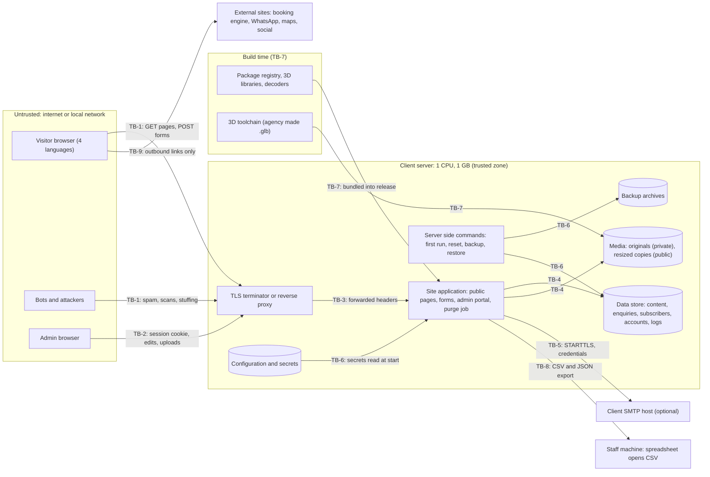

# Threat model: Jazz Casa del Mar resort website

- Client slug: jazz_casa_del_mar
- Project slug: site
- Task: P3-T2 (Security Engineer, Phase 3 early threat model)
- Date: 2026-10-15
- Status: draft for the security gate; revisit after the architecture (Phase 4) and before any hosted use
- Inputs: `docs/brief.md` ("Decisions from Steven" D1 to D7 are authoritative), `docs/requirements.md` (FR-1 to FR-48, NFR-1 to NFR-33, OQ-1 to OQ-19), `docs/assumptions.md` (A-n, RSK-1 to RSK-20), `docs/backlog.md`, `docs/mvp.md`
- Companion: `docs/risk-register.md` (the single project risk register; the security risks from this model are RSK-21 onward)
- Method: assets, actors, entry points and trust boundaries; STRIDE per entry point; likelihood and impact rated High, Medium or Low; mitigations mapped to existing FR and NFR IDs; gaps named with a proposed requirement change. Guidance: OWASP Top 10 2021 and OWASP ASVS 4.0.3.

## 1. Scope and assumptions

### In scope

- The public site: 21 page types in English, German, Italian and Russian (84 URLs, FR-1), including the 3D hero, landing scenes, loader and transitions (FR-27 to FR-31).
- The three public forms: Contact Us (FR-19, FR-20), newsletter sign up (FR-22) and newsletter unsubscribe (FR-23).
- The admin portal: sign in, accounts, content editing in four languages, list items, settings, media library, enquiries, subscribers and export, data subject tool, audit log (FR-32 to FR-46).
- Operation of the package: first run, configuration, purge job, backup and restore, optional SMTP notification (FR-21, FR-45, FR-47, FR-48, NFR-32).
- The build and supply chain: third party libraries (including the 3D and animation libraries and any WebAssembly decoders) and the 3D asset toolchain (FR-31, NFR-26).

### Out of scope

- The JAZ booking engine and any other site reached by an outbound link (FR-11, FR-12). We only control the link.
- The client's server operating system, TLS terminator, firewall and mail server, beyond the requirements the package places on them. The hosting guide (agency:hosting-guide) carries those instructions.
- Physical security, social engineering of client staff beyond the account controls, and volumetric network attacks larger than a single small server can absorb (accepted, see TM-68).

### Assumptions

- **SA-1 Release context.** The release is a package for local review only (D2, FR-47, OQ-13 working answer). It binds to the local machine address by default and refuses a non local address without HTTPS (NFR-18). Ratings in this model nevertheless assume the site **could be reachable from the internet on the client's server**, because the requirements say every requirement still holds if hosted (OQ-13). Where a threat is materially lower in local review, the residual column says so.
- **SA-2 Server.** One small Linux server with 1 CPU, 1 GB memory and 10 GB disk, no database server (an embedded file database or files), TLS terminated in front of the site, no mail server unless OQ-2 is answered yes (A-19, OQ-14).
- **SA-3 Admin users.** Fewer than 10 staff accounts (A-3). The MVP has one staff role, so every staff user can read enquiries and export subscribers (`docs/mvp.md`, OQ-1 not yet answered).
- **SA-4 MVP scope.** Per `docs/backlog.md` and `docs/mvp.md`: two step verification (US-31, FR-33) and draft, preview, publish and version history (US-36, FR-38) are Won't this release; audit log (US-44, FR-46), data subject tool (US-42, FR-44) and backup and restore (US-46, FR-48) are Could; rate limiting (US-66, NFR-21) is Should. This model treats those requirements as **planned but not delivered in the MVP** and states the security consequence.
- **SA-5 Data.** All data in the release is synthetic (FR-47 placeholder content, OQ-16). Real personal data only arrives if the site is ever hosted.
- **SA-6 No technology chosen.** The stack is a Phase 4 decision (DEP-4). The model is technology neutral. Threats whose likelihood or mitigation depends on a stack choice are marked **Stack: Y** and listed in section 9.
- **SA-7 No outbound requests.** The running site makes no request to any external host except the configured SMTP host (NFR-31). There is therefore no server side request forgery surface unless a future feature fetches a user supplied URL.

## 2. Assets

| ID | Asset | Why it matters | Security properties | Where it lives |
| --- | --- | --- | --- | --- |
| AS-1 | Enquiries (name, email, telephone, message, language, consent version and time) | Personal data under UK GDPR (D1); free text may hold anything a visitor types | Confidentiality, integrity, retention (FR-45) | Data store on the server |
| AS-2 | Newsletter subscriber list (email, language, status, consent version) and the suppression list (keyed hashes) | Personal data; a clean list has commercial value; consent evidence for PECR | Confidentiality, integrity (consent records), availability of unsubscribe | Data store; CSV exports on staff machines |
| AS-3 | Admin credentials, password hashes and sessions | Full control of all content and all personal data | Confidentiality, integrity | Data store (hashes), browser cookie (session id), server memory |
| AS-4 | Site content integrity (all text in four languages, list items, settings including the Book now URL) | Defacement, phishing redirection or false claims would harm the client and the agency | Integrity, availability | Data store; rendered pages |
| AS-5 | Uploaded media (originals and resized copies) and their metadata | Originals may carry location data; files are an execution and parser attack vector | Integrity, confidentiality of originals (FR-41) | Media folder outside the public area; public copies |
| AS-6 | Backups (FR-48) | A complete copy of AS-1 to AS-5, AS-7 | Confidentiality, integrity on restore | Archive files on the server or copied elsewhere |
| AS-7 | Configuration and secrets: SMTP host and credentials, session and form token signing keys, the key for the suppression hash, retention values | Exposure lets an attacker forge tokens, read data or abuse the client's mail server | Confidentiality, integrity | Configuration file or environment (NFR-32) |
| AS-8 | The concept notice and the noindex controls (FR-17, FR-39, NFR-27) | The legal safeguard for a speculative, unauthorised concept (D2, RSK-1) | Integrity, availability on every response | Code and content store; every response |
| AS-9 | Audit and security logs (FR-46) | Accountability and detection | Integrity, completeness, no personal data leakage (NFR-14) | Data store or log files |
| AS-10 | Release package and its dependencies, including 3D assets and decoders | Everything shipped runs on the client's server or in visitors' browsers | Integrity, provenance | Repositories and the release zip |
| AS-11 | Service availability on a 1 CPU, 1 GB server | A single server with no paid CDN (D6) | Availability | Server |

## 3. Actors

| ID | Actor | Trust | Typical goals or failure modes |
| --- | --- | --- | --- |
| AC-1 | Anonymous visitor (any of four languages) | Untrusted | Browse, send enquiries, subscribe, unsubscribe |
| AC-2 | Automated bot or spammer | Hostile | Form spam, list poisoning, credential stuffing, scanning |
| AC-3 | Opportunistic attacker | Hostile | Exploit known vulnerabilities, default setups, exposed files and backups |
| AC-4 | Targeted attacker (for example a defacer, or someone seeking to embarrass the client or the agency) | Hostile | Admin takeover, defacement, phishing through the Book now link, removal of the concept notice |
| AC-5 | Malicious or careless subscriber or visitor | Untrusted | Plant payloads (stored XSS, CSV formula injection) for staff to trigger |
| AC-6 | Editor (if OQ-1 introduces the role) | Partly trusted | Edit content; might try to reach Administrator functions |
| AC-7 | Administrator | Trusted but fallible | Mistakes, reused passwords, phishing victim, departing staff with a copy of the list |
| AC-8 | Server operator (client IT or Steven) | Trusted | Install, configure, back up, restore; may misconfigure permissions or the proxy |
| AC-9 | Local reviewer | Trusted | Runs the package on one computer; may expose it on a shared network |
| AC-10 | Supply chain attacker | Hostile, indirect | Compromise a package, decoder or toolchain used by the build |
| AC-11 | Network attacker on the same network | Hostile | Intercept traffic if TLS is missing (SMTP or HTTP) |

## 4. Entry points

| ID | Entry point | Who reaches it | Requirements |
| --- | --- | --- | --- |
| EP-1 | Public pages and static assets (GET), site root language redirect | AC-1, AC-2, AC-3 | FR-1 to FR-18, FR-24 to FR-26, NFR-15, NFR-27 |
| EP-2 | Contact form submission | AC-1, AC-2, AC-5 | FR-19, FR-20, FR-21 |
| EP-3 | Newsletter sign up | AC-1, AC-2, AC-5 | FR-22 |
| EP-4 | Newsletter unsubscribe | AC-1, AC-2 | FR-23 |
| EP-5 | Admin sign in, sign out, session, first run setup | AC-2, AC-3, AC-4, AC-7 | FR-32, FR-33, FR-47, NFR-5, NFR-19, NFR-20 |
| EP-6 | Content and list editing in four languages | AC-6, AC-7 (and anyone who takes over an account) | FR-35 to FR-38 |
| EP-7 | Site settings (Book now URL, contact links, concept notice wording) | AC-6, AC-7 | FR-17, FR-39 |
| EP-8 | Media upload and library | AC-6, AC-7 | FR-40, FR-41, NFR-23 |
| EP-9 | Enquiry reading and deletion | AC-7 | FR-42 |
| EP-10 | Subscriber list and CSV export | AC-7 | FR-43 |
| EP-11 | Account management | AC-7 | FR-34 |
| EP-12 | Data subject tool and audit log view | AC-7 | FR-44, FR-46 |
| EP-13 | 3D scenes, WebGL code, decoders and front end libraries | Build pipeline (AC-10) into every visitor browser | FR-27 to FR-31, NFR-7, NFR-8, NFR-12, NFR-24, NFR-26 |
| EP-14 | Operations: configuration file, server side commands (first run, password reset, backup, restore), purge job, outbound SMTP, reverse proxy headers | AC-8, AC-9, AC-11 | FR-21, FR-45, FR-47, FR-48, NFR-17, NFR-18, NFR-21, NFR-32 |
| EP-15 | Raw request handling on the single server (all routes) | AC-2, AC-3 | NFR-10, NFR-21, NFR-31 |

## 5. Trust boundaries and data flow

| ID | Boundary | What crosses it |
| --- | --- | --- |
| TB-1 | Visitor browser to the site (through the TLS terminator) | Page requests, form posts, static and 3D asset requests |
| TB-2 | Admin browser to the admin portal (authenticated) | Session cookie, content edits, uploads, enquiry and subscriber reads, CSV and JSON downloads |
| TB-3 | TLS terminator or reverse proxy to the application | Decrypted requests and forwarding headers (client address, scheme) |
| TB-4 | Application to its storage (data store, media folder, originals, backups, logs) | All personal data and content |
| TB-5 | Application to the SMTP host (optional, FR-21) | Notification email and SMTP credentials |
| TB-6 | Server operator shell to the application (server side commands, configuration) | Secrets, first Administrator creation, backup and restore archives |
| TB-7 | Package registry and 3D toolchain to the release package (build time) | Third party code, WebAssembly decoders, `.glb` files |
| TB-8 | Exported files to staff machines (CSV, JSON, backup copies) | Personal data leaves the server; spreadsheet software interprets CSV |
| TB-9 | Public site to external sites (booking engine, WhatsApp, maps, social) | Outbound navigation only, `rel="noopener noreferrer"` (FR-11, FR-12) |

## 6. Rating method

Likelihood (L) and impact (I) are High, Medium or Low. The inherent rating, before planned mitigations, comes from this matrix:

| Likelihood \ Impact | High | Medium | Low |
| --- | --- | --- | --- |
| High | High | High | Medium |
| Medium | High | Medium | Low |
| Low | Medium | Low | Low |

"Residual (MVP)" is the expected rating once the planned mitigations in the MVP scope are built **and** the gap fixes proposed in section 8 are adopted, while the deferred stories (US-31, US-36, US-44) stay deferred. Where the default local review package is materially lower, it is shown as "Low local". STRIDE letters: S spoofing, T tampering, R repudiation, I information disclosure, D denial of service, E elevation of privilege.

## 7. Threats by entry point (STRIDE)

### EP-1 Public pages and static assets

| ID | STRIDE | Threat | L | I | Rating | Planned mitigations | Gap | Residual (MVP) | Stack |
| --- | --- | --- | --- | --- | --- | --- | --- | --- | --- |
| TM-01 | S | The concept is taken for the official resort site (look alike phishing or confusion), especially if hosted | M | H | High | FR-16, FR-17, FR-18, NFR-27, FR-47 local only | G-6 | Medium (Low local) | |
| TM-02 | T, I | Traffic intercepted or altered in transit when reachable from another machine | L | H | Medium | NFR-18 (HTTPS, refuse non local without HTTPS), NFR-24 (HSTS) | | Low | |
| TM-03 | I | Error pages, version headers, source maps or directory listings reveal software versions and paths | M | L | Low | FR-13, NFR-26 (no stack traces, versions) | G-8 | Low | Y |
| TM-04 | I | Path traversal in a language segment or static file route reads the data folder, originals or configuration | L | H | Medium | NFR-18 (no public URL to data, originals, backups), NFR-24 (validation) | | Low | Y |
| TM-05 | T | Open redirect through the root language redirect or language switcher fallback | L | L | Low | FR-25 (fixed set of four languages), FR-24 | | Low | |
| TM-06 | D | Repeated requests for 3D assets (up to 3 MB) and pages saturate the single CPU or uplink | M | M | Medium | NFR-7 asset caps, NFR-10 | G-13 | Medium | Y |
| TM-07 | I | Third party requests (fonts, CDNs, map tiles) leak visitor addresses | L | M | Low | NFR-15 (zero requests to other hosts), NFR-31, FR-6 | | Low | |

### EP-2 Contact form

| ID | STRIDE | Threat | L | I | Rating | Planned mitigations | Gap | Residual (MVP) | Stack |
| --- | --- | --- | --- | --- | --- | --- | --- | --- | --- |
| TM-08 | D, T | Automated spam floods the enquiry store and the admin portal, filling disk and burying real enquiries; no third party captcha (D6, RSK-5) | H | M | High | FR-20 spam trap and 2 second minimum, NFR-21 (5 per hour per address, Should), NFR-23 storage cap is for media only | G-9, G-10, G-13 | Medium (Low local) | Y |
| TM-09 | T, E | Stored XSS against staff: a visitor puts script in name, email or message, which runs when an Administrator opens the enquiry | M | H | High | NFR-24 (context encoding, CSP without `unsafe-inline`), FR-19 length and format rules | G-8 | Low | Y |
| TM-10 | S | Cross site request forgery posts enquiries in a visitor's name from another site | L | L | Low | NFR-22 (form token and `Origin` check). The public site sets no cookie (NFR-15, A-18), so the token must be a signed form token, not a session token | G-9 | Low | Y |
| TM-11 | I | Enquiry content read by guessing the reference (`ENQ-` plus 6 characters) or a confirmation URL | L | M | Low | FR-20 (confirmation shows only the reference), NFR-25 (record level checks; the reference is never an access key) | | Low | |
| TM-12 | T | Email header injection through enquiry fields when notification is on | L | M | Low | FR-21 (no visitor data in the email); FR-21 is Won't in the MVP | | Low | |
| TM-13 | I | Enquiry text or addresses written to application logs | M | M | Medium | NFR-14 (logs exclude enquiry text, emails), FR-46 exclusions | | Low | Y |

### EP-3 Newsletter sign up

| ID | STRIDE | Threat | L | I | Rating | Planned mitigations | Gap | Residual (MVP) | Stack |
| --- | --- | --- | --- | --- | --- | --- | --- | --- | --- |
| TM-14 | D, R | Bulk sign up of third party addresses (list poisoning); consent cannot be proven without double opt in (OQ-11) | H | M | High | FR-22 (consent tick and version recorded), NFR-21 (Should). FR-22 has no spam trap or minimum time | G-9, G-10 | Medium (Low local) | |
| TM-15 | I | Enumeration of subscribed addresses through different messages or response times | M | L | Low | FR-22 (same message for an existing subscriber) | G-11 | Low | Y |
| TM-16 | T | A formula payload is stored as a valid email local part (for example `=HYPERLINK(...)@example.com`, characters `=`, `+`, `-` are legal in the local part) for later CSV export | M | H | High | FR-22 format check does not block it; see TM-47 | G-4 | Low | |

### EP-4 Newsletter unsubscribe

| ID | STRIDE | Threat | L | I | Rating | Planned mitigations | Gap | Residual (MVP) | Stack |
| --- | --- | --- | --- | --- | --- | --- | --- | --- | --- |
| TM-17 | I | Enumeration of subscribers through unsubscribe messages or response times | M | L | Low | FR-23 (same message whether or not subscribed) | G-11 | Low | Y |
| TM-18 | T, D | Anyone unsubscribes anyone, including by a scripted list (no proof of ownership, RSK-11) | M | L | Low | FR-23, NFR-21 (10 per hour, Should); accepted by RSK-11 | G-9, G-10 | Low | |
| TM-19 | R | An unsubscribe fails to match because of letter case or surrounding spaces, so the person stays on the exported list (PECR exposure) | M | M | Medium | None: FR-22, FR-23 and FR-44 do not define how addresses are compared | G-12 | Low | |

### EP-5 Admin sign in, session and first run

| ID | STRIDE | Threat | L | I | Rating | Planned mitigations | Gap | Residual (MVP) | Stack |
| --- | --- | --- | --- | --- | --- | --- | --- | --- | --- |
| TM-20 | S | Credential stuffing or password spraying against the few admin accounts | M | H | High | NFR-19 (12 characters, breached list, lockout 5 per 15 minutes, Argon2id), NFR-21 (20 per 15 minutes per address, Should) | G-10 | Medium (Low local) | |
| TM-21 | S | Account takeover by phishing or password reuse, with no second factor because FR-33 (US-31) is Won't this release | M | H | High | NFR-19, NFR-20, FR-32 generic errors. FR-33 would mitigate but is deferred | G-22, G-23 | High if hosted, Low local | |
| TM-22 | S, I | Session theft by script or network | L | H | Medium | NFR-20 (`HttpOnly`, `Secure`, `SameSite=Strict`, 128 bit id, timeouts), NFR-24 CSP, NFR-18 HTTPS | | Low | Y |
| TM-23 | S | Session fixation | L | H | Medium | NFR-20 (new id at sign in) | | Low | Y |
| TM-24 | D | An attacker locks every admin account by sending 5 wrong passwords each per 15 minutes (lock applies whatever the source) | M | M | Medium | NFR-19 (15 minute lock), FR-34 (password reset by command) | G-21 | Medium | |
| TM-25 | I | Account enumeration through sign in messages or timing | L | L | Low | FR-32 (one generic message), NFR-19 (timing within 100 ms) | | Low | |
| TM-26 | E | First run hijack: whoever reaches a freshly started, network reachable install first creates the first Administrator | M | H | High | FR-47 (local address by default, no default credentials), NFR-18 | G-1 | Low (Medium if hosted without G-1) | |
| TM-27 | S | Login CSRF or sign out CSRF | L | L | Low | NFR-22 (tokens on every state change, sign out by POST), NFR-20 `SameSite=Strict` | | Low | |
| TM-28 | R | A takeover or misuse goes unnoticed because the audit log (FR-46, US-44) is Could and nothing else records security events | M | M | Medium | FR-46 (deferred), NFR-14 | G-2, G-23 | Low | |
| TM-29 | S | Sessions survive a password reset by an Administrator or the disabling of an account | L | M | Low | NFR-20 (ends on the user's own password change) | G-19 | Low | |

### EP-6 Content and list editing in four languages

| ID | STRIDE | Threat | L | I | Rating | Planned mitigations | Gap | Residual (MVP) | Stack |
| --- | --- | --- | --- | --- | --- | --- | --- | --- | --- |
| TM-30 | T, E | Stored XSS through "edit everything" rich text in any of the four languages: sanitiser bypass, mutation XSS, `javascript:` or encoded scheme links, or a language value that skips sanitising | M | H | High | FR-35 (paragraphs, bold, italic, links, lists only), NFR-24 (allow list sanitiser, scheme allow list, CSP without `unsafe-inline` or `unsafe-eval`) | G-7, G-8 | Low | Y |
| TM-31 | T, E | XSS through plain text fields placed in attribute, head or script contexts (browser title, meta description, alt text, captions, a JSON data island passed to the 3D scene or transitions) | M | H | High | NFR-24 (encoding for each context) | G-8 | Low | Y |
| TM-32 | T | Bidirectional control or invisible characters disguise link targets or alter the visible concept notice | L | M | Low | None | G-7 | Low | |
| TM-33 | T, D | Defacement or mass deletion (compromised account, malicious Editor or mistake) with no version history (US-36 Won't) and no backup command (US-46 Could) | M | H | High | FR-36 (confirmation before delete), NFR-33 (all or nothing saves) | G-3 | Medium | |
| TM-34 | E | An Editor reaches Administrator functions (enquiries, export, accounts) by direct request; in the MVP every staff user has all permissions (one role) | M | M | Medium | NFR-25 (deny by default, server side roles), FR-34 roles (provisional OQ-1) | | Medium until OQ-1 | |
| TM-35 | T | Two editors overwrite each other's changes | L | L | Low | NFR-33 (Should) | | Low | |

### EP-7 Site settings

| ID | STRIDE | Threat | L | I | Rating | Planned mitigations | Gap | Residual (MVP) | Stack |
| --- | --- | --- | --- | --- | --- | --- | --- | --- | --- |
| TM-36 | T | A malicious settings value: Book now pointed at a phishing booking page, or a social, maps or WhatsApp link set to `javascript:` or `data:` and rendered on every page | L | H | Medium | FR-39 (Book now must start with `https://`), FR-12 (`rel="noopener noreferrer"`), NFR-24 | G-5 | Low | |
| TM-37 | T | The concept notice is emptied with whitespace or invisible characters, or rewritten to claim the site is official, removing the legal safeguard | M | H | High | FR-17 (never empty), FR-39 (no setting removes it), OQ-5 | G-6 | Low | |
| TM-38 | T | Noindex is switched off through configuration, or a proxy strips the header | L | M | Low | NFR-27 (header and meta tag, no admin setting) | | Low | |

### EP-8 Media upload and library

| ID | STRIDE | Threat | L | I | Rating | Planned mitigations | Gap | Residual (MVP) | Stack |
| --- | --- | --- | --- | --- | --- | --- | --- | --- | --- |
| TM-39 | E, T | Malicious upload runs on the server or in browsers: web shell, polyglot, SVG or HTML with script, wrong extension | L | H | Medium | NFR-23 (content check, allow list JPEG, PNG, WebP, AVIF, no SVG, random names, no script execution, `nosniff`), FR-41 (re-encoded copies only are public) | | Low | Y |
| TM-40 | D | Decompression bomb or very large dimensions, or many concurrent uploads, exhaust 1 GB memory or the CPU | M | M | Medium | NFR-23 (10 MB, 40 megapixels, 20 per batch), NFR-21 (30 per hour, Should), NFR-10 | G-13, G-14 | Low | Y |
| TM-41 | E | A vulnerability in the image decoder or resizer is triggered by a crafted file (no antivirus at zero cost, RSK-13) | L | H | Medium | NFR-26 (dependency audit), FR-41 re-encode, NFR-23 | G-14 | Low | Y |
| TM-42 | I | Location and camera metadata in photos is published | L | M | Low | FR-41 (strip all metadata from public copies; originals private) | | Low | |
| TM-43 | T | Path characters in uploaded file names write outside the media folder | L | H | Medium | NFR-23 (random stored names, path characters never reach the file system) | | Low | Y |
| TM-44 | D | Media storage fills the 10 GB disk | L | M | Low | NFR-23 (2 GB cap, warning at 80 percent) | | Low | |

### EP-9 Enquiry reading

| ID | STRIDE | Threat | L | I | Rating | Planned mitigations | Gap | Residual (MVP) | Stack |
| --- | --- | --- | --- | --- | --- | --- | --- | --- | --- |
| TM-45 | I | Enquiries read without permission by guessing identifiers or calling an unprotected data route | M | H | High | FR-32 (sign in for every admin data request), NFR-25 (record level checks, deny by default) | | Low | Y |
| TM-46 | I | Enquiry pages kept in a shared or browser cache | L | M | Low | NFR-20 (`Cache-Control: no-store`) | | Low | |

### EP-10 Subscriber list and export

| ID | STRIDE | Threat | L | I | Rating | Planned mitigations | Gap | Residual (MVP) | Stack |
| --- | --- | --- | --- | --- | --- | --- | --- | --- | --- |
| TM-47 | T, E | CSV formula injection: an exported cell starting with `=`, `+`, `-`, `@`, a tab or a carriage return runs as a formula in a spreadsheet (data exfiltration through `HYPERLINK` or `WEBSERVICE`, or command execution through DDE in older software) | M | H | High | FR-43 (escape cells starting with `=`, `+`, `-`, `@`), AC-41.3 | G-4 | Low | |
| TM-48 | I | Bulk copy of the whole list by a compromised or departing staff member, unnoticed | M | H | High | NFR-25, FR-34 roles (one role in MVP), FR-43 audit entry (deferred with FR-46) | G-2 | Medium | |
| TM-49 | D | A large export ties up the single CPU | L | L | Low | NFR-10 (10,000 rows in 10 s) | G-13 | Low | Y |

### EP-11 Account management

| ID | STRIDE | Threat | L | I | Rating | Planned mitigations | Gap | Residual (MVP) | Stack |
| --- | --- | --- | --- | --- | --- | --- | --- | --- | --- |
| TM-50 | E | An Editor creates an Administrator or changes its own role (mass assignment, missing server check) | L | H | Medium | NFR-25, FR-34 (roles enforced on the server; last Administrator protected) | | Low | Y |
| TM-51 | S | A weak temporary password set by an Administrator stays in use | L | M | Low | FR-34 (must change at first sign in), NFR-19 | | Low | |

### EP-12 Data subject tool and audit log

| ID | STRIDE | Threat | L | I | Rating | Planned mitigations | Gap | Residual (MVP) | Stack |
| --- | --- | --- | --- | --- | --- | --- | --- | --- | --- |
| TM-52 | I | The data subject tool is used to profile a person across enquiries and subscriptions without a request | L | M | Low | NFR-25 (Administrator only), FR-46 (tool use logged); both deferred in the MVP | G-2 | Low | |

### EP-13 3D scenes, WebGL and front end supply chain

| ID | STRIDE | Threat | L | I | Rating | Planned mitigations | Gap | Residual (MVP) | Stack |
| --- | --- | --- | --- | --- | --- | --- | --- | --- | --- |
| TM-53 | T, E | A compromised dependency (3D library, loader, animation or transition library, build tool) injects code into the public bundle or runs an install script on the build machine | M | H | High | NFR-26 (lock file, dependency audit), NFR-31 (licence allow list), NFR-15 (same origin only) | G-18 | Medium | Y |
| TM-54 | T | A tampered or malformed `.glb` or WebAssembly decoder (Draco, meshopt, Basis), or a glTF that references an external URI | L | M | Low | FR-31 (agency made models), NFR-15, NFR-24 CSP (`default-src 'self'`, `wasm-unsafe-eval` only if needed) | G-18 | Low | Y |
| TM-55 | D | A scene exhausts the visitor's GPU or memory, or loses the WebGL context | M | L | Low | NFR-8 (triangle, draw call and memory caps, adaptive quality), NFR-12 (fallback on context loss) | | Low | Y |
| TM-56 | T | The content security policy is weakened (`unsafe-eval`, `unsafe-inline`, broad worker sources) to make a 3D or animation library work, reopening XSS | M | M | Medium | NFR-24, RSK-17 (choose compatible libraries) | | Low | Y |
| TM-57 | T | The 3D authoring or export toolchain (add-ons, scripts) is compromised and alters assets | L | M | Low | FR-31 (source files and authorship statement) | G-18 | Low | Y |

### EP-14 Operations: configuration, commands, purge, backups, SMTP, proxy

| ID | STRIDE | Threat | L | I | Rating | Planned mitigations | Gap | Residual (MVP) | Stack |
| --- | --- | --- | --- | --- | --- | --- | --- | --- | --- |
| TM-58 | I | Backup archives (all personal data, password hashes, settings) are left in a served folder, kept forever, copied to an insecure place or readable by other server users | M | H | High | NFR-18 (no public URL), NFR-17 (35 days), FR-48 (marked as personal data), RSK-15 hosting guide | G-15 | Medium | |
| TM-59 | T, E | A crafted archive restored with the restore command writes outside the data folder (path traversal, links) or replaces configuration | L | H | Medium | FR-48 (restore into an empty install) | G-15 | Low | Y |
| TM-60 | I | SMTP credentials exposed through a world readable configuration file, logs, error pages, backups, the admin portal or the repository | L | M | Low (Medium once FR-21 is built) | NFR-26 (no secrets in repos or package, no details in errors), NFR-32 (example file without secrets) | G-16, G-17 | Low | |
| TM-61 | I | SMTP traffic and credentials sent without TLS | L | M | Low | None | G-16 | Low | Y |
| TM-62 | S | Signing keys (session, form token, suppression hash key) are shipped as defaults, shared between installs or weak, so tokens can be forged | L | H | Medium | NFR-26 (no secrets in the package, read from configuration) | G-17 | Low | Y |
| TM-63 | I, T | The data folder or configuration is readable or writable by other local accounts | L | H | Medium | NFR-18 | G-17 | Low | |
| TM-64 | R | The purge job fails silently and personal data is kept beyond its retention period | M | M | Medium | FR-45 (runs logged in the audit log, deferred with FR-46) | G-2 | Low | |
| TM-65 | S, D | Rate limits bypassed with a forged `X-Forwarded-For`, or every visitor shares the proxy's address and is blocked together | M | M | Medium | NFR-21, RSK-12 (hosting guide) | G-20 | Low | Y |

### EP-15 Raw request handling on a 1 CPU server

| ID | STRIDE | Threat | L | I | Rating | Planned mitigations | Gap | Residual (MVP) | Stack |
| --- | --- | --- | --- | --- | --- | --- | --- | --- | --- |
| TM-66 | D | Concurrent sign in attempts each take 19 MiB of Argon2id memory and CPU time, exhausting 1 GB | M | M | Medium | NFR-19, NFR-21 (Should) | G-13 | Low | Y |
| TM-67 | D | Slow requests, very large bodies, or catastrophic regular expression backtracking in validation or the sanitiser block the single worker | M | M | Medium | NFR-24 (length validation), NFR-10 | G-13 | Low | Y |
| TM-68 | D | A volumetric flood larger than one small server and link can absorb | L | M | Low | Accepted: no paid CDN or scrubbing (D6, RSK-5); hosting guide covers the reverse proxy | | Low (accepted) | |

### Threat count

| Rating | Inherent (before mitigations) | Residual (MVP, after planned mitigations and gap fixes) |
| --- | --- | --- |
| High | 17 | 1 if hosted (TM-21), 0 in local review |
| Medium | 24 | 11 |
| Low | 27 | 56 |
| Total | 68 | 68 |

- Inherent High (17): TM-01, TM-08, TM-09, TM-14, TM-16, TM-20, TM-21, TM-26, TM-30, TM-31, TM-33, TM-37, TM-45, TM-47, TM-48, TM-53, TM-58.
- Residual Medium (11): TM-01, TM-06, TM-08, TM-14, TM-20, TM-24, TM-33, TM-34, TM-48, TM-53, TM-58. Of these, TM-01, TM-08, TM-14 and TM-20 drop to Low in local review.
- Residual High: TM-21 (admin takeover without a second factor) on any reachable server; Low in local review. G-22 makes the hosted case impossible without FR-33.
- 31 of the 68 threats are stack dependent (marked Y; see section 9).

## 8. Requirement gaps

Each gap is a threat that no existing requirement mitigates, or mitigates only partly. The proposed wording is for the Requirements Analyst to adopt or adjust through the change log; backlog changes go to the Product Owner.

| ID | Threats | Requirement to add or change | Proposed wording |
| --- | --- | --- | --- |
| G-1 | TM-26 | Change FR-47 | "The first Administrator shall be created only by a documented server side command, or by a setup screen that requires a single use setup code printed to the server console at first start and expiring after 60 minutes; until an Administrator exists every other admin request shall be refused." |
| G-2 | TM-28, TM-48, TM-52, TM-64 | Add NFR-34 Security event log (Must), because FR-46 (US-44) is Could | "Even when the audit log screen (FR-46) is not built, the server shall write a security event record (time, account identifier, event, result, no personal data beyond the account identifier) for every sign in success and failure, lockout, password change or reset, account change, subscriber export with row count, enquiry deletion and purge run, kept for 12 months." |
| G-3 | TM-33 | Change FR-48 and promote US-46 to Must (US-36 stays Won't) | "The package shall run the backup command automatically once every 24 hours (configurable, on by default), keeping archives for the period in NFR-17, so content and records can be restored after defacement or mass deletion." |
| G-4 | TM-16, TM-47 | Change FR-43 | "The export shall quote every cell and shall prefix with a single quote any cell whose first character is `=`, `+`, `-`, `@`, a tab (U+0009) or a carriage return (U+000D); the same rule shall apply to every CSV file the site produces." |
| G-5 | TM-36 | Change FR-39 | "Every URL setting (Book now, Google Maps and the five social links) shall be an absolute `https://` URL without a user name or password part and at most 2,048 characters; telephone and WhatsApp values shall contain only digits, spaces and a leading plus sign; the email address shall be a valid address." |
| G-6 | TM-01, TM-37 | Change FR-17 (and close OQ-5) | "The concept notice shall start with a fixed statement per language, held in code and not editable, that the site is an unofficial concept not affiliated with JAZ Hotels; the admin portal may edit only an optional plain text addition of at most 200 characters after it." |
| G-7 | TM-30, TM-32 | Change NFR-24 | "The rich text sanitiser shall run on save for every language value and its output shall still be encoded on render; plain text fields shall reject bidirectional control characters (U+202A to U+202E, U+2066 to U+2069) and invisible format characters other than those the four languages need." |
| G-8 | TM-03, TM-09, TM-30, TM-31 | Change NFR-24 | "The headers in this requirement shall be sent on every response of the public site, error pages and the admin portal; responses shall not carry server or framework version headers; source maps shall not be served; and the admin portal shall show enquiry, subscriber and media metadata only as encoded text." |
| G-9 | TM-08, TM-10, TM-14, TM-18 | Change FR-22 and FR-23 (and clarify NFR-22) | "Newsletter sign up and unsubscribe shall apply the spam trap field and 2 second minimum of FR-20; the time the form was shown shall be carried in a signed, tamper evident form token (no cookie), which also serves as the anti forgery token for public forms in NFR-22." |
| G-10 | TM-08, TM-14, TM-18, TM-20 | Backlog: promote US-66 (NFR-21) from Should to Must | "Rate limits for admin sign in, the contact form, newsletter sign up and unsubscribe are part of the MVP, because with no captcha (D6) and no second factor (US-31 Won't) they are the main control against automated abuse." |
| G-11 | TM-15, TM-17 | Change FR-22 and FR-23 | "The response time for an address that is subscribed and one that is not shall not differ by more than 100 ms at the median." |
| G-12 | TM-19 | Change FR-22, FR-23 and FR-44 | "Email addresses shall be compared after trimming surrounding spaces and ignoring letter case, for duplicate detection, unsubscribe, the suppression list and data subject searches." |
| G-13 | TM-06, TM-08, TM-40, TM-49, TM-66, TM-67 | Add NFR-35 Resource limits | "The server shall reject request bodies over 64 KB on public forms and over 1 MB on admin requests other than uploads; close connections that send no complete request within 30 s; run at most one image processing job and at most two password hash computations at a time, queueing the rest; send long cache lifetimes for fingerprinted static and 3D assets; and cap stored enquiries and subscribers (default 50,000 each) with an admin warning at 80 percent." |
| G-14 | TM-40, TM-41 | Change NFR-23 | "Image dimensions shall be read from the file header and checked before full decoding, and every image shall be decoded and re-encoded in a separate worker or process with a time limit of 60 s and a memory limit of 256 MB; a failure shall reject the upload and leave the site serving." |
| G-15 | TM-58, TM-59 | Change FR-48 | "Archives shall be written outside any served folder with permissions that allow only the account running the site, shall exclude live sessions and rate limit counters, may be encrypted with a passphrase from configuration, and the restore command shall refuse an archive containing absolute paths, `..` segments or links." |
| G-16 | TM-60, TM-61 | Change FR-21 | "SMTP shall use TLS (implicit TLS or required STARTTLS with certificate verification); SMTP credentials shall be read only from server configuration and shall never be shown in the admin portal or written to logs, error pages or backup archives." |
| G-17 | TM-60, TM-62, TM-63 | Change NFR-32 | "The configuration file and data folder shall be readable and writable only by the account running the site, and the site shall refuse to start if they are readable by other accounts; signing keys shall be generated randomly per install at first run (at least 256 bits) and never shipped in the package." |
| G-18 | TM-53, TM-54, TM-57 | Change NFR-26 | "The release shall include a software bill of materials; dependency install scripts shall be disabled except for an approved list; any WebAssembly or worker decoder shall come from a pinned dependency and be served from the site's own origin; and every `.glb` file shall pass the Khronos glTF validator with no errors and reference no external URI." |
| G-19 | TM-29 | Change NFR-20 | "All sessions of an account shall end when its password is changed or reset, or when the account is disabled or deleted." |
| G-20 | TM-65 | Change NFR-21 | "The client address shall be taken from a forwarding header only when the direct peer is a configured trusted proxy; by default no forwarding header is trusted." |
| G-21 | TM-24 | Change FR-34 | "A documented server side command shall unlock a locked account, so that a lockout attack cannot keep every Administrator out." |
| G-22 | TM-21 | Change NFR-18 (compensating control for US-31) | "The package shall refuse to start on a non local address unless HTTPS is configured and two step verification (FR-33) is built and enforced for every admin account." |
| G-23 | TM-21, TM-28 | Change FR-32 | "After sign in the portal shall show the time of the account's previous successful sign in and the number of failed attempts since then." |

Also noted for the Product Owner, not a requirement gap: in the MVP every staff user has every permission (one role, OQ-1). That is acceptable for local review with synthetic data, but least privilege (separate Editor and Administrator, FR-34) should return before real enquiries or subscribers exist.

## 9. Stack dependent threats

These threats change in likelihood or in how the mitigation is built depending on Phase 4 choices. The System Architect should address each in the architecture and ADRs.

| Decision (Phase 4) | Threats | What to decide |
| --- | --- | --- |
| Templating and front end framework | TM-09, TM-30, TM-31, TM-56 | Automatic context aware encoding; no raw HTML insertion outside the sanitiser output; how content reaches the 3D scenes and transitions without inline scripts |
| Rich text sanitiser | TM-30 | A maintained allow list sanitiser that runs on the server; same library for all four languages |
| 3D, animation and transition libraries, decoders | TM-53, TM-54, TM-55, TM-56 | Compatibility with the CSP in NFR-24 (no `unsafe-eval`; `wasm-unsafe-eval` only for a decoder); worker sources from `'self'` |
| Session and form token mechanism | TM-10, TM-22, TM-23, TM-62 | Server side sessions or signed cookies; signed form tokens for the cookie free public site; Safari on `http://localhost` (RSK-10) |
| Data store (embedded file database or files) | TM-04, TM-13, TM-45, TM-59 | Parameterised access, file permissions, record level checks, archive format for backup |
| Image processing library | TM-39, TM-40, TM-41, TM-43 | Library maturity and patch cadence; running it in a worker with limits |
| Web server, process model and reverse proxy | TM-03, TM-06, TM-49, TM-65, TM-66, TM-67 | Body and time limits, concurrency on one CPU, trusted proxy configuration, header stripping |
| SMTP client | TM-61 | TLS enforcement and certificate checks |

## 10. OWASP Top 10 2021 mapping

| OWASP Top 10 2021 | Threats | Requirements (existing, and gaps) |
| --- | --- | --- |
| A01 Broken Access Control | TM-34, TM-45, TM-50, TM-52 | FR-32, FR-34, NFR-25 |
| A02 Cryptographic Failures | TM-02, TM-58, TM-61, TM-62 | NFR-18, NFR-19, NFR-20, NFR-24 (HSTS); G-15, G-16, G-17 |
| A03 Injection (including XSS and CSV formula injection) | TM-09, TM-16, TM-30, TM-31, TM-47 | FR-19, FR-35, FR-43, NFR-24; G-4, G-7, G-8 |
| A04 Insecure Design | TM-08, TM-14, TM-24, TM-26, TM-33 | FR-20, FR-47, NFR-21, NFR-33; G-1, G-3, G-9, G-10, G-13, G-21 |
| A05 Security Misconfiguration | TM-03, TM-38, TM-56, TM-63 | NFR-24, NFR-26, NFR-27, NFR-32; G-8, G-17 |
| A06 Vulnerable and Outdated Components | TM-41, TM-53, TM-54 | NFR-26; G-14, G-18 |
| A07 Identification and Authentication Failures | TM-20, TM-21, TM-22, TM-23, TM-25, TM-29 | FR-32, FR-33 (deferred), FR-34, NFR-5, NFR-19, NFR-20; G-19, G-22, G-23 |
| A08 Software and Data Integrity Failures | TM-53, TM-57, TM-59 | NFR-26 (lock file), FR-31, FR-48; G-15, G-18 |
| A09 Security Logging and Monitoring Failures | TM-28, TM-48, TM-64 | FR-46 (Could), FR-45; G-2, G-23 |
| A10 Server Side Request Forgery | none today (SA-7) | NFR-31 (no outbound requests except SMTP). Keep it that way: no feature may fetch a user supplied URL |

## 11. ASVS level and mapping

**Recommendation: OWASP ASVS 4.0.3 Level 2 for the whole application**, with one declared deviation for the local review release.

Reason: Level 1 is meant for low assurance applications. This site holds personal data (enquiries, the subscriber list), lets staff change every word on a site that carries a legal safeguard (the concept notice), and processes uploaded files on the server. Those are the conditions ASVS describes for Level 2 (applications that contain sensitive data and need protection against most risks). Level 3 (critical applications) would be disproportionate for a speculative concept with fewer than 10 staff.

Declared deviation: ASVS Level 2 aligns its authentication chapter with NIST SP 800-63B at AAL2, which expects a second factor. With FR-33 (US-31) deferred, the MVP meets the Level 2 password, lockout and session requirements but not multi factor authentication. This is acceptable only while the package runs in local review with synthetic data, and G-22 turns the condition into a technical control.

| ASVS 4.0.3 chapter | Key requirements for this project | Project requirements |
| --- | --- | --- |
| V1 Architecture, design and threat modelling | Threat model maintained; trust boundaries; components documented | This document; Phase 4 ADRs; DEP-4 |
| V2 Authentication | Password length and breached list (2.1), anti automation (2.2.1), multi factor (2.2, deviation), credential storage (2.4), recovery without weakness (2.5), first run without default credentials | FR-32, FR-33 (deferred), FR-34, FR-47, NFR-5, NFR-19; G-1, G-21, G-22, G-23 |
| V3 Session management | Random identifiers, rotation at sign in, timeouts, cookie attributes, termination on password change | NFR-20; G-19 |
| V4 Access control | Deny by default, server side enforcement, record level checks | FR-34, NFR-25 |
| V5 Validation, sanitisation and encoding | Server side validation, HTML sanitisation, output encoding, CSV injection (5.3.x) | FR-19, FR-20, FR-22, FR-35, FR-39, FR-43, NFR-24; G-4, G-5, G-7, G-8 |
| V6 Stored cryptography | Approved hashing, random key generation, keyed hash for the suppression list | NFR-19, retention schedule (suppression entry); G-15, G-17 |
| V7 Error handling and logging | No sensitive data in errors or logs; security events logged | FR-13, FR-46, NFR-14, NFR-26; G-2 |
| V8 Data protection | No caching of sensitive responses, data minimisation, retention, metadata removal | FR-41, FR-45, NFR-14, NFR-17, NFR-18, NFR-20 |
| V9 Communication | TLS for all client connections and for SMTP | NFR-18, NFR-24 (HSTS); G-16 |
| V10 Malicious code | Integrity of dependencies and build, no unexpected outbound calls | NFR-15, NFR-26, NFR-31, FR-31; G-18 |
| V11 Business logic | Anti automation of forms, realistic limits | FR-20, NFR-21; G-9, G-10, G-13 |
| V12 Files and resources | Upload type and size checks, no execution, file name handling, archive extraction | FR-40, FR-41, FR-48, NFR-23; G-14, G-15 |
| V13 API and web service | Anti forgery, method rules, authorisation on every data request | NFR-22, NFR-25 |
| V14 Configuration | Secure headers, no debug, dependency hygiene, secrets out of code | NFR-24, NFR-26, NFR-32; G-8, G-17 |

## 12. Specific topics

**Admin account takeover with no two step verification.** TM-20, TM-21, TM-24, TM-26. Passwords alone protect an account that can rewrite every page and export the list. In local review the portal is reachable only from the reviewer's own machine, so the residual is Low; on a reachable server it is High. Compensating controls: NFR-19, NFR-20, rate limits promoted to Must (G-10), first run hijack closed (G-1), lockout unlock (G-21), previous sign in shown (G-23), and a hard stop on non local binding without FR-33 (G-22).

**Stored XSS through "edit everything" rich text in four languages.** TM-30, TM-31, TM-32, TM-09. The defence is layered: an allow list sanitiser on save for every language value (G-7), context encoding on render, and a strict CSP on every response including the admin portal (NFR-24, G-8). Data passed to the 3D scenes must reach them as encoded data, never as inline script (section 9).

**Malicious uploads.** TM-39 to TM-44. NFR-23 and FR-41 are strong: content based type check, raster only, re-encode, random names, no execution. Remaining work: check dimensions before decoding and isolate decoding with limits (G-14), and serialise processing on one CPU (G-13).

**CSV formula injection in subscriber exports.** TM-16, TM-47. The email format check cannot stop it because `=`, `+` and `-` are legal in the local part. FR-43 misses tab and carriage return and does not say how to escape; G-4 fixes both.

**Form spam and abuse without a third party captcha.** TM-08, TM-14, TM-18. The spam trap and minimum time exist only on the contact form, and rate limiting is Should. G-9 extends the trap to the newsletter forms using a signed form token (no cookie); G-10 promotes rate limiting; G-13 caps storage.

**CSRF.** TM-10, TM-27. NFR-22 plus `SameSite=Strict` cover the admin portal. The public site has no cookie, so its forms use a signed form token and the `Origin` check (G-9 clarifies this).

**Enumeration via newsletter unsubscribe.** TM-15, TM-17, TM-19. Same message is required (FR-22, FR-23); same timing is not (G-11). Address comparison is undefined, which can make an unsubscribe silently fail (G-12).

**3D asset and WebGL supply chain.** TM-53 to TM-57. Models are agency made and same origin; the real exposure is the library and decoder dependency tree and pressure to weaken the CSP. G-18 adds a software bill of materials, controlled install scripts, pinned same origin decoders and glTF validation.

**Backup exposure.** TM-58, TM-59. Backups concentrate every asset. G-15 adds owner only permissions, exclusion of sessions, optional encryption and safe restore. G-3 makes backups exist at all in the MVP.

**SMTP credential exposure.** TM-60, TM-61. Only relevant once FR-21 is built (US-14 is Won't). G-16 requires TLS and keeps the credentials out of the portal, logs and backups; G-17 locks down the configuration file.

**Denial of service on a 1 CPU server.** TM-06, TM-40, TM-49, TM-66, TM-67, TM-68, TM-24. The server is small by design (D6). G-13 adds body, time, concurrency and storage limits and cache lifetimes for 3D assets; volumetric floods are accepted (TM-68).

## 13. Deferred stories and their security consequence

| Deferred story | Security consequence | Compensating control |
| --- | --- | --- |
| US-31 two step verification (FR-33), Won't | Account takeover by phishing or reused password is not stopped by anything but the password; deviation from ASVS Level 2 | NFR-19, NFR-20, G-10, G-22, G-23. Acceptable for local review only |
| US-36 draft, preview, publish and version history (FR-38), Won't | Every save is live at once; a defacement or a mistaken mass edit cannot be rolled back from within the portal | G-3 (automatic backups, promote US-46 to Must) |
| US-44 audit log (FR-46), Could | No record of sign ins, exports, deletions or purge runs; repudiation and undetected misuse | G-2 (minimal security event log as Must) |
| US-46 backup and restore (FR-48), Could | No recovery path in the MVP | G-3 |
| US-66 rate limiting (NFR-21), Should | Automated abuse limited only by the spam trap and account lockout | G-10 |
| US-42 data subject tool (FR-44), Could | Rights handled manually; no direct security consequence | None needed |

## 14. Next steps

1. Requirements Analyst: adopt or adjust G-1 to G-23 through the change log; Product Owner: decide the backlog changes in G-2, G-3 and G-10.
2. System Architect (Phase 4): answer section 9 in the ADRs and confirm the CSP compatibility of the chosen 3D stack before committing to it (RSK-17).
3. Security Engineer: revisit this model after the architecture, and before any hosted use (OQ-13), when US-31 must be reconsidered.
